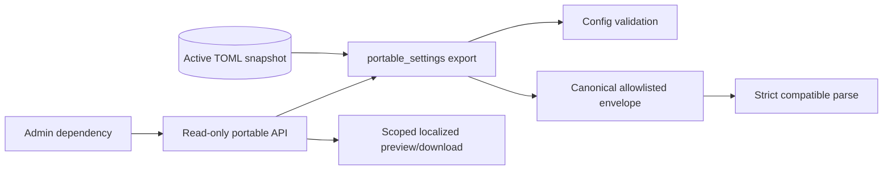

<!--
Copyright (c) 2026 DDP Engineering
This software is licensed under the PolyForm Noncommercial License 1.0.0.
Commercial use requires a separate commercial license.
See the LICENSE.txt in the .agentic folder for full license details.
SPDX-License-Identifier: LicenseRef-PolyForm-Noncommercial-1.0.0
-->

# TASK-c4655839 - Portable project settings export (W05)

stage: deliver
type: feature
path: full
interaction: autopilot
requirements: REQ-DATA-9528fad6, REQ-SEC-f96d80d4, REQ-UX-302fbce4
parent:
branch: task/adore-web-interface
base: 7b4caea6f031f3f535456671baa8eb4640baa434
opened: 2026-10-06

## Done checklist (current stage)

- [x] validated candidate confirmed unchanged; otherwise returned to validate
- [x] validation evidence, diff, exclusions, and outcome presented
- [x] delivery confirmed by the human
- [x] journal and report included in the delivery commit
- [ ] agreed outcome delivered: scoped commit/normal push and #9 closure after coordinator instruction; no PR
- [ ] close-out committed after the outcome succeeded

## Frame

Problem: STATED exact TOML is host-specific; metrics CSV is not settings portability.
Desired outcome: STATED deterministic strictly parsed portable rules and Admin export with honest preview.
Actors: Admin exports; future new-project consumer parses; Dev and invalid sessions are denied.
Primary scenario: validated active config -> allowlist projection -> preview/download -> strict parse reproduces portable values.
Examples: polling interval 90, recovery backoff [5,30], cost cap 0 reproduce unchanged.
Counterexamples: nested secret, unknown envelope field, incompatible source, boolean integer or altered checksum rejects with value-free typed error.
In scope: W05 #9 seven live criteria; format/API/UI/tests and same-change documentation.
Out of scope: W06 #10 import/clone/enrollment writes, later tickets, planning edits, live acceptance, PR/merge/release/deploy.
Constraints: 4 hours; at most 3 corrective cycles; 20 authored product/test/doc paths; generated/workflow separately inventoried; additional paid API/executors/subagents budget ZERO.
Success signals: complete portable roundtrip; fail-closed source/parser; no identity/host/credential leakage; RBAC-before-project lookup; unchanged TOML/CSV contracts.
Evidence: OBSERVED clean local/remote 7b4caea6f031f3f535456671baa8eb4640baa434 on task/adore-web-interface; authenticated tea ddp #9 open, native dependency #6 closed, #13 closed with 8/8; epic #3 open and approved attachment a3006796-ce57-452a-8497-c1e38b102a09. Sources: config.py, web/app.py, config.example.toml, Component_Config/Web_API/Frontend, approved DESIGN_BRIEF.md.
Assumptions: INFERRED conservative numeric/boolean/closed-enum rules can transfer independently of target host configuration.
Unknowns: live infrastructure and five-participant novice acceptance remain human end-of-epic work.
Decision-blocking questions: none; conservative format choice explicitly authorized by delegation.
Proposed behaviors: four-section enumerated allowlist; exact running source-version compatibility; checksum detection; admin active-config export and scoped localized preview/download.
Path and reason: full; new format/interface/data handling. Quick criteria: no new behavior=no; no new interface=no; no dependency=yes; existing covering requirement=no; no security/data changes=no. Tightly coupled work, no child tasks.

## Requirement coverage

| Frame outcome | Atomic behavior | Requirement | Positive case | Boundary/failure | Verification | Design decision |
|---|---|---|---|---|---|---|
| portable roundtrip | Strict complete export/parse contract | REQ-DATA-9528fad6 | exact values | schema/type/source/secret/corruption | public module tests | bounded closed allowlist |
| protected source | Admin-only authoritative export | REQ-SEC-f96d80d4 | preview/download | RBAC/invalid source/stale checksum | HTTP contract tests | guard before lookup |
| honest affordance | localized scoped preview/download | REQ-UX-302fbce4 | server-byte download | empty/error/late response | helper/browser/captures | isolated memory component |

## Design

REQ-DATA-9528fad6: portable_settings.py owns bounded source structural validation, existing Config validation, closed projection, canonical export and duplicate-rejecting JSON parser. Known dynamic config maps remain recognized; unknown source fields fail closed. No credentials/endpoints/free-form strings enter settings. Exact installed source version is required; no state migration. Complete format lives in linked spec.
REQ-SEC-f96d80d4: additive read-only GET uses existing administrator dependency before project lookup, reads one active TOML byte snapshot, exports or rejects generically. Optional preview checksum conflict prevents changed-value download; no state, pending, worker, metrics or readiness IO. No CSRF required for read-only GET; existing mutation guards untouched.
REQ-UX-302fbce4: isolated keyed memory-only React panel; explicit preview, then download exact re-fetched validated server bytes with checksum binding. In-flight ref plus unmount cancellation excludes stale scope/results; error empties preview and gives localized retry. Four supported locales and shared themes/styles. Pure strict response checker tests and Chromium fixture seam.
Alternatives: reject broad redaction-based dumps because unknown/nested data leaks; omit credential references rather than invent target reconfirmation workflow; exact version compatibility rather than speculative ranges. Conservative format excludes quiet-hours/timezone and arbitrary labels/commands. No new dependencies.
Expected authored files: portable module/test, web app/API test, PortableSettings/portable/App/helper test/browser test/errors, operator format guide, portable/API/Frontend component docs, portable/web knowledge, project context, CHANGELOG (19); static/workflow/evidence separately inventoried.
Risks: malformed known excluded fields must also fail closed; config loader is lenient, so portable source checks recognize declared structure before loading; error messages carry no field values. Direct host editors do not honor ADORE locks; exports use one byte snapshot. Future consumer must explicitly supply target-host settings and paused new-project enrollment.
Open decisions: none. Reviews are separate primary-agent spec/quality passes; no additional agent/executor budget.

### Proposed architecture - TASK-c4655839

## Log

- 2026-10-06 frame: full path accepted under standing human instruction relayed in source chat 01a10aec-6ac2-79f3-ada3-741950212fb8; existing branch retained as requested. Authenticated readback confirms native blocker closed and exact clean baseline; no labels changed.

- 2026-10-06 specify: Created 3 atomic requirements, reused/revised/retired 0; complete behavior inventory and exact format in linked spec. Seven live issue criteria covered; source/version and omission policy fixed before implementation.

- 2026-10-06 design: Audited complete conservative format and API/UI seams in Design; no unresolved decisions or new dependency; proceed under standing human authority.

- 2026-10-06 build red: REQ-DATA-9528fad6 command=`uv run pytest -q tests/test_portable_settings.py::test_portable_public_export_exists_and_roundtrips` (04_Software); exit=1; expected missing behavior=public portable export missing assertion, 1 failed.

- 2026-10-06 build green: REQ-DATA-9528fad6 `uv run pytest -q tests/test_portable_settings.py`; exit=0; 42 passed covering roundtrip, source/parser corruption, strict types/bounds, duplicates, exclusions and source compatibility.
- 2026-10-06 build red: REQ-SEC-f96d80d4 `uv run pytest -q tests/test_web_portable_settings.py::test_admin_preview_download_is_active_canonical_and_bound`; exit=1; expected missing behavior=portable endpoint 404 instead of 200.

- 2026-10-06 build green: REQ-SEC-f96d80d4 targeted public module/API tests exit=0, 49 passed; authenticated Admin snapshot/download, preview conflict, Dev/no-grant/invalid-session denial before lookup, source errors and pending omission.
- 2026-10-06 build red: REQ-UX-302fbce4 `node --test tests/portable.test.mjs` (web); exit=1; expected missing behavior=portable preview validation missing assertion.

- 2026-10-06 build: Initial browser run 4 passed/2 failed: fixture username typo corrected; actual 390px checksum overflow corrected by scoped wrapping/layout. No assertion weakened. Typecheck initially caught React error-render signature/type and was corrected. Final focused module/API 54 passed; TOML/metrics regression 123 passed; helper 2 passed; typecheck passed; 6 portable Chromium scenarios passed after correction. These inner-loop fixes precede explicit review.
- 2026-10-06 build inspection: Viewed retained portable-light-390.png and portable-dark-390.png; full panel copy/controls fit, checksum wraps, focus ring visible, JSON scroll stays within panel. Four-locale browser assertions passed; no live/participant/WCAG claim. Binary screenshot provenance is local offline fixture, not operator data.
- 2026-10-06 build to validate: Active requirements/test links reconciled; same-change operator/component docs and knowledge/context complete; environment unchanged because toolchain/setup/commands are unchanged. Evolution paths match scoped ownership; generated static build separately inventoried. Check errors=0; remaining historical sidecar/journal and binary inspection advisories classified at final review. Continue under standing human authority.

- 2026-10-06 validate review round 1: Independent primary-agent spec pass approved; separate quality pass changes_required for candidate 72e493f8cc7607f9376a85a7014d02043e05a3da89500062ce5ba7f15fcbb3fc. Findings: recheck immutable project identity after active snapshot export to fail closed if the profile is replaced/renamed mid-read; replace dense nested scalar-validation ternary with explicit branch logic for maintainability. Same scope/requirements; return to build for one bounded corrective cycle, then both verdicts refreshed. No subagents/executors.

- 2026-10-06 corrective build red: REQ-SEC-f96d80d4 `uv run pytest -q tests/test_web_portable_settings.py::test_export_rechecks_project_identity_after_snapshot`; exit=1; expected missing behavior=200 instead of typed 409 after profile identity replacement.

- 2026-10-06 corrective build green: Scoped identity recheck and readable scalar branches complete; `uv run pytest -q tests/test_web_portable_settings.py tests/test_portable_settings.py` exit=0, 55 passed; `node --test tests/portable.test.mjs` exit=0, 2 passed; targeted and full-workdir Ruff passed. Docs and spec retain same scope and explicit changed-identity conflict. One of three allowed corrective review cycles used; both previous verdicts invalidated by edits.
- 2026-10-06 preliminary full suite: Explicit requested `uv run pytest` (04_Software) exit=1: 1011 passed, 1 platform skip, 1 failure at unchanged `test_web_commands.py::test_worker_heartbeats_during_blocking_engine_command`, 100ms freshness assertion. Worker/store/test files have no candidate diff; simultaneous frontend build was running. Focused unchanged selector rerun exit=0, 1 passed. This suggests scheduling sensitivity, not proven cause; no test or timing assertion changed. Final serial strict proof still required. `uv run ruff check .` (04_Software) exit=0.

- 2026-10-06 validate review round 2: Separate primary-agent compliance and quality passes approved the exact candidate 31a9c5bd01e59c041f1f4b5140562f35aa01fb5d568ff0f6c8ce5824ff3655e1; all requirements/spec/knowledge/context/diagrams reconciled, complete diff reviewed. One corrective cycle used; no external reviewer/agent/executor. Bound inventory and retained round-1 findings in portable-candidate review. Final serial strict proof follows.

- 2026-10-06 final validate: `python .agentic/aegis.py check --task TASK-c4655839 --strict --run --json` exit=0, strict.passed=true, errors=0/warnings=7/notes=30. Python 1013 passed/1 existing platform skip/1 TestClient deprecation warning (168.8s command); Ruff exit=0 (0.1s); frontend validate exit=0 (153.2s), helper/typecheck/isolated build and 73 Chromium passed. Earlier unchanged 100ms-heartbeat failure passed in final full proof, no test edits/omissions/weakening. Exact full proof SHA256=28d7c0eaad0f8be0abe2f215eff54d3689c70cfaeee318019e5dfd5fb6e6638f; console encoding losslessly normalized to UTF-8 JSON. Seven catalog advisories: two synthetic PNG scan gaps visually inspected, generated JS full scan no keys/tokens and five harmless React/UI-label password matches, final JSON complete scan all zero; historical two tracked sidecars/old Handoff TASK-5e99ee1d/old ruling TASK-c765e6b4 untouched. Existing chunk-size/color/deprecation warnings nonfatal. No material deviation, unresolved relevant finding or weaker proof accepted.
- 2026-10-06 validate to deliver: All ten Validate obligations complete; evolution refreshed 2026-10-05T22:38:23Z with 22 non-workflow operations. Scope/requirements/knowledge/context/diagrams and representative manual inspection complete. All 35 bound operations still match approved round-2 fingerprint 31a9c5bd01e59c041f1f4b5140562f35aa01fb5d568ff0f6c8ce5824ff3655e1 after proof. Inventory: 17 authored product/test/doc + 5 generated + 11 workflow + 2 synthetic evidence, five reporting paths separately enumerated; including three context/knowledge paths yields 20 authored non-requirement/spec/report paths. One corrective cycle of three; no children/agents/executors/paid APIs or later-ticket work. Local/remote HEAD remain 7b4caea6f031f3f535456671baa8eb4640baa434. No commit/push/issue write; #9 and epic #3 open. Stop per standing human delegation for coordinator exact-inventory verification and delivery instruction. Intended later outcome: scoped commit/normal push, authenticated #9 closure/readbacks and separate journal-only close-out; no PR/merge/tag/version/release/deployment/live acceptance.

- 2026-10-06 deliver instruction: Coordinator/source chat 01a10aec-6ac2-79f3-ada3-741950212fb8 verified exact 35 bound hashes/deletions, 40 scoped paths, inventory SHA256=9a45a7ddde37a5d29d39bb8a0adb6c806e83654ddf56a8d8a767c7ed0683486d and proof SHA256=28d7c0eaad0f8be0abe2f215eff54d3689c70cfaeee318019e5dfd5fb6e6638f; approved round-2 fingerprint unchanged. Explicit instruction relays standing HUMAN authority: scoped commit with requirement IDs, normal push task/adore-web-interface, seven #9 criteria/evidence and close ONLY #9, compact epic mapping while epic/labels preserved, then journal-only close-out commit/push after authenticated successful readbacks. No routine reapproval; no PR/merge/release/version/deployment/live acceptance/#10. Re-read full journal/current Deliver step and live criteria; independent immediate exact-path/hash verification passed. Journal records authority provenance and cannot grant authority. Reporting journal changes only; validated payload unchanged.

## Rulings

- RULING-001 | date=2026-10-06 | decision=Autopilot through validation; stop at exact candidate for coordinator verification and delivery instruction | reason=Explicit human standing authority relayed in this task's delegation; journal cannot grant authority | source=user | supersedes=none

## Handoff

current: deliver
status: ready
next: Scoped commit and normal push, issue-only delivery/readback, then journal closeout
must_read: .agentic/specs/portable-candidate-inventory.json, .agentic/specs/portable-candidate-review.md, .agentic/specs/portable-verification.md, .agentic/tasks/TASK-c4655839.validation-final.json
blockers: none

## Stage report

stage: deliver
result: paused
current: deliver
changed: Portable format/parser and Admin-only localized active-rule export; docs/tests/static/workflow
evidence: Final strict exit 0; 1013 Python/1 skip, Ruff and frontend with 73 Chromium passed; candidate unchanged
issues: Seven classified advisories; no material deviation; live/novice/full-WCAG acceptance excluded
next: Authorized scoped commit/push and #9 closure/readbacks, then journal-only closeout
needs_user: no
spec_compliance: approved
implementation_quality: approved
review_round: 2

## Delivery report (2026-10-06)

- stage: deliver; type: feature; path: full; branch: task/adore-web-interface
- requirements:
  - REQ-DATA-9528fad6 - Roundtrip a strict portable working-rules envelope
  - REQ-SEC-f96d80d4 - Restrict portable settings export to administrators
  - REQ-UX-302fbce4 - Preview and download portable active project rules
- deviations: none recorded
- explicit review: enabled; spec_compliance=approved; implementation_quality=approved; review_round=2
- diff vs task base 7b4caea: 40 file(s) changed, 2363 line(s) added; 3 file(s) not content-scanned
- checks: errors=0 warnings=7 notes=30
- checklist: 4/6 done; open: agreed outcome delivered: scoped commit/normal push and #9 closure after coordinator instruction; no PR; close-out committed after the outcome succeeded
