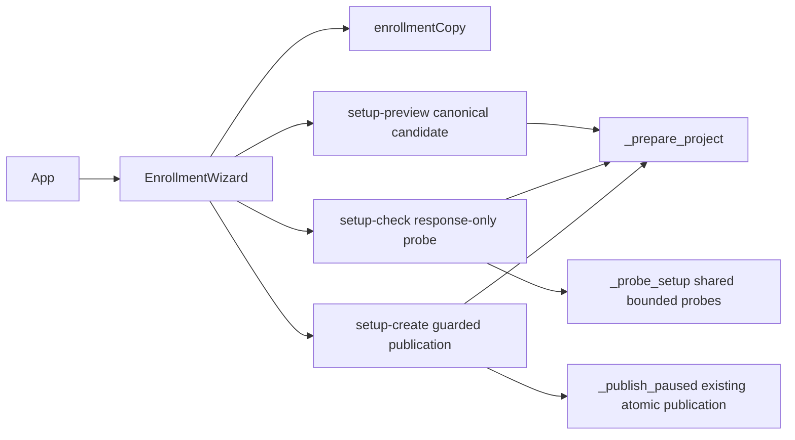

<!--
Copyright (c) 2026 DDP Engineering
This software is licensed under the PolyForm Noncommercial License 1.0.0.
Commercial use requires a separate commercial license.
See the LICENSE.txt in the .agentic folder for full license details.
SPDX-License-Identifier: LicenseRef-PolyForm-Noncommercial-1.0.0
-->

# TASK-e30045d4 - [Web UX] Guided project enrollment with explicit verification and review (#7)

stage: done
type: feature
path: full
interaction: autopilot
requirements: REQ-UX-072cf049, REQ-UX-3609c9ed, REQ-UX-002cbd25, REQ-FUNC-702b0fce, REQ-FUNC-49e89542, REQ-DATA-e1eaf583, REQ-SEC-dc4bd0c3, REQ-UX-7f8fde2c
parent:
branch: task/adore-web-interface
base: 06202733365954afc969304ef720febe6db0ef8b
opened: 2026-10-05

## Done checklist (current stage)

- [x] Validated candidate confirmed unchanged
- [x] Validation evidence, diff, exclusions and intended outcome prepared
- [x] Coordinator verification and delivery instructions received under standing authority
- [x] Journal and report prepared for delivery commit
- [x] Scoped commit/push and verified issue-7 closure delivered
- [x] Truthful journal close-out carried by this subsequent close-out commit

## Frame

Problem: STATED: issue #7 requires an understandable six-step enrollment; OBSERVED: App.tsx currently presents one infrastructure form and immediately creates a profile.
Desired outcome: STATED: an administrator reviews the exact in-memory draft, explicitly checks the environment, corrects errors, and creates a complete project with pickup stopped.
Actors: STATED: administrator enrolls; Dev is denied mutations; unfamiliar operator needs visible explanations; API host owns clone paths and probes; worker discovers only complete stopped profiles.
Primary scenario: STATED: method -> repository/identity -> environment -> eligibility/reviewers/limits -> verification -> review/create -> stopped-pickup completion with separate activation guidance.
Examples: STATED: an existing clone on the ADORE server, supported forge owner/repository and branch, explicit executor/provider/model, installed runtime/image and credential references; Back and review Change retain values.
Counterexamples: STATED: browser paths presented as server paths, automatic clone, fabricated presets/providers/images, stale/failed checks shown as success, Dev bypass, double creation, literal secrets or durable draft storage.
In scope: STATED: only #7 guided enrollment, memory-only state and navigation-loss warning, downstream invalidation, accessible field/summary errors and focus, honest verification, exact review submission, stopped completion; relevant component/operator docs, knowledge/context and Unreleased changelog; offline happy/negative E2E and backend regressions. INFERRED proposed supporting contract work is limited to the gaps below and requires scope acceptance before implementation.
Out of scope: STATED: #8 exact TOML redesign, portable import/settings clone, automatic cloning, metrics or other tickets; planning changes; live forge/container acceptance; merge/tag/release/PR; Git publication before separate deliver approval.
Constraints: STATED: existing branch, branding, routes, four locales/themes, Admin/Dev RBAC, CSRF, immutable identity, secret references only, fail-closed errors and draft-only publication. Bounds: four hours per run; three corrective/review cycles; twenty hand-authored implementation/documentation files, with generated output and workflow records separately inventoried. No executor/subagent launches during frame; additional executor spend budget USD 0, launches 0; do not launch paid/external executors without a newly recorded authorized budget. Current agent/account cost is unavailable and is not claimed as zero.
Success signals: STATED: all eight #7 criteria and offline cases: malformed/empty inputs, collision, invalid server clone/runtime, failed/stale/unverified evidence, upstream edits, Back/review correction, double submit, Dev denial, refresh/navigation loss, keyboard/focus and 390px screenshots. Final observed pytest/Ruff/typecheck/build/validate and strict AEGIS proof, then approved delivery and authenticated issue closure; epic stays open.
Evidence: OBSERVED: authenticated tea login ddp reads issue #7 open with no comments; native /issues/7/dependencies returns #5/#6 both closed; epic #3 open and latest comments confirm #6 publication. Clean checkout and fresh fetch: HEAD and origin/task/adore-web-interface at 06202733365954afc969304ef720febe6db0ef8b, divergence 0/0; ancestors 132cc3a and #5 delivery present. No deeper AGENTS.md discovered. .agentic/aegis.toml interaction.autopilot=false and review.enabled=true; no open journals. Sources: 04_Software/adore/web/app.py ProjectInput/_prepare_project and setup-preview/create/readiness routes; 04_Software/adore/wizard.py field/budget/auth generation; 04_Software/web/src/App.tsx creation form; 05_SoftwareDocu/Component_Web_API.md identity/enrollment/readiness contract; Component_Web_Frontend.md; .agentic/knowledge/web-interface.md; Code_Style.md; project/environment context; approved Gitea_Issues/DESIGN_BRIEF.md and PUBLICATION.md. Tool availability: Node 24.15.0, npm 11.11.1, uv 0.11.3, Python 3.13.5 with pytest/Ruff/FastAPI/httpx/Uvicorn/Argon2 imports, installed npm dependencies including Playwright 1.63.0, Chromium binary present. This is availability evidence, not test proof. CodeGraph unavailable (missing index); ordinary source search used.
Assumptions: INFERRED: existing fixture API/worker and injectable probe runner can support scoped offline wizard journeys without a new dependency. User explicitly requests AEGIS; that workflow governs over generic BMAD skill applicability and no BMAD setup/workflow is introduced.
Unknowns: OBSERVED concrete contract gaps: readiness-check loads a persisted profile/config, so it cannot verify a pre-create memory draft. setup-preview returns no candidate/config revision or server-path review model. ProjectInput forbids unknown fields and exposes neither configurable ready label/budgets nor arbitrary supported credential references; wizard generates these from defaults/model. UNKNOWN: exact smallest backwards-compatible extension and file count, to be specified/designed after scope acceptance; no gap is silently converted into product behavior.
Decision-blocking questions: Accept a bounded supporting API extension within #7 for pre-create explicit verification, complete supported setup fields/server-path review, and revision-bound creation? No alternative durable draft or early project creation is assumed.
Proposed behaviors: STATED wizard flow and safety requirements above. INFERRED proposal: reuse offline preparation and existing probe logic with secret-free draft requests, no durable draft storage, exact candidate revision checks and redacted findings; preserve existing enrollment/import contracts and runtime schema. Explain probe effects before explicit action; unverified/partial/stale/failed remain visible, with correction/recheck; no mandatory full-readiness success invented. Specify will make these contracts and behavior decisions reviewable.
Path and reason: full: new observable UX and required supporting contract decisions.

| Quick-path criterion | Result | Evidence |
| --- | --- | --- |
| No new observable behavior | no | Six-step flow, review and navigation guards |
| No new interface/data format | no | Proposed pre-create verification/review contract |
| No new dependency | yes, provisional | Existing React/API/Playwright stack; no dependency proposed |
| Existing requirement covers whole behavior | unknown | Requirements to be written in specify |
| No security/data-handling change | no | Draft/revision/verification trust boundaries |

Children: none during frame; no delegation requested for implementation. Independently scoped review requirements will be resolved at validate under the actual step instructions. Existing user bound of three correction cycles overrides configured four.

## Requirement coverage

Behavior inventory and one-to-one coverage (actor: administrator; trigger: draft step/probe/confirm).

| Frame outcome | Atomic behavior | Requirement | Positive case | Boundary or failure | Verification | Design decision |
| --- | --- | --- | --- | --- | --- | --- |
| Six-step supported enrollment guidance | Six-step supported enrollment guidance | REQ-UX-072cf049 | Valid administrator draft | Complete supported six-step enrollment; inspect essential instructions, absence of invented presets, keyboard operation and screenshots at 390px and desktop in both themes. | Offline API / browser journeys | Canonical preview + generation-guarded wizard |
| Memory draft correction and navigation protection | Memory draft correction and navigation protection | REQ-UX-3609c9ed | Valid administrator draft | Fill then go Back and Change, edit upstream fields during pending responses, cancel/accept navigation and refresh warnings, observe retained or discarded values and stale-response rejection. | Offline API / browser journeys | Canonical preview + generation-guarded wizard |
| Corrective enrollment errors and focus | Corrective enrollment errors and focus | REQ-UX-002cbd25 | Valid administrator draft | Reject empty/malformed fields, ID collisions and invalid server clone/runtime; navigate error links by keyboard and observe focused field/heading and corrected retry. | Offline API / browser journeys | Canonical preview + generation-guarded wizard |
| Complete offline enrollment candidate preview | Complete offline enrollment candidate preview | REQ-FUNC-702b0fce | Valid administrator draft | Preview explicit fields with a runner that fails if called; inspect generated candidate fields, paths and digest; reject malformed references/limits/clone/runtime without profile artifacts. | Offline API / browser journeys | Canonical preview + generation-guarded wizard |
| Explicit pre-create environment verification | Explicit pre-create environment verification | REQ-FUNC-49e89542 | Valid administrator draft | Fake tool/container/model responses; verify calls only on explicit draft probe, current failed/partial/verified evidence, mismatched revisions and no profile creation or durable draft. | Offline API / browser journeys | Canonical preview + generation-guarded wizard |
| Exact revision-bound reviewed enrollment | Exact revision-bound reviewed enrollment | REQ-DATA-e1eaf583 | Valid administrator draft | Preview then confirm and inspect exact configuration bytes; mutate identity/setup or omit/wrong revision on guarded route, race duplicate calls, double-click UI and delay responses; verify one profile or explicit conflict. | Offline API / browser journeys | Canonical preview + generation-guarded wizard |
| Secret-reference-only administrator draft operations | Secret-reference-only administrator draft operations | REQ-SEC-dc4bd0c3 | Valid administrator draft | Admin happy calls and Dev/no-session/missing-CSRF failures for all draft routes; inject bad credential names and inspect redacted findings with no probes/artifacts. | Offline API / browser journeys | Canonical preview + generation-guarded wizard |
| Honest stopped-pickup enrollment completion | Honest stopped-pickup enrollment completion | REQ-UX-7f8fde2c | Valid administrator draft | Create offline profile; observe stopped server state and completion with identity, activation guidance, project link and no automatic resume/start request. | Offline API / browser journeys | Canonical preview + generation-guarded wizard |

## Design

- Requirements coverage: all eight rows use the canonical preview/draft generation architecture; details in specs/REQ-DATA-e1eaf583.md.
- Backend owns offline preparation, safe supported fields, canonical digest/paths, probe execution and atomic stopped publication (REQ-FUNC-702b0fce, REQ-FUNC-49e89542, REQ-DATA-e1eaf583).
- Frontend EnrollmentWizard owns mounted memory state, six-step controls, visible locale copy, findings/focus, invalidation and immediate submission lock (all four UX requirements).
- Extract existing readiness probe body to a shared helper; persisted project checks retain existing schema and revision guard. Draft checks return response-only evidence and never create profiles.
- Add guarded setup-create rather than break legacy POST projects. Candidate digest binds exact generated config and identity/description; optional revision input excluded from hash.
- Expose real supported labels/budgets and explicitly selected credential-name lists in ProjectInput; convert through existing wizard and TOML scalar emitter. Validate names and typed limits, then use existing configuration findings.
- Security: Admin/CSRF on additive routes, forbid unknown fields, reference-only names, redacted findings; no draft files/database/browser storage (REQ-SEC-dc4bd0c3).
- Readiness can remain unverified/partial/failed for stopped enrollment; review makes limitations visible. A false readiness badge and automatic probe are forbidden.
- Ordering: each changed answer increments draft generation and clears dependent state; late preview/probe/create responses cannot refill another draft. Ref lock closes double-click window.
- Navigation: wizard registers a dirty loss guard for shell/history, cancel/sign-out, and beforeunload; step Back is internal. Completion disables guard.
- Alternatives: early project creation rejected because final confirmation would no longer create; durable draft records rejected by memory-only scope; breaking legacy enrollment rejected for compatibility.
- Expected authored files (12): app.py, tests/test_web_enrollment.py, web/src/EnrollmentWizard.tsx, App.tsx, enrollmentCopy.ts, styles.css, e2e/enrollment.spec.ts, e2e/server.py, Component_Web_API.md, Component_Web_Frontend.md, Web_Interface.md, CHANGELOG.md. Workflow knowledge/context/requirements and generated output inventoried separately.
- Risks: all-locales copy volume, browser history loss guard, downstream response races, doctor auth login context. Review and tests explicitly cover them.
- Open decisions: none blocking; supporting contracts accepted by standing human authority.

### Proposed architecture - TASK-e30045d4

## Log

- 2026-10-05 frame: Full path selected; clean synchronized baseline and native dependency closures confirmed. Supporting contract gaps documented before implementation.
- 2026-10-05 frame: Standing human authority received through coordinator: unattended #7 implementation including scoped supporting contracts, routine stage continuation, final validation and scoped commit/push/closure after coordinator verification. Record stages, evidence and reviews; await coordination on the unchanged final candidate.
- 2026-10-05 specify: Created eight atomic draft requirements and one contract spec; reused existing stopped-publication/RBAC/config invariants without modifying earlier requirements. Supporting gaps accepted by standing authority; coverage audited.
- 2026-10-05 design: Canonical candidate digest, additive draft probe/guarded create and generation-guarded localized wizard selected; see Design and linked spec. No dependency or runtime-state migration.
- 2026-10-05 build red: command=04_Software/.venv/Scripts/python.exe -m pytest tests/test_web_enrollment.py -q -k 'guided or draft_verification' (workdir 04_Software); exit=1; 4 failed/8 passed/55 deselected; missing supported fields, candidate revision and additive setup-check/setup-create routes; expected contract failures for REQ-FUNC-702b0fce, REQ-FUNC-49e89542, REQ-DATA-e1eaf583 and REQ-SEC-dc4bd0c3.
- 2026-10-05 build green: targeted test_web_enrollment.py exit=0, 67 passed in 31.98s; availability not full proof. Existing FastAPI TestClient deprecation warning retained as dependency warning.
- 2026-10-05 build red: npm run build:e2e succeeded; npx playwright test e2e/enrollment.spec.ts exit=1, one missing Enrollment method heading, expected absent six-step flow (UX requirements). Existing Vite bundle and Node colour warnings observed.
- 2026-10-05 build: Additive route names require portable-ID reservations in profiles.py; component seam/knowledge inspected. Include Component_Profiles documentation with this directly required compatibility boundary; remains below authored-file bound.

- 2026-10-05 build complete: .venv/Scripts/python.exe -m pytest tests/test_web_enrollment.py tests/test_web_readiness.py -q exit=0, 79 passed; added boundary tests later focused 14 passed/57 deselected. npm run build:e2e exit=0 includes TypeScript; npx playwright test e2e/enrollment.spec.ts exit=0, latest 13 passed in 26.2s. Covers all eight linked requirements; broad final proof remains pending.
- 2026-10-05 build evidence: anchor saved before implementation (264 files); evolution reports 14 authored files, all within #7 and 20-file bound. No children/executor launches. Full catalog errors=0/warnings=5/notes=31; added E2E affected paths to remove two introduced coverage warnings; remaining tracked fingerprints and historical journals pre-exist and are outside #7.

- 2026-10-05 validate reconciliation: Read all eight active requirements and spec; source/test/doc hunks reviewed. Corrected stale enrollment prose in web knowledge; updated generated static paths in requirement coverage. Web/profiles knowledge contains current template sections; architecture agrees with the task proposal. Project context updated; environment/toolchain/setup unchanged and canonical configuration references remain accurate. No implementation correction or scope change in validation.
- 2026-10-05 validate inspection: Viewed current Playwright screenshots for desktop review and 390px environment/review in light and dark themes; long server paths/revision wrap, required labels and instructions remain readable, focused headings visible, branding retained. Browser assertions verify keyboard error/heading focus and no horizontal overflow. Evidence is offline layout/interaction inspection, not novice-user acceptance, full WCAG or live infrastructure acceptance.
- 2026-10-05 review round 1 specification question: Does the current candidate satisfy the eight active atomic requirements, approved six-step design and issue acceptance while preserving exclusions? Verdict approved. Reviewed memory lifecycle/invalidations, visible concepts/corrections, complete canonical review, exact draft/digest submission, reference-only inputs and honest stopped completion against source, API and browser cases. Exact import/clone/portable work, planning and other issues remain outside this candidate. This is a separate primary-agent review perspective, not a fabricated external reviewer.
- 2026-10-05 review round 1 quality question: Is the same candidate correct, secure, portable, maintainable and supported by happy/negative boundary evidence? Verdict approved. Reviewed Admin/CSRF route dependencies, bounded injectable probes, deterministic digest and atomic publication, generation/unmount and ref-lock guards, malformed/stale response handling, failure recovery, secret-free output and offline fixture isolation. Existing persisted readiness/import behavior is covered by final regressions. No new dependency, OS-specific core glue, unrequested operation or blocking finding. Both verdicts apply to the candidate before final proof.
- 2026-10-05 validate supplemental checks: uv run ruff check . exit=0; npm run typecheck exit=0; npm run build exit=0. Production output replaces old JS/CSS and HTML links, with legal headers and unchanged approved logo. Vite 500kB chunk advisory pre-exists (baseline 515.44kB, current 550.96kB); code splitting is outside #7. Complete 551263-byte bundle scanned with all AEGIS built-in secret patterns: no key blocks/access keys/token findings; five password heuristic matches classified as React input-type boolean map and four locale labels, no credential literals. Catalog's untracked-large-bundle scan-gap advisory remains visible, supplemented by this complete scan.

- 2026-10-05 validate gate failure / correction cycle 1 of 3: check --task TASK-e30045d4 --strict --run --json exit=1. Configured Python suite passed (136.3s), lint passed (0.1s); frontend failed (76.4s), 32 browser cases passed and one shell essential-help regression still addressed obsolete new-project-* form IDs without advancing the new method step. Quality verdict changes_required for test contract adaptation; both current verdicts cleared before editing. Return to build for this finding only; preserve visible-help and aria-describedby assertions through the public wizard flow. No product contract or scope change.

- 2026-10-05 build correction green: npx playwright test e2e/shell.spec.ts -g 'glossary defines supported human actions' exit=0, 1 passed in 5.1s. Existing glossary and essential help checks now follow method -> repository, retain visible forge/clone guidance and input aria-describedby; no product behavior changed. Authored inventory is now 15, below the bound of 20; requirement links include this existing regression. Prior gate Python result was 827 passed/1 skipped/1 dependency warning.
- 2026-10-05 review round 2 specification question: Does the revised candidate still satisfy scope, all eight requirements and design? Verdict approved. Re-read the affected guidance requirement and test hunk; progression and mandatory associated instructions remain explicit, with no weakened assertion or altered implementation. All unchanged candidate contracts retain the round-1 semantic findings; knowledge/context/spec remain accurate.
- 2026-10-05 review round 2 quality question: Is the revised candidate sound across correctness/errors/security/portability/tests? Verdict approved. The recorded obsolete-selector failure is corrected and the focused regression passes. The adjusted test asserts the public wizard flow and exact accessible association; no timeout relaxation or test deletion. Same current candidate applies to both verdicts; final full proof is rerun after this test change. One correction cycle used, two remain.

- 2026-10-05 validate final proof: python .agentic/aegis.py check --task TASK-e30045d4 --strict --run --json exit=0, strict passed=true, errors=0/warnings=4/notes=31. Configured .venv Python pytest -q exit=0: 827 passed, 1 skipped, 1 FastAPI/Starlette TestClient dependency deprecation warning in 136.54s (command 137.6s). The suite's skip is its existing platform-unprivileged-symlink condition in test_isolation.py, outside this unchanged component. Configured Ruff adore/tests exit=0 (0.1s). Configured npm --prefix web run validate exit=0 (63.8s): Node helper suite, UI/E2E typecheck, isolated Vite build and all 33 Chromium journeys passed (52.0s), including 13 enrollment cases and corrected shared help regression. Supplemental broad uv run ruff check ., production typecheck/build passed earlier on unchanged source. No weaker substitute or live acceptance claimed.
- 2026-10-05 validate advisories: Historical tracked fingerprints (2 sidecars) and invalid fields in TASK-5e99ee1d/TASK-c765e6b4 are pre-existing out-of-scope maintenance; retain rather than edit another task. Large newly generated JS not scanned by catalog remains a visible advisory; complete supplemental built-in-pattern scan and classified benign matches recorded above. Vite chunk-size and Node colour warnings are pre-existing non-fatal tooling advisories. All 31 manual-verification catalog notes belong to other requirements; issue-7 visual inspection and automated boundaries are recorded separately. No relevant unresolved failure remains.
- 2026-10-05 deliver handoff: Final evolution refreshed after the shell regression correction, 20 non-workflow paths = 15 authored + 5 generated (including 2 removed old assets). Stable inventory has 12 workflow paths plus journal/ownership record, 34 total paths. Ownership SHA-256 e9a616d53d943f55dce1a69ec2ed81067fe072e1f54cded3c09b3feb22993873, table at .agentic/tasks/ISSUE-7-final-ownership.md; all 32 stable-path byte hashes confirmed unchanged. Both review verdicts approved in round 2, one correction cycle used; no children/executors. HEAD remains base 0620273; no commit/push/issue closure performed. Publication waits for coordinator verification/instructions under RULING-001, not a new human approval request.

- 2026-10-05 deliver presentation: English final evidence/inventory/limitations posted and read back at issue #7 comment 2019 and epic #3 comment 2021. Both remain open; #7 retains only P1. The intended scoped commit/push/closure and exclusions are explicit, and publication remains conditional on coordinator verification of unchanged ownership. No new human confirmation requested. Session ends at waiting deliver; candidate is preserved.

- 2026-10-05 deliver authorization satisfied: Coordinator in source chat 01a10aec-6ac2-79f3-ada3-741950212fb8 read the full journal, issue acceptance, ownership table/backend delta and key wizard guards, verified diff --check and all 32 stable hashes/absences, confirmed successful strict proof/round-2 verdicts and relayed delivery instructions under standing human authority. Authorized scoped inventoried commit/push, authenticated acceptance/closure of #7, English epic update keeping #3 open, then truthful journal close-out commit/push. No PR/merge/tag/version/deployment/live acceptance or #8. Independent immediate inventory check in this chat matches all 32 hashes/absences and exact 34 changed-path set; branch/base unchanged before staging.

- 2026-10-05 deliver outcome: Implementation commit 9b81bd055ea6e4b3ab5a37c3b276f693fa245349 normally pushed to origin/task/adore-web-interface; fresh fetch and ls-remote both confirmed exact commit, working tree clean. Authenticated issue PATCH marked all eight criteria and closed #7; readback confirms state=closed, accepted=8/pending=0, P1 unchanged and branch ref unchanged. English delivery comments: issue #7 comment 2025; epic #3 comment 2028. Epic readback remains open. No PR/merge/tag/version/deployment/live acceptance or other-ticket implementation.
- 2026-10-05 close-out: Delivery outcome succeeded before this journal-only close-out commit. Final product/requirement/spec/knowledge ownership remains unchanged. Two pre-existing blank journal lines with trailing spaces were detected by the staged whitespace check; the commit step proceeded before correction. Trim these journal-only spaces in this close-out and verify whitespace before its commit; no validated candidate change or new product proof required. Preserve historical report snapshots. Close-out is committed and normally pushed separately after the published implementation and authenticated issue closure.

## Rulings

- RULING-001 | date=2026-10-05 | decision=Autopilot for issue 7 with scoped supporting contract work; scoped commit/push and closure authorized after final coordinator verification; no fresh human approval needed | reason=Explicit standing human authority relayed in current session | source=user | supersedes=none
- RULING-002 | date=2026-10-05 | decision=No PR/merge/release/deployment/live acceptance; only issue 7 in this session; four hours, three correction cycles, twenty authored product/doc files; no executor launches or paid external calls (additional executor budget USD 0) | reason=Explicit task bounds; live tests reserved for user | source=user | supersedes=none

## Handoff

current: done
status: ready
next: None; issue-7 delivery complete
must_read: .agentic/tasks/TASK-e30045d4.md, .agentic/tasks/ISSUE-7-final-ownership.md
blockers: none

## Stage report

stage: deliver
result: completed
current: done
changed: Issue-7 implementation 9b81bd0 published; journal-only close-out follows successful delivery
evidence: Strict exit=0; 827 Python passed/1 skip; Ruff/typecheck/build/validate passed, 33 browser cases; implementation remote verified; issue 7 closed with 8/8 criteria
issues: Four classified advisories; live acceptance remains with operator; epic 3 stays open
next: None; issue-7 delivery complete
needs_user: no
spec_compliance: approved
implementation_quality: approved
review_round: 2

## Delivery report (2026-10-05)

- stage: deliver; type: feature; path: full; branch: task/adore-web-interface
- requirements:
  - REQ-UX-072cf049 - Six-step supported enrollment guidance
  - REQ-UX-3609c9ed - Memory draft correction and navigation protection
  - REQ-UX-002cbd25 - Corrective enrollment errors and focus
  - REQ-FUNC-702b0fce - Complete offline enrollment candidate preview
  - REQ-FUNC-49e89542 - Explicit pre-create environment verification
  - REQ-DATA-e1eaf583 - Exact revision-bound reviewed enrollment
  - REQ-SEC-dc4bd0c3 - Secret-reference-only administrator draft operations
  - REQ-UX-7f8fde2c - Honest stopped-pickup enrollment completion
- deviations: none recorded
- explicit review: enabled; spec_compliance=approved; implementation_quality=approved; review_round=2
- diff vs task base 0620273: 34 file(s) changed, 1835 line(s) added; 1 file(s) not content-scanned
- checks: errors=0 warnings=5 notes=31
- checklist: 4/6 done; open: Scoped commit/push and verified issue-7 closure delivered; Truthful journal close-out committed and pushed after outcome success
