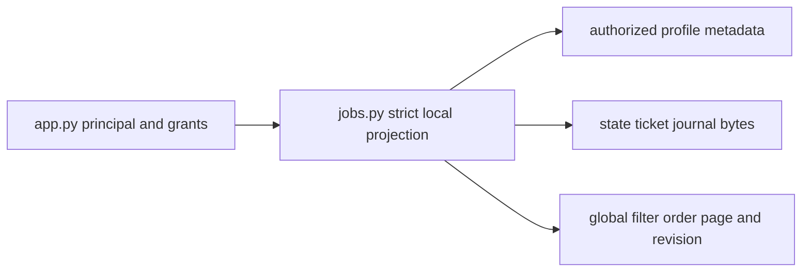

<!--
Copyright (c) 2026 DDP Engineering
This software is licensed under the PolyForm Noncommercial License 1.0.0.
Commercial use requires a separate commercial license.
See the LICENSE.txt in the .agentic folder for full license details.
SPDX-License-Identifier: LicenseRef-PolyForm-Noncommercial-1.0.0
-->

# TASK-fc000e98 - Authorized global job read model (Gitea #11)

stage: deliver
type: feature
path: full
interaction: autopilot
requirements: REQ-FUNC-e8455ab6, REQ-DATA-0ba9e469, REQ-SEC-5d0f86e7
parent:
branch: task/adore-web-interface
base: 76bbb2469a532ae28e3f452e7c7be65692c53b8f
opened: 2026-10-05

## Done checklist (current stage)

- [x] validated candidate confirmed unchanged
- [x] validation evidence, exact inventory, exclusions and conditional outcome prepared
- [x] coordinator verifies unchanged candidate and supplies delivery instructions
- [x] journal and report included in the scoped delivery commit
- [x] authorized normal push and issue #11 closure delivered (approved outcome; execution pending)
- [ ] truthful close-out committed after successful delivery

## Frame

Problem: STATED #11 requires global authorized jobs; OBSERVED app.py currently pages one profile at a time.
Desired outcome: complete, deterministic authorized pages with persisted evidence and explicit unknowns.
Actors: administrator, assigned developer, local HTTP service.
Primary scenario: authenticated global read -> authorize profiles, validate persisted sources, globally filter/order/page -> complete totals and source revision.
Examples: two authorized projects share run ID a; both appear with distinct project_id identities.
Counterexamples: unauthorized project data never contributes to search/totals; corrupt authorized evidence returns a typed error, never partial success.
In scope: additive global/project read model, direct composite detail, persisted ticket/journal evidence, strict trust validation, docs and offline tests.
Out of scope: #12 UI, statistics, new runtime writes, live acceptance, merges/releases.
Constraints: four hours; three corrective/review cycles; twenty authored product/doc files; paid/executor/subagent budget zero. Existing branch explicitly required. English artifacts, Romanian reports.
Success signals: paging/RBAC/collision/evidence/source-mutation negative tests plus final strict proof.
Evidence: STATED delegated human scope/authority; OBSERVED clean HEAD and remote 76bbb2469a532ae28e3f452e7c7be65692c53b8f, authenticated #11 open and native blocker #4 closed. OBSERVED state.py has schema-1 ticket snapshots and JSONL events; read_journal intentionally skips malformed lines for operational recovery.
Assumptions: additive endpoint may use stricter reads without changing recovery APIs.
Unknowns: legacy title, wait reason/person and consumption may be absent; report null with explicit coverage rather than inventing evidence.
Decision-blocking questions: none.
Proposed behaviors: authorize before reads; build one complete local read projection; source revision detects changes across page requests; exact lifecycle/stage/outcome and available source evidence.
Path and reason: full; new interface/data/security semantics require specification/design.

| Quick criterion | yes | no | evidence |
|---|---|---|---|
| no observable behavior | | x | global jobs |
| no interface/data format | | x | additive job routes |
| no dependency | x | | standard library |
| existing requirement covers change | | x | new global contract |
| no security/data change | | x | authorized global evidence |

## Requirement coverage

| Frame outcome | Atomic behavior | Requirement | Positive case | Boundary or failure | Verification | Design decision or no impact |
|---|---|---|---|---|---|---|
| complete authorized global reads | global identity/filter/order/page | REQ-FUNC-e8455ab6 | multiple projects/pages | denied scope, changed sources | test_web_jobs.py | complete local projection and optimistic revision |
| honest local evidence | persisted fields/unknowns | REQ-DATA-0ba9e469 | title/questions/links | legacy missing metadata | test_web_jobs.py | existing schema-1 snapshots, no writes |
| trusted complete totals | reject corrupt sources | REQ-SEC-5d0f86e7 | valid projection | malformed state/journal/URLs | test_web_jobs.py | strict reader and safe errors |

## Design

REQ-FUNC-e8455ab6: jobs.py owns full authorized local projections; app.py resolves principals/grants before reading sources. New jobs-page and composite job detail routes are additive; project_id query also serves project pages.
REQ-DATA-0ba9e469: derive evidence from existing state/ticket/journal fields only. Keep exact lifecycle/stage/outcome, validate timestamps as UTC instants, show null unknowns, role only with real matching wait evidence. Consumption remains unknown.
REQ-SEC-5d0f86e7: raw state/ticket/JSONL strict read, safe text projection/URL validation, typed errors without exception text. Preserve operational StateStore recovery behavior.
Interfaces: see .agentic/specs/REQ-FUNC-e8455ab6.md; snapshots are optimistic content revisions, not stored frozen pages. Failed authorized project read rejects all totals.
Concurrency: collect source bytes and inventory twice; mismatch fails with 409. Recheck authorization/profile selection after read. Digest incorporates authorized project metadata; continuation checks supplied revision.
Compatibility analysis: RunState.from_dict rejects unknown keys but accepts omitted default fields in schema 1. No new persisted fields are necessary. Existing normalized ticket snapshots include iid/title/web_url; JSONL already records parked questions and approval-presented. Strict read model rejects malformed/torn journals rather than using the recovery reader. No migrations or writes.
Security: omit descriptions, author, outbox/validation payloads, host paths and arbitrary journal fields. Free text credential patterns are redacted; unsafe URL source fails closed.
Operations: safe composite detail and comment links locate evidence; missing snapshots/journals/timestamps explicit in coverage. Archived history included; deleted profiles unavailable.
Tests: public HTTP endpoints through offline TestClient, multi-project fixtures and prohibited command runner. Direct malformed/read-failure injections prove trust boundaries; source mutation and grant change fixtures prove consistency.
Alternative: concatenating existing project pages loses global order/completeness. Durable SQLite projection adds migration/cache invalidation without needed writer changes; full local scan favors correctness at current scale.
Expected product/doc files: jobs.py, app.py, test_web_jobs.py, errors.ts, Component_Web_API.md, Component_Web_Jobs.md, README index, Web_Interface.md, CHANGELOG.md. Workflow artifacts tracked separately.
Risks: two scans per read scale with retained history; uncoordinated host writes after reinspection are visible next request. Unknown named responsibility remains null.
Open decisions: none.

### Proposed architecture - TASK-fc000e98

## Log

- 2026-10-05 build red: REQ-FUNC-e8455ab6, REQ-DATA-0ba9e469, REQ-SEC-5d0f86e7; command=`04_Software/.venv/Scripts/python.exe -m pytest -q tests/test_web_jobs.py::test_global_pages_search_groups_and_collision_identity` (workdir 04_Software); exit=1; expected missing behavior=global job route returns 404 instead of authenticated contract. Shared HTTP seam tests authored before implementation.

- 2026-10-05 design: Strict local projection and additive composite routes audited; existing persisted fields suffice with no schema change. Scope remains below authored file limit.

- 2026-10-05 specify: Three independent behaviors specified with positive/boundary inventory and exact additive API/source semantics; no new persisted schema.

- 2026-10-05 frame: Full path accepted under standing human scope/continuation authority; existing branch and clean baseline verified.

- 2026-10-05 build evidence clarification: The actual red command was `.\.venv\Scripts\python.exe -m pytest -q tests/test_web_jobs.py::test_global_pages_search_groups_and_collision_identity` from 04_Software (exit 1); earlier ledger path denotes its repository-relative executable.
- 2026-10-05 build green: `.\.venv\Scripts\python.exe -m pytest -q tests/test_web_jobs.py tests/test_web_paging.py tests/test_web_rbac.py tests/test_state.py` from 04_Software; exit=0; 113 passed, one existing Starlette/httpx deprecation warning. Ruff `check .` exit=0. All three requirements linked and active; docs and local-only source semantics reconciled.
- 2026-10-05 build: Evolution reviewed nine authored product/doc paths against planned scope; generated static assets tracked separately. Check has no errors; historical tracked fingerprint and old journal warnings remain unrelated. Localization path coverage fixed; synthetic helper credential warning removed by clearer fixture parameter naming. Advanced to validate.

- 2026-10-05 validate review round 1: Specification compliance=approved (scope, additive routes, complete authorized ordering, evidence unknowns, schema compatibility and docs). Separate implementation-quality pass=changes_required: redaction order can leave the tail of an Authorization Bearer value; quoted credential assignments with spaces are only partially masked. Correct these secret-boundary findings with regression tests; no scope expansion. No other reviewers/subagents launched under zero budget.
- 2026-10-05 validate -> build: Both current verdicts cleared for recorded quality corrections; corrective cycle 1 of maximum 3.

- 2026-10-05 build red correction: REQ-SEC-5d0f86e7; command=`.\.venv\Scripts\python.exe -m pytest -q tests/test_web_jobs.py::test_free_text_masks_entire_quoted_and_authorization_credentials` (04_Software); exit=1; expected missing behavior=quoted credential tail and Authorization token still visible in safe detail response.

- 2026-10-05 build green correction cycle 1: `pytest -q tests/test_web_jobs.py` through project .venv; exit=0, 63 passed, one existing deprecation warning; Ruff check . exit=0. Complete quoted values and Authorization prefixes are masked. Returned to validate.
- 2026-10-05 validate review round 2: Specification compliance=approved in a separate scope/contract pass. Implementation quality=changes_required: invalid Unicode scalar/deep JSON may escape typed errors; a broken runs-root symlink can look absent; old parked questions need current parked_at correlation before becoming current actions. These are trust/evidence contract corrections, with no new schema/writer or interface scope. Corrective cycle 2 of maximum 3; both verdicts cleared during fixes.

- 2026-10-05 build red correction cycle 2: REQ-DATA-0ba9e469, REQ-SEC-5d0f86e7; command=`.\.venv\Scripts\python.exe -m pytest -q tests/test_web_jobs.py -k "stale_parked or broken_runs_root or corrupt_authorized" --tb=short` from 04_Software; exit=1. Observed unpaired Unicode returns 500, stale question becomes current action, broken symlink appears empty; added deeper JSON parser-failure input separately (1100-level JSON remained parseable in this test runtime). Correlate questions with the actual current parked timestamp; unknown legacy correlation stays unknown.

- 2026-10-05 build green correction cycle 2: `pytest -q tests/test_web_jobs.py --tb=short` through .venv; exit=0, 67 passed, one existing deprecation warning; Ruff check . exit=0. Invalid Unicode/parser errors are typed, symlink roots fail closed, and current parked timestamp correlation prevents stale-question actions. Added minimal omitted-field schema-1 regression for final proof; state bytes remain untouched.
- 2026-10-05 validate reconciliation: Component docs/knowledge and project context agree with strict projection; environment commands unchanged. Generated localization bundle rebuilt successfully; enrollment requirements retain their unchanged behaviors and now point at the current generated JS name. Nine authored product/doc files, three generated asset changes, workflow separately. No implementation deviation or live acceptance claimed.

- 2026-10-05 validate final review round 3: Separate specification-compliance pass=approved against #11, three active requirements, exact spec, exclusions and compatibility; no interface/UI/statistics expansion. Separate implementation-quality pass=approved after secret/corrupt-source/current-wait corrections and Doxygen reconciliation. Both bind candidate `2b2df41056fd676e806c69069a13d22573af85056da74e5a2ae3b9272f3ef43e` in TASK-fc000e98-candidate.md; performed by this agent as two distinct review passes, not external peer reviews. Two corrective cycles used, no agents/executors launched.
- 2026-10-05 validate evidence reconciliation: Minimal omitted-field schema-1 test passed (1 test), state unchanged; `uv run ruff check .` exit=0. Existing scanner warning on synthetic password assignment in regression fixture is a confirmed test string, not a credential; generated minified JS is reviewed via localized source and reproducible successful build. Prior tracked fingerprints/old journal warnings are retained out of scope; no verification weakened.

- 2026-10-05 validate additional boundary review: Isolated offline public HTTP probe with invalid UTF-8 profile metadata confirmed global read 503 but project-filtered and direct detail reads 500. Round-3 implementation-quality approval invalidated; specification contract remains unchanged, both current verdicts cleared. Corrective cycle 3 of maximum 3 is limited to the selected-profile typed-error wrapper and regression tests. The first full verification is running on the prior candidate; its results will not substitute for proof after this correction.

- 2026-10-05 validate prior-candidate proof: Configured test, lint and frontend all exited 0 (212.7s, 0.2s, 146.7s). Overall strict check exited 1 because the inventory filename in tasks was interpreted as a journal; inventory relocated to .agentic/specs/job-read-candidate.md. This is not final proof after pending trust-boundary corrections; exact final results will be recorded from JSON command tails.
- 2026-10-05 build red correction cycle 3: REQ-SEC-5d0f86e7; command=`.\.venv\Scripts\python.exe -m pytest -q tests/test_web_jobs.py::test_corrupt_profile_decoding_is_typed_on_global_project_and_direct_reads --tb=short` (04_Software); exit=1; expected missing behavior=selected-project and direct details fail with 500 for invalid UTF-8/deep profile data; global deep-profile read also escapes safe decoding. Both roles tested. Final correction scope remains selected-profile trust errors only.

- 2026-10-05 build green correction cycle 3: `.\.venv\Scripts\python.exe -m pytest -q tests/test_web_jobs.py tests/test_web_paging.py tests/test_web_rbac.py --tb=short` (04_Software); exit=0, 92 passed, one existing Starlette/httpx warning. Ruff check 04_Software exit=0. Selected-profile decoding is now inside the typed wrapper; no existing route contracts changed. Returned to validate; maximum three corrective cycles used.
- 2026-10-05 validate final review round 4: Separate spec-compliance pass=approved and separate implementation-quality pass=approved for candidate `2062470371b949eb2df2a29d8a6c2fbb7e7c36be652710640c5039e2467a1c02` in .agentic/specs/job-read-candidate.md. The last pass checked the exact selected-profile wrapper and both-role/global/direct negative tests; all prior contract, source/evidence/security/doc checks remain applicable and were rechecked for unchanged scope. Same-agent review passes, no external/subagent claim. No remaining current-task findings; no candidate edits planned before full proof.

- 2026-10-05 validate proof attempt 2: `python .agentic/aegis.py check --task TASK-fc000e98 --strict --run --json` exited 1 solely for unchanged `test_web_commands.py::test_worker_heartbeats_during_blocking_engine_command`; 936 passed, 1 failed, 1 platform skip, 1 existing dependency warning. Ruff and frontend exited 0; full JSON evidence retained in TASK-fc000e98.validation-attempt2.json. The worker file/test is byte-identical to baseline and not exercised by new read code; its fixture uses a 100ms real-clock freshness window. No test was changed or omitted.
- 2026-10-05 validate focused investigation: `uv run pytest -q tests/test_web_commands.py::test_worker_heartbeats_during_blocking_engine_command` (04_Software) exited 0, 1 passed, 1 existing warning, 4.08s. This and prior full pass support intermittent timing behavior; exact original assertion is not present in the compact AEGIS tail. Repeat complete proof on unchanged candidate 2062470371b949eb2df2a29d8a6c2fbb7e7c36be652710640c5039e2467a1c02; this verification retry adds no corrective/review cycle or product change.

- 2026-10-05 validate final proof: `python .agentic/aegis.py check --task TASK-fc000e98 --strict --run --json` exited 0; strict.passed=true, zero errors/promoted warnings. Python: 937 passed, 1 platform skip, 1 existing Starlette/httpx deprecation warning (242.90s). Ruff passed. Frontend configured proof passed, 45 Chromium journeys (1.7m). Full envelope retained in TASK-fc000e98.validation-final.json. Prior unchanged heartbeat failure and isolated success retained; full retry passed without weakening or omitting tests.
- 2026-10-05 validate warnings: Five advisories classified: three pre-existing tracked-sidecar/old-journal findings outside #11; generated minified asset scan gap covered by complete bundle credential-pattern scan, localized source review and reproducible successful build; synthetic quoted password regression literal is not a real credential. Existing dependency and Vite bundle-size warnings accepted; no live acceptance claimed. No current-task manual checks remain.
- 2026-10-05 validate -> deliver: All 20 stable candidate paths and deletion bytes rehashed after successful proof; fingerprint 2062470371b949eb2df2a29d8a6c2fbb7e7c36be652710640c5039e2467a1c02 unchanged. Diff check passed. Local and remote branch HEAD remain 76bbb2469a532ae28e3f452e7c7be65692c53b8f. Nine authored product/doc paths, three generated asset paths, eight stable workflow paths; reporting artifacts separately inventoried. Three corrective cycles, zero executors/subagents, under four-hour limit. Both round-4 same-agent review verdicts remain approved. Await coordinator verification and delivery instructions under standing conditional authority; no commit, push, closure, PR, merge, release or live deployment performed.

- 2026-10-05 deliver evidence publication: Authorized identical English evidence comments posted to #11 comment 2057 and epic #3 comment 2060; authenticated readback verified exact bodies, both issues open and unchanged issue bodies/labels. Links: http://192.168.1.15:3001/dpasare/AgenticDeliveryOrchestratorRuntimeEngine/issues/11#issuecomment-2057 and http://192.168.1.15:3001/dpasare/AgenticDeliveryOrchestratorRuntimeEngine/issues/3#issuecomment-2060. Exact candidate/proof inventory prepared for coordinator. No publication of Git candidate or issue closure; waiting gate follows RULING-001.

- 2026-10-05 deliver reporting check: Journal/inventory-only updates passed `python .agentic/aegis.py check --task TASK-fc000e98 --strict` (zero errors, strict ok) and diff check. Six current advisories comprise the five classified validation advisories plus expected unticked-deliver for the four conditional publication/close-out items; this is the waiting gate, not a product finding. Reporting check does not replace the successful complete proof.

- 2026-10-05 deliver authorized: Coordinator source chat 01a10aec-6ac2-79f3-ada3-741950212fb8 confirmed full journal/spec/inventory review, exact 24 listed hashes/deletion plus inventory, both verdicts approved and final strict proof. Under standing human authority explicitly instructed scoped #11 commit/normal push, remote verification, acceptance checkmarks and authenticated issue closure, epic #3 evidence with epic open, then truthful journal-only close-out commit/push. Immediately reverified all 25 unchanged paths and empty index on expected baseline branch; no implementation change or additional correction. No PR/merge/tag/version/deployment/live acceptance; do not start #12.

## Rulings

- RULING-001 | date=2026-10-05 | decision=Autopilot through final validation under standing human authority; final candidate goes to coordinator before scoped commit/normal push/closure | reason=Explicit delegated instruction; publication authority is conditional on coordinator verification | source=user | supersedes=none
- RULING-002 | date=2026-10-05 | decision=Use direct repository AEGIS; no BMAD setup or workflow, no executors/subagents, preserve existing task/adore-web-interface branch | reason=Explicit task scope and zero additional paid executor budget | source=user | supersedes=none

## Handoff

current: deliver
status: ready
next: Execute approved scoped commit and normal push, verify remote and close issue 11
must_read: .agentic/steps/6_deliver.md; .agentic/tasks/TASK-fc000e98.md; .agentic/specs/job-read-candidate.md; .agentic/tasks/TASK-fc000e98.validation-final.json
blockers: none

## Stage report

stage: deliver
result: in_progress
current: deliver
changed: Authorized global job API, persisted actionable evidence, trust-boundary tests and documentation
evidence: Strict proof exit 0; 937 Python tests and 45 Chromium journeys passed; Ruff passed; candidate unchanged
issues: Five validation advisories plus expected delivery-pending advisory; existing timing failure passed final retry
next: Approved scoped commit, normal push, remote verification and issue 11 closure
needs_user: no
spec_compliance: approved
implementation_quality: approved
review_round: 4

## Delivery report (2026-10-05)

- stage: deliver; type: feature; path: full; branch: task/adore-web-interface
- requirements:
  - REQ-FUNC-e8455ab6 - Read globally ordered authorized job pages
  - REQ-DATA-0ba9e469 - Expose persisted job evidence with honest unknowns
  - REQ-SEC-5d0f86e7 - Fail closed on corrupt job read evidence
- deviations: none recorded
- explicit review: enabled; spec_compliance=approved; implementation_quality=approved; review_round=4
- diff vs task base 76bbb24: 25 file(s) changed, 2215 line(s) added; 1 file(s) not content-scanned
- checks: errors=0 warnings=6 notes=30
- checklist: 5/6 done; open: truthful close-out committed after successful delivery
