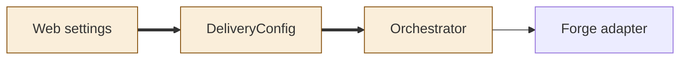
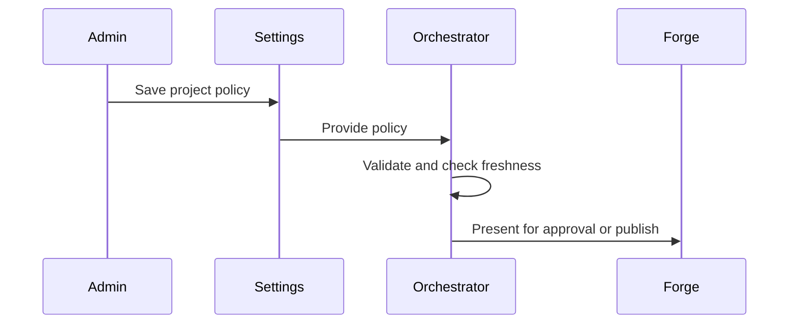
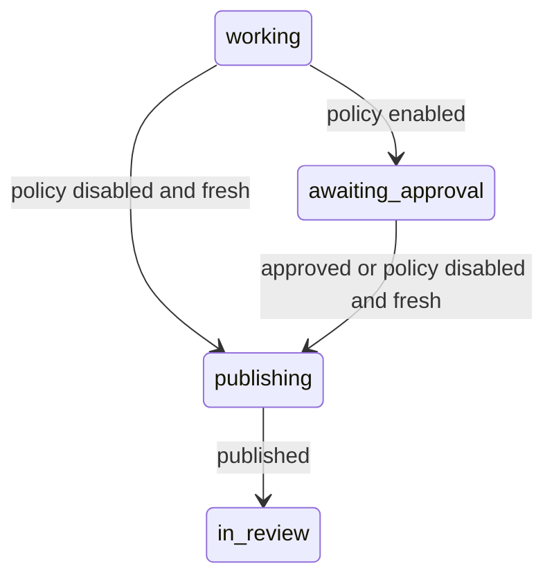

<!--
Copyright (c) 2026 DDP Engineering
This software is licensed under the PolyForm Noncommercial License 1.0.0.
Commercial use requires a separate commercial license.
See the LICENSE.txt file for full license details. SPDX-License-Identifier: LicenseRef-PolyForm-Noncommercial-1.0.0
-->
# TASK-0067fee1 diagrams

Illustrates the design in TASK-0067fee1.md.

## Structure

Changed: config, web settings, conductor. Reused: forge.

## Sequence

## State

