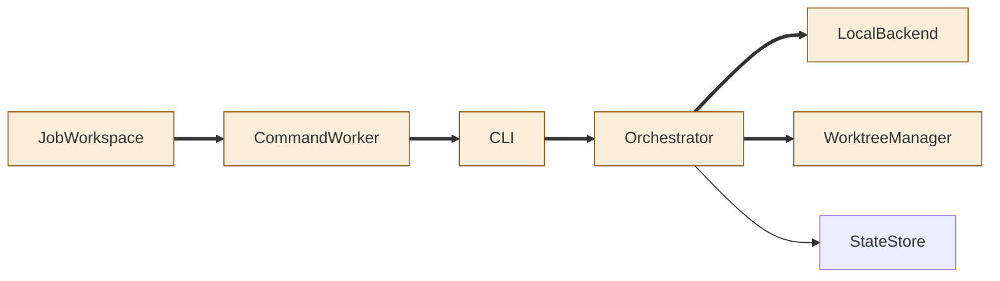
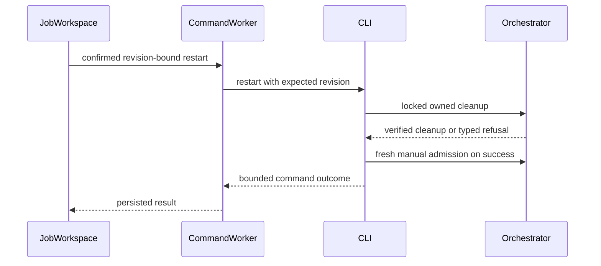
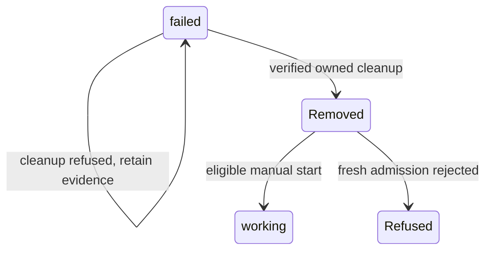

<!--
Copyright (c) 2026 DDP Engineering
This software is licensed under the PolyForm Noncommercial License 1.0.0.
Commercial use requires a separate commercial license.
See the LICENSE.txt file for full license details. SPDX-License-Identifier: LicenseRef-PolyForm-Noncommercial-1.0.0
-->
# TASK-12cca970 diagrams

Design in TASK-12cca970.md is authoritative.

## Structure

Node map: JobWorkspace, CommandWorker, CLI, Orchestrator, LocalBackend and WorktreeManager changed; StateStore reused.

## Sequence

## State

