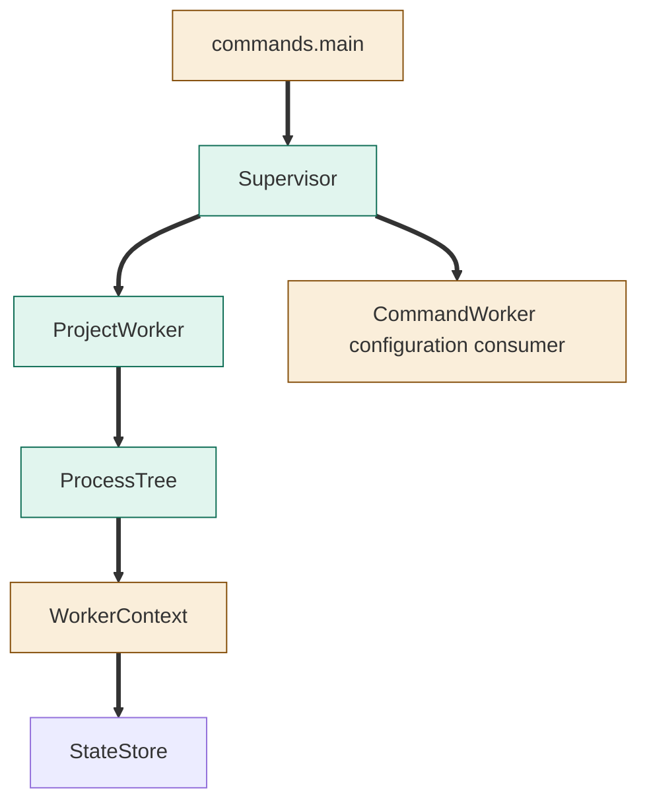
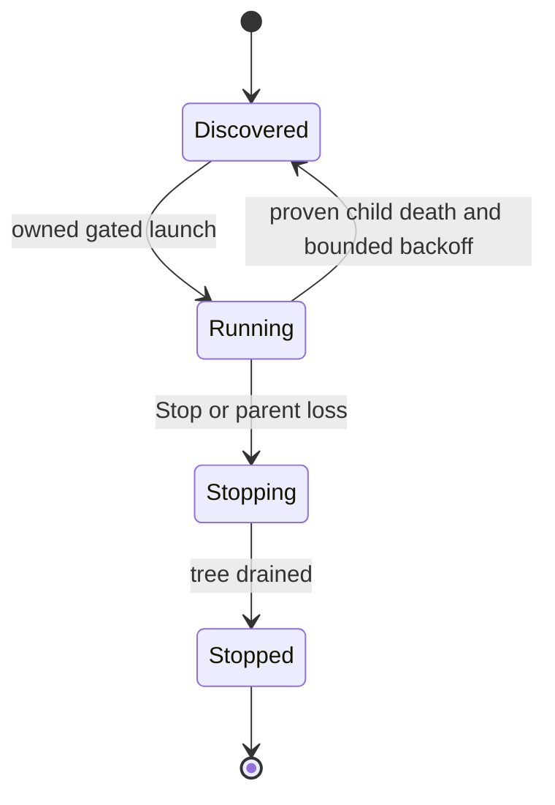

<!--
Copyright (c) 2026 DDP Engineering
This software is licensed under the PolyForm Noncommercial License 1.0.0.
Commercial use requires a separate commercial license.
See the LICENSE.txt file for full license details. SPDX-License-Identifier: LicenseRef-PolyForm-Noncommercial-1.0.0
-->
# TASK-1921263d diagrams

Illustrates the authoritative Design. Node map: Supervisor, ProjectWorker, ProcessTree added;
commands.main and WorkerContext changed; StateStore reused unchanged.

## Structure



## Sequence

```mermaid
sequenceDiagram
 participant S as Supervisor
 participant P as ProjectWorker
 participant A as Admission CLI
 participant R as Run CLI
 S->>P: launch by project_id
 P->>A: run --once --admit-only
 A-->>P: durable reservation
 P->>R: conduct run --config-revision
 Note over P,R: polling and other runs continue
 R-->>P: observed exit; durable lifecycle retained
```

## State


