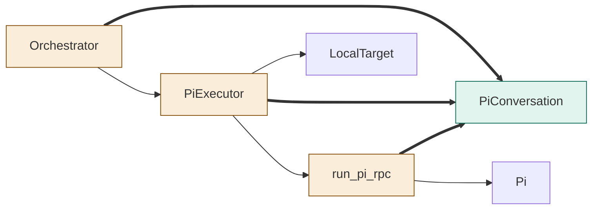
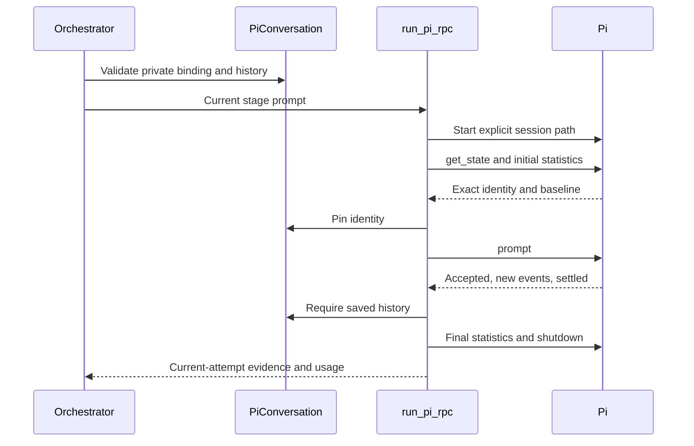

<!--
Copyright (c) 2026 DDP Engineering
This software is licensed under the PolyForm Noncommercial License 1.0.0.
Commercial use requires a separate commercial license.
See the LICENSE.txt file for full license details. SPDX-License-Identifier: LicenseRef-PolyForm-Noncommercial-1.0.0
-->

# TASK-1d2c5b87 diagrams

Illustrates the task Design, which is authoritative.

## Structure

Node map: PiConversation added; Orchestrator, PiExecutor and run_pi_rpc changed; Pi and LocalTarget reused unchanged.

## Sequence

## State

Not drawn: existing job/workflow lifecycle states and transitions are unchanged.
