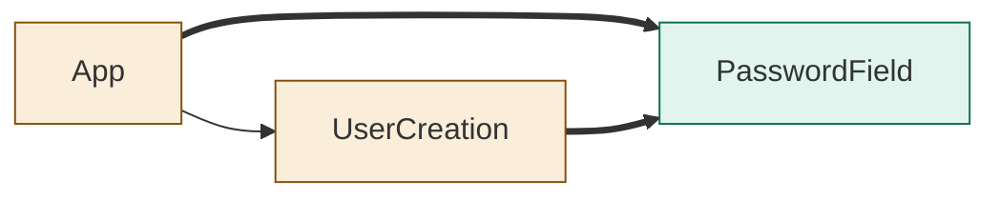
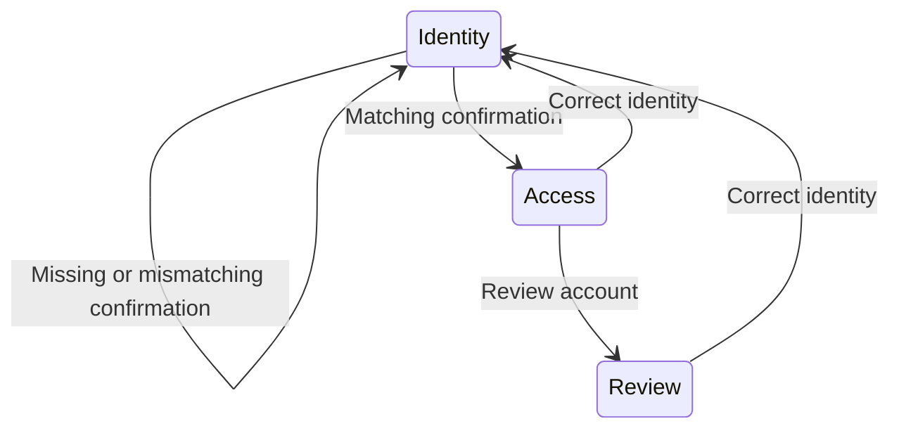

<!--
Copyright (c) 2026 DDP Engineering
This software is licensed under the PolyForm Noncommercial License 1.0.0.
Commercial use requires a separate commercial license.
See the LICENSE.txt file for full license details. SPDX-License-Identifier: LicenseRef-PolyForm-Noncommercial-1.0.0
-->

# TASK-20a14bfc diagrams

The task design defines the behavior. App and UserCreation change; PasswordField is added.

## Structure

## Sequence

Not drawn: the confirmation has no new API interaction.

## State

