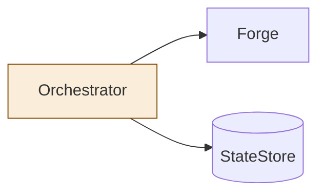
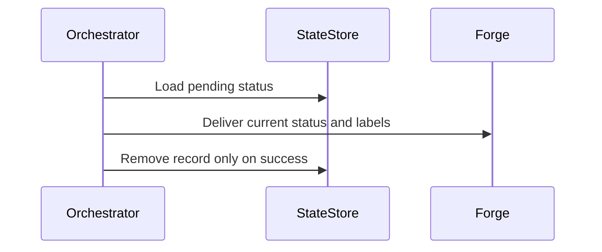

<!--
Copyright (c) 2026 DDP Engineering
This software is licensed under the PolyForm Noncommercial License 1.0.0.
Commercial use requires a separate commercial license.
See the LICENSE.txt file for full license details. SPDX-License-Identifier: LicenseRef-PolyForm-Noncommercial-1.0.0
-->
# TASK-21f716f2 diagrams

The journal Design is authoritative.

## Structure

Node map: orchestrator changed; forge and state store unchanged.

## Sequence

## State

Not drawn: no lifecycle transitions are added or changed.
