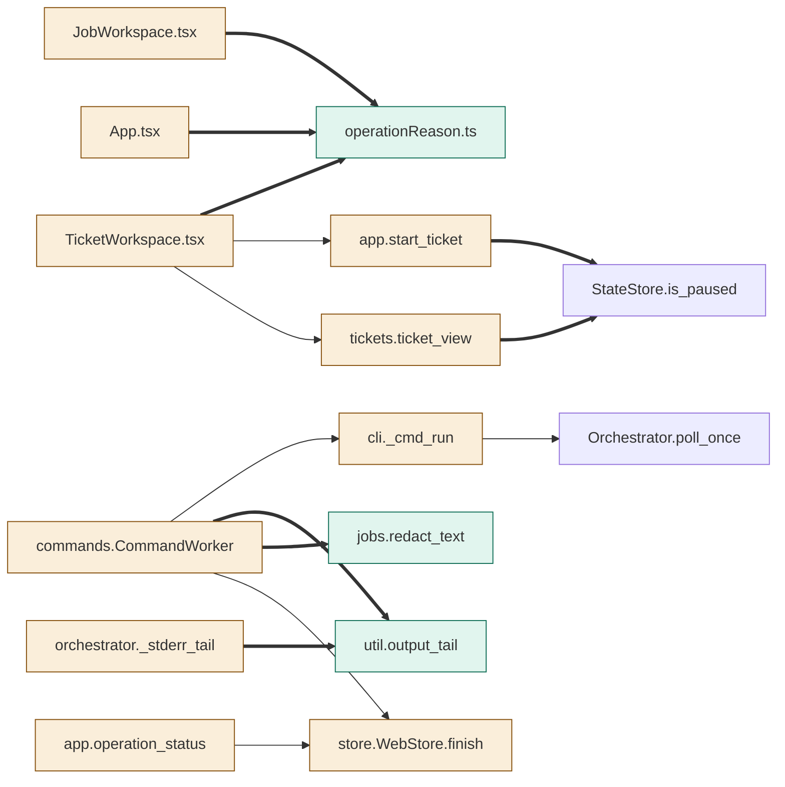

# TASK-235f217c diagrams

Illustrates `## Design` in `TASK-235f217c.md`. The Design text is authoritative.

Node classes (from the Design): added - `util.output_tail`, `jobs.redact_text`,
`operationReason.ts`; changed - `app.start_ticket`, `tickets.ticket_view`,
`cli._cmd_run`, `commands.CommandWorker`, `store.WebStore.finish`,
`app.operation_status`, `orchestrator._stderr_tail`, `TicketWorkspace.tsx`,
`JobWorkspace.tsx`, `App.tsx`; unchanged - `StateStore.is_paused`,
`Orchestrator.poll_once`.

## Structure



## Sequence

```mermaid
sequenceDiagram
    participant UI as TicketWorkspace.tsx
    participant API as app.start_ticket
    participant W as commands.CommandWorker
    participant CLI as cli._cmd_run
    participant DB as store.WebStore
    UI->>API: POST tickets/{iid}/start
    alt pickup stopped
        API-->>UI: 409 ticket_not_startable (pickup_paused), no label
    else pickup active
        API->>API: add ready/priority labels
        API->>DB: enqueue start
        API-->>UI: operation id, labels_added
        W->>DB: claim start
        W->>CLI: run --once --ticket N (stdout+stderr combined)
        CLI-->>W: exit 1 + "error: ticket #N not started: <code>"
        W->>W: output_tail(redact_text) -> detail; parse line -> reason
        W->>DB: finish(failed, result, reason, detail)
        UI->>DB: GET /operations/{id} (poll)
        DB-->>UI: status, result, reason, detail
        UI->>UI: localized reason + detail + kept labels
    end
```

## State

Not drawn: the operation status lifecycle (pending, running, succeeded,
failed, uncertain) is unchanged; reason and detail are fields set on the
existing failed and uncertain transitions.
