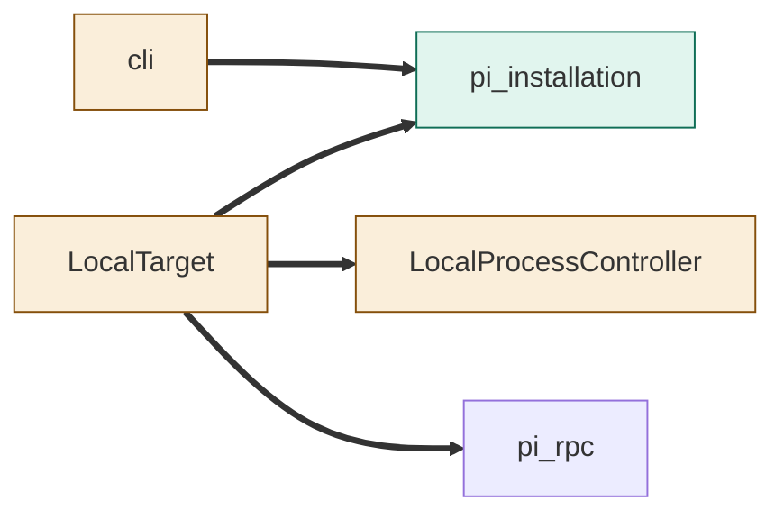
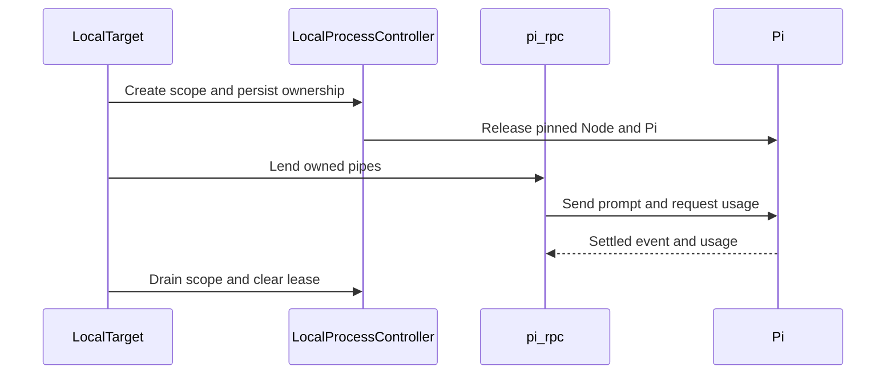
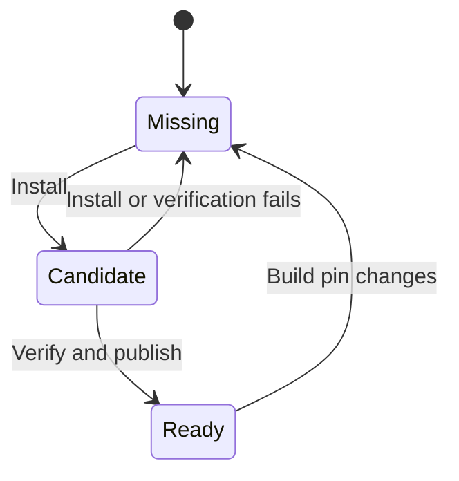

<!--
Copyright (c) 2026 DDP Engineering
This software is licensed under the PolyForm Noncommercial License 1.0.0.
Commercial use requires a separate commercial license.
See the LICENSE.txt file for full license details. SPDX-License-Identifier: LicenseRef-PolyForm-Noncommercial-1.0.0
-->

# TASK-2813a6af diagrams

Illustrates the Design in TASK-2813a6af.md.

## Structure

Map: pi_installation added; cli, LocalTarget and LocalProcessController changed;
pi_rpc reused.

## Sequence

## State

