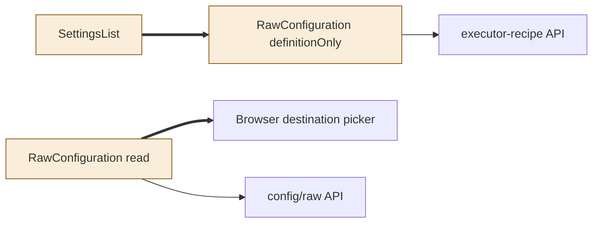
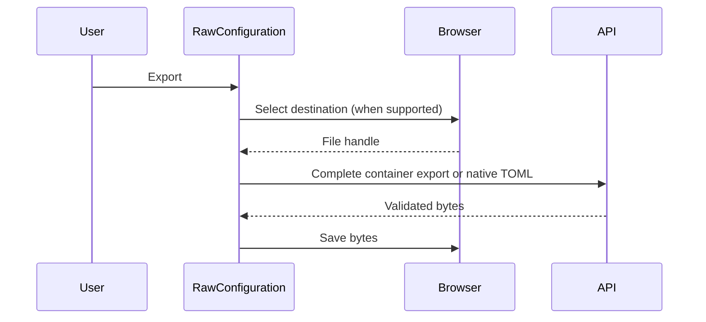
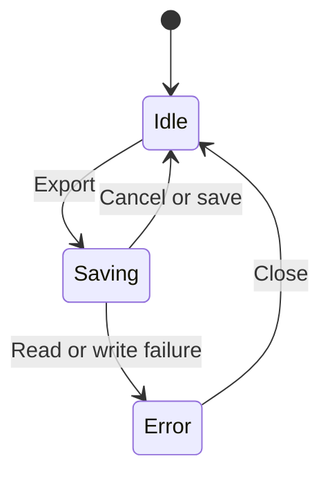

<!--
Copyright (c) 2026 DDP Engineering
This software is licensed under the PolyForm Noncommercial License 1.0.0.
Commercial use requires a separate commercial license.
See the LICENSE.txt file for full license details. SPDX-License-Identifier: LicenseRef-PolyForm-Noncommercial-1.0.0
-->

# TASK-3ca87e3e diagrams

Illustrates Design in TASK-3ca87e3e.md.

## Structure

Changed: RawConfiguration, SettingsList. Unchanged: raw API, recipe API, browser.

## Sequence

## State

