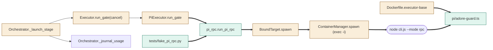
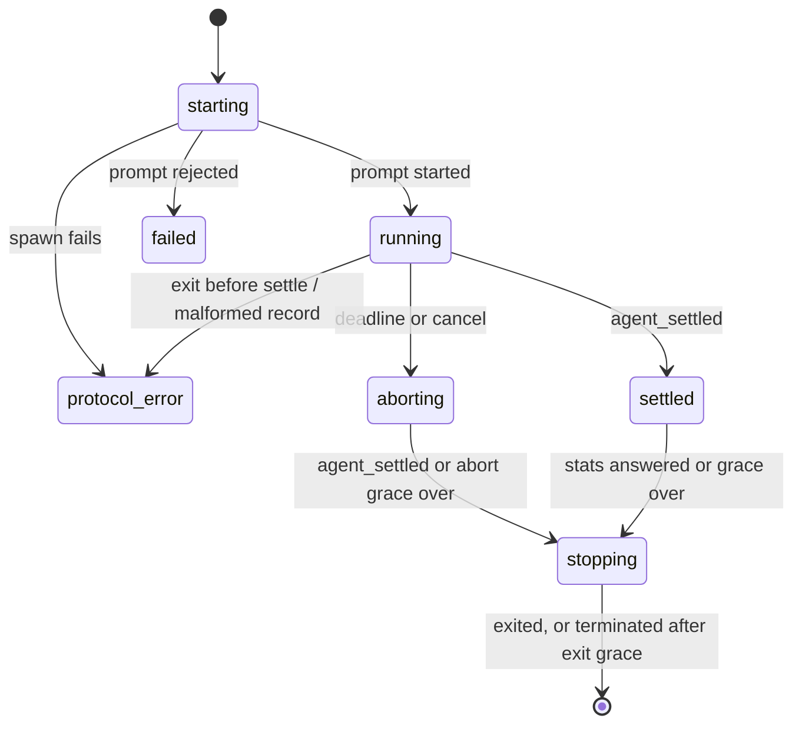

<!--
Copyright (c) 2026 DDP Engineering
This software is licensed under the PolyForm Noncommercial License 1.0.0.
Commercial use requires a separate commercial license.
See the LICENSE.txt file for full license details. SPDX-License-Identifier: LicenseRef-PolyForm-Noncommercial-1.0.0
-->

# TASK-41fd0159 diagrams

Illustrates `## Design` in `TASK-41fd0159.md`. The Design text is authoritative.

Node classes: added = `run_pi_rpc`, `adore_guard`, `fake_pi`; changed =
`launch_stage`, `PiExecutor`, `Executor_run_gate`, `BoundTarget`,
`ContainerManager`, `Dockerfile`; unchanged = `journal_usage`, `pi_process`.

## Structure



## Sequence

```mermaid
sequenceDiagram
    participant O as Orchestrator._launch_stage
    participant E as PiExecutor
    participant R as pi_rpc.run_pi_rpc
    participant P as Pi (docker exec -i)
    O->>E: run_gate(prompt, timeout, cancel)
    E->>R: argv, env, prompt
    R->>P: spawn; {"type":"prompt"}
    P-->>R: response started; events
    alt deadline or cancel
        R->>P: {"type":"abort"}
        P-->>R: agent_settled aborted
    else normal end
        P-->>R: agent_settled
    end
    R->>P: get_session_stats
    P-->>R: stats (cross-check)
    R->>P: close stdin (terminate after grace)
    R-->>E: PiRpcResult
    E-->>O: GateRun (usage, exit, evidence)
    O->>O: _journal_usage
```

## State


