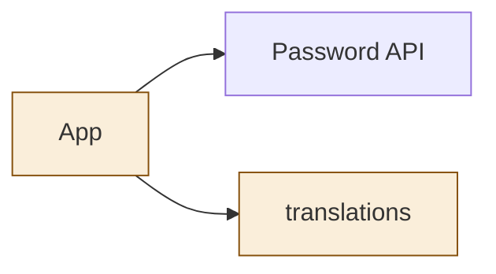
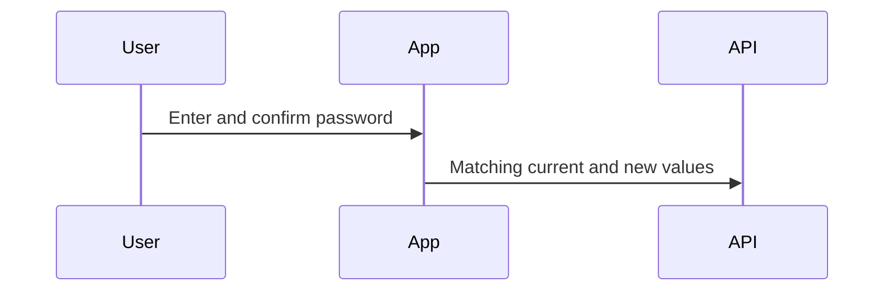

<!--
Copyright (c) 2026 DDP Engineering
This software is licensed under the PolyForm Noncommercial License 1.0.0.
Commercial use requires a separate commercial license.
See the LICENSE.txt file for full license details. SPDX-License-Identifier: LicenseRef-PolyForm-Noncommercial-1.0.0
-->
# Password form diagrams

The design is authoritative. Changed nodes: App, translations; API is unchanged.

## Structure

## Sequence

## State
Not drawn: the change adds no durable lifecycle state.
