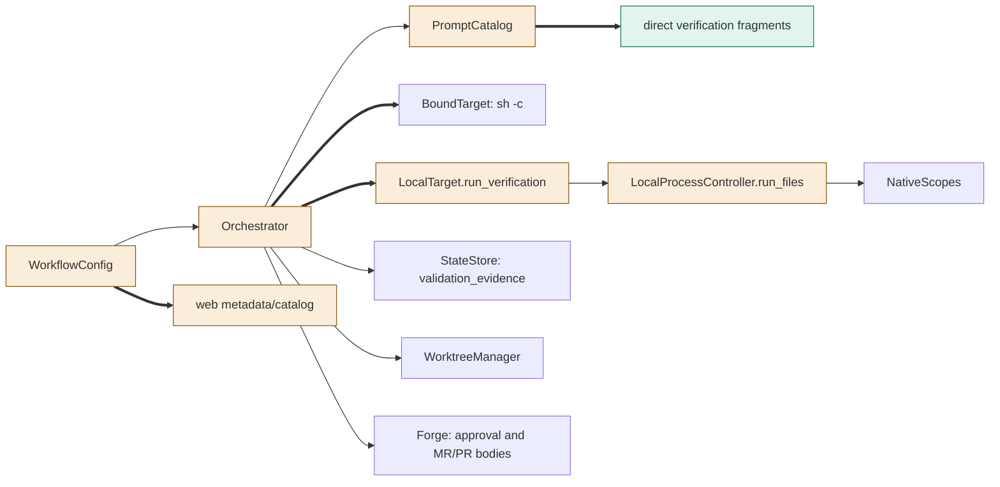

<!--
Copyright (c) 2026 DDP Engineering
This software is licensed under the PolyForm Noncommercial License 1.0.0.
Commercial use requires a separate commercial license.
See the LICENSE.txt file for full license details. SPDX-License-Identifier: LicenseRef-PolyForm-Noncommercial-1.0.0
-->

# TASK-48ef7915 diagrams

Illustrates `## Design` in `TASK-48ef7915.md`. The Design text is authoritative.
All flows are proposed design, not evidence of implemented or tested behavior.

## Structure

Node classification from explicit Design edits:

| Node | Classification | Design basis |
|---|---|---|
| WorkflowConfig | changed | D1 adds and validates verify_command. |
| web metadata/catalog | changed | D2 preserves the key, catalogues it and keeps controls hidden/noneditable. |
| Orchestrator | changed | D3/D4/D7/D8 conduct verification, retain evidence and present the candidate. |
| PromptCatalog | changed | D3 registers two direct resources; renderer is reused unchanged. |
| direct verification fragments | added | D3 adds configured-command and failure-context fragments. |
| BoundTarget | unchanged | D6 reuses owned sh -c/timeout transport; no container operation is added. |
| LocalTarget | changed | D5 adds run_verification without changing ordinary shell refusal. |
| LocalProcessController | changed | D6 adds opt-in bounded tail capture to owned run_files. |
| NativeScopes | unchanged | D5/D6 retain ownership, release and drain authority. |
| StateStore | unchanged | D4/D7 use the existing validation_evidence object and save/journal calls. |
| WorktreeManager | unchanged | D4/D8 reuse integration, checkpoint and clean fingerprints. |
| Forge | unchanged | D8 passes the new body through existing approval/create/update calls. |



## Sequence

```mermaid
sequenceDiagram
    participant Pi as PiExecutor
    participant O as Orchestrator
    participant S as StateStore
    participant W as WorktreeManager
    participant T as BoundTarget or LocalTarget
    participant F as Forge
    O->>Pi: Fresh build prompt naming configured command
    Pi-->>O: Settled success, product changes, summary, no questions
    O->>S: Save completion + validate, preserving stage_failures
    O->>W: Progress checkpoint and target integration
    loop While lifecycle is working; bounded verification and fresh fixes
        O->>T: Verify from worktree root under validate timeout
        Note over T: Container sh -c reuses bound execution; native uses owned verification-only shell operation
        T-->>O: Exit, authoritative timeout and captured streams after owned cleanup
        O->>O: Check types, sanitize and retain bounded latest result
        alt Failure or timeout
            O->>S: Shared stage_failure saves result, build routing, count and validate incident
            O->>F: Required incident notification
            alt Limit reached
                O->>S: Failed VERIFICATION_FAILED; retain evidence
                Note over O,Pi: No further autonomous launch; explicit Retry alone re-arms
            else Remediation permitted under cumulative limits
                O->>Pi: Fresh build with durable sanitized failure context
                Pi-->>O: Existing direct done conditions met
                O->>S: Save completion + validate without resetting count
                O->>W: Checkpoint and integrate target
            end
        else Pass without timeout
            O->>W: Final checkpoint, clean fingerprint and target binding
            O->>S: Save passed evidence and done; reset count on final success
            O->>F: Present command/result with exact candidate for fresh approval
            O->>S: Awaiting approval
            Note over O,F: Existing human freshness check gates later MR/PR body publication; never merge
        end
    end
```

## State

```mermaid
stateDiagram-v2
    [*] --> Build
    Build --> Validate: settled product progress, no questions; completion persisted
    Build --> Parked: questions; existing clarification limits
    Parked --> Build: answered; fresh session with retained evidence
    Build --> Failed: existing executor, no-progress or budget failure
    Validate --> Build: verification failed/timed out; count below limit; clear completion
    Validate --> Failed: count exhausted; VERIFICATION_FAILED; last result retained
    Validate --> Failed: typed integrity, ownership, cleanup or checkpoint failure
    Validate --> Done: configured pass then final checkpoint/fingerprint
    Validate --> Done: no command; unchanged explicit-unverified path
    Build --> Failed: exhausted saved verification incident; no new launch
    Failed --> Build: explicit Retry of failed verification; re-arm count, retain history/budgets
    Failed --> Validate: explicit Retry with durable completed validation work
    Done --> AwaitingApproval: present workflow-appropriate evidence
    AwaitingApproval --> Validate: candidate/target drift; invalidate pass and approval
    AwaitingApproval --> Publishing: fresh candidate/target-bound human approval
    Publishing --> InReview: existing guarded publication with retained command/result
    InReview --> Build: existing bounded revision flow
```
