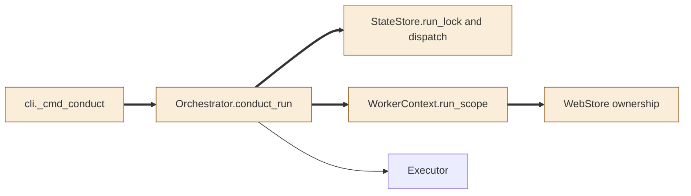
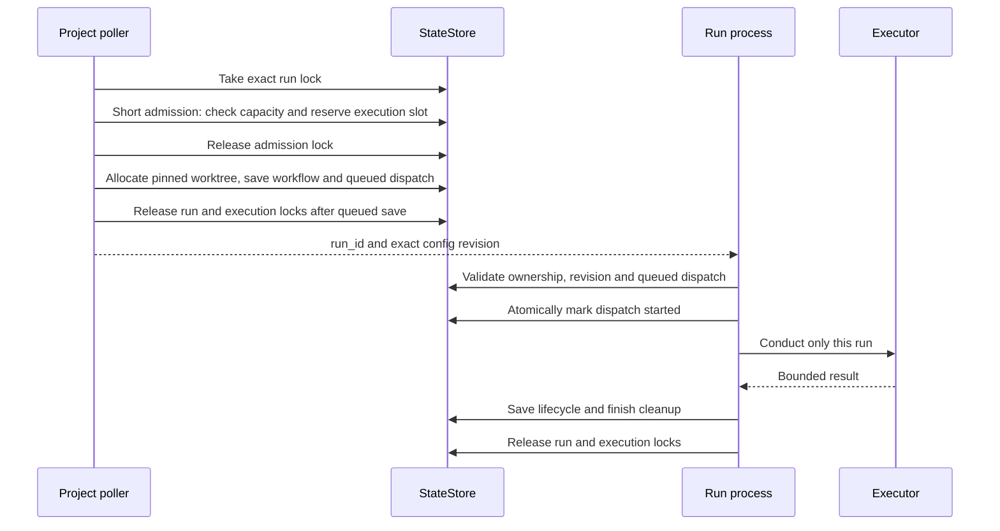
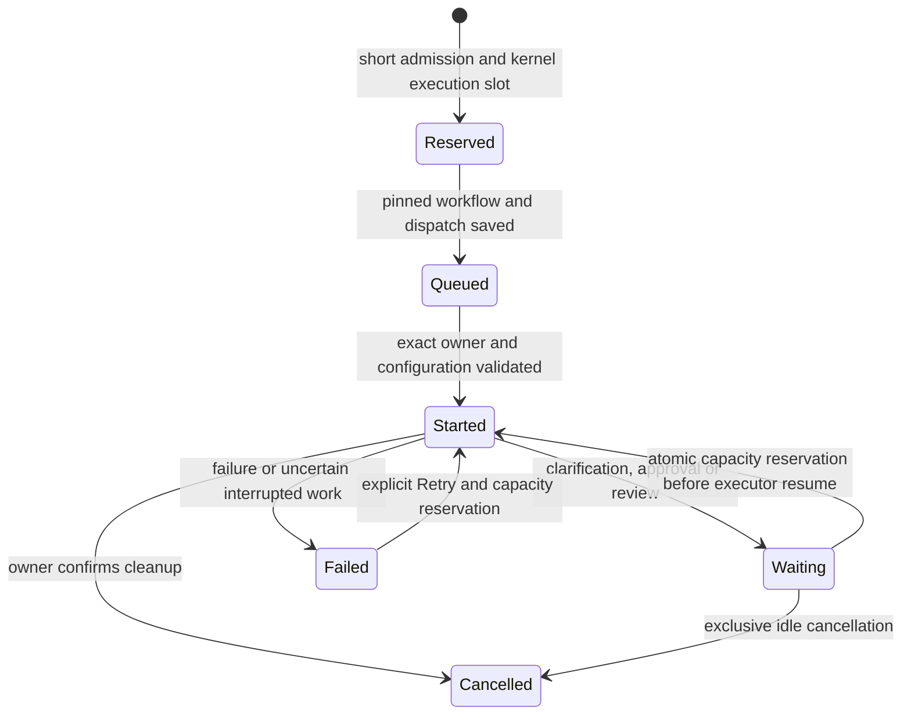

<!--
Copyright (c) 2026 DDP Engineering
This software is licensed under the PolyForm Noncommercial License 1.0.0.
Commercial use requires a separate commercial license.
See the LICENSE.txt file for full license details. SPDX-License-Identifier: LicenseRef-PolyForm-Noncommercial-1.0.0
-->

# TASK-490684e8 diagrams

Illustrates the Design in TASK-490684e8.md; that text is authoritative.

## Structure

Classification: CLI, Orchestrator, StateStore and WorkerContext are changed;
WebStore ownership authorization is changed to include the exact run action.

## Sequence

## State

