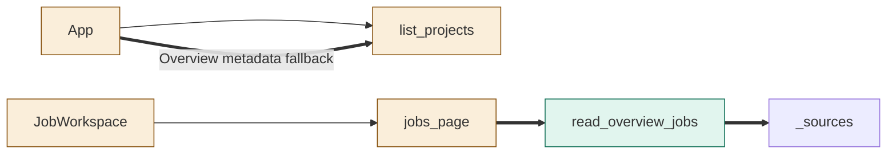
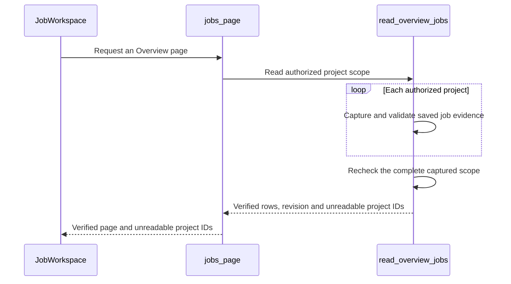

<!--
Copyright (c) 2026 DDP Engineering
This software is licensed under the PolyForm Noncommercial License 1.0.0.
Commercial use requires a separate commercial license.
See the LICENSE.txt file for full license details. SPDX-License-Identifier: LicenseRef-PolyForm-Noncommercial-1.0.0
-->

# TASK-4aea4dea diagrams

Illustrates Design in TASK-4aea4dea.md.

## Structure

App, list_projects, JobWorkspace and jobs_page change. read_overview_jobs is added. _sources is reused.

## Sequence

## State

Not drawn because no job lifecycle or state transition changes.
