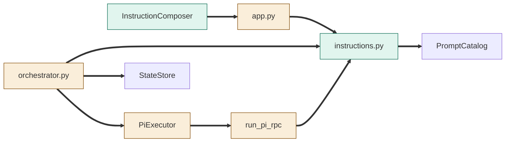
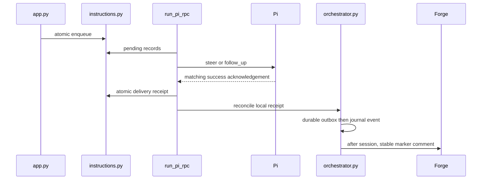
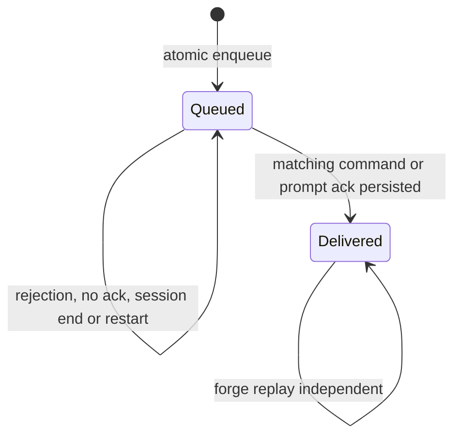

<!--
Copyright (c) 2026 DDP Engineering
This software is licensed under the PolyForm Noncommercial License 1.0.0.
Commercial use requires a separate commercial license.
See the LICENSE.txt file for full license details. SPDX-License-Identifier: LicenseRef-PolyForm-Noncommercial-1.0.0
-->

# TASK-4d1d734a diagrams

Illustrates Design in TASK-4d1d734a.md; Design is authoritative.

## Structure

Map: instructions.py and InstructionComposer added; app.py, orchestrator.py,
PiExecutor and run_pi_rpc changed; StateStore and PromptCatalog reused unchanged.

## Sequence

## State

