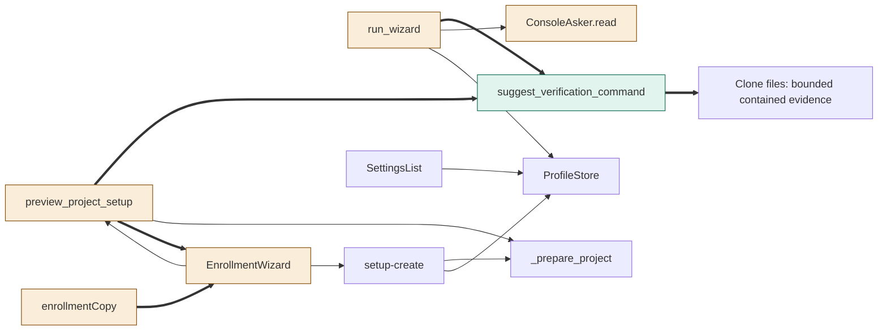
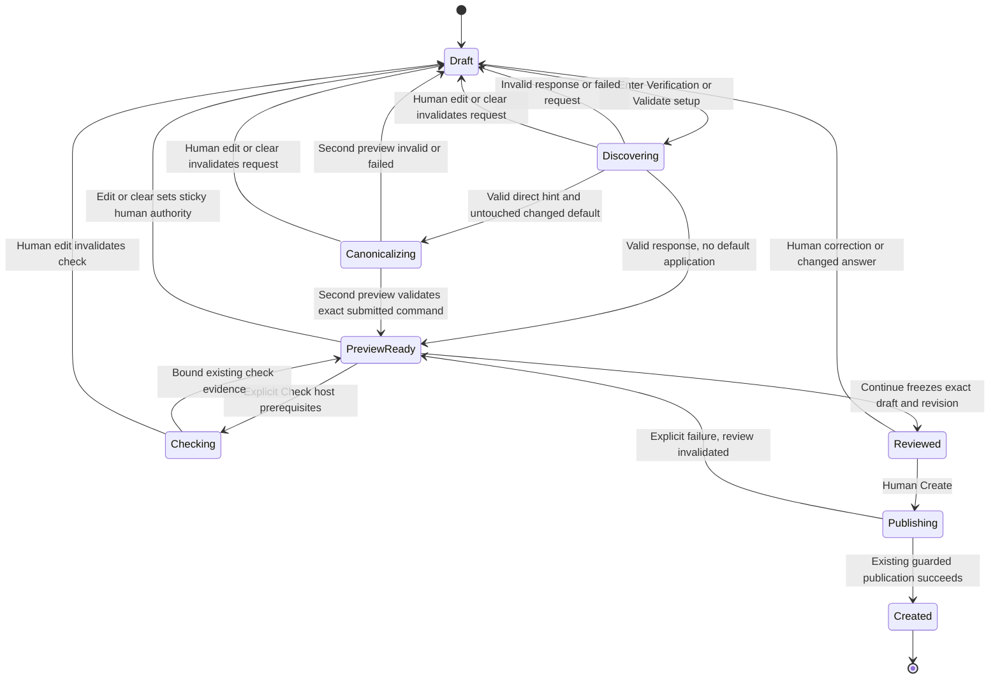

<!--
Copyright (c) 2026 DDP Engineering
This software is licensed under the PolyForm Noncommercial License 1.0.0.
Commercial use requires a separate commercial license.
See the LICENSE.txt file for full license details. SPDX-License-Identifier: LicenseRef-PolyForm-Noncommercial-1.0.0
-->

# TASK-51bf134b diagrams

Illustrates `## Design` in `TASK-51bf134b.md`. The Design text is authoritative.
These are proposed flows, not evidence that implementation or tests exist.

## Structure

Node classification from D1–D6:
- Added: `suggest_verification_command` (D1/D2).
- Changed: `run_wizard` and field-local `ConsoleAsker.read` (D5),
  `preview_project_setup` (D3), `EnrollmentWizard` and `enrollmentCopy` (D4).
- Reused unchanged: `_prepare_project`, `setup-create`, `ProfileStore`,
  `SettingsList`, clone files. No removed node.
- Added edges: helper calls/reads, preview hint transport and localized provenance.
  All other shown edges are existing calls/data flow. Settings has no hint edge.



## Sequence

D3/D4 primary direct-clone path, including exact human-reviewed persistence.
Only the first preview in an invocation may prefill; the canonical re-preview
cannot recursively apply another hint. Human edits invalidate either response.

```mermaid
sequenceDiagram
    actor Human
    participant UI as EnrollmentWizard
    participant API as preview_project_setup
    participant Prepare as _prepare_project
    participant Hint as suggest_verification_command
    participant Files as Clone files
    participant Create as setup-create
    Human->>UI: Enter Verification with untouched draft
    UI->>API: setup-preview with current exact command
    API->>Prepare: Validate candidate, no probes or publication
    Prepare-->>API: Canonical review, digests and direct observation
    API->>Hint: Read existing direct clone root
    Hint->>Files: Eligible bounded root rows, then immediate children
    Files-->>Hint: Manifest evidence
    Hint-->>API: Command and repository-relative source
    API-->>UI: Canonical candidate plus separate transient hint
    UI->>UI: Validate full response, prefill, invalidate old evidence
    UI->>API: Second preview with resulting exact command
    API->>Prepare: Validate submitted command, do not install a hint
    Prepare-->>API: Canonical review and digests
    API-->>UI: Canonical preview; no further automatic application
    Human->>UI: Keep, edit or clear command
    opt Human edits or clears
        UI->>UI: Sticky edit authority, invalidate review/check
        UI->>API: Explicit Validate setup with exact chosen command
        API->>Prepare: Validate exact chosen candidate
        Prepare-->>API: Canonical candidate
        API-->>UI: Hint cannot replace human choice
    end
    Human->>UI: Review then Create
    UI->>Create: Frozen draft and reviewed revision
    Create->>Prepare: Regenerate exact submitted candidate
    Prepare-->>Create: Candidate for revision comparison
    Create-->>UI: Existing guarded stopped-profile publication
```

## State

D4 adds transient browser transitions only. The sticky human-edited flag is
orthogonal: every edit/clear sets it, and no preview/Back/reread clears it.
No persisted run state or workflow-selection transition is introduced.


