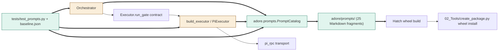

<!--
Copyright (c) 2026 DDP Engineering
This software is licensed under the PolyForm Noncommercial License 1.0.0.
Commercial use requires a separate commercial license.
See the LICENSE.txt file for full license details. SPDX-License-Identifier: LicenseRef-PolyForm-Noncommercial-1.0.0
-->

# TASK-555331a0 diagrams

Illustrates `## Design` in `TASK-555331a0.md`. The Design text is authoritative.

## Structure

Node classification from Design D1-D7:
- Added: `PromptCatalog`, `adore/prompts/` resources, `tests/test_prompts.py` and baseline data.
- Changed: `Orchestrator` composition/construction, `build_executor`/`PiExecutor` catalog wiring and notice rendering.
- Reused unchanged: `Executor.run_gate` contract, `pi_rpc` transport, Hatch wheel build and portable wheel installation.
- Removed nodes: none; prompt literals move into the new resources rather than representing a separate module removal.
- Added edges: catalog reads/injection/render dependencies and new test dependencies. Unchanged edges: conductor/executor gate calls, Pi RPC transport and wheel-to-portable installation.



## Sequence

Primary production construction and gate flow (D2-D6); standalone constructor defaults are described in Design.

```mermaid
sequenceDiagram
    participant factory as Orchestrator.from_config
    participant catalog as PromptCatalog
    participant files as adore/prompts/
    participant launcher as build_executor / PiExecutor
    participant conductor as Orchestrator
    participant rpc as pi_rpc
    factory->>catalog: Construct catalog
    loop Every required fragment
        catalog->>files: Read bytes once
        files-->>catalog: UTF-8 resource bytes
        catalog->>catalog: Remove legal prefix, validate Template
    end
    Note over factory,catalog: Any load failure raises file-named PromptError; no conductor is returned
    factory->>launcher: Construct with shared catalog
    factory->>conductor: Construct with same catalog
    conductor->>catalog: Render selected stage/recovery/review fragments with values
    catalog-->>conductor: Literal-value substitutions, no file reads
    conductor->>conductor: Preserve existing branches/order/joins/sanitization
    conductor->>launcher: run_gate with composed prompt
    launcher->>catalog: Render existing branch's system notice
    catalog-->>launcher: Notice text, no file reads
    launcher->>rpc: Existing argv/notice and prompt transport
```

## State

Not drawn: the extraction changes no run lifecycle, persisted status or stage transitions. Catalog construction success/failure is ordinary synchronous initialization, not a new product state machine.
