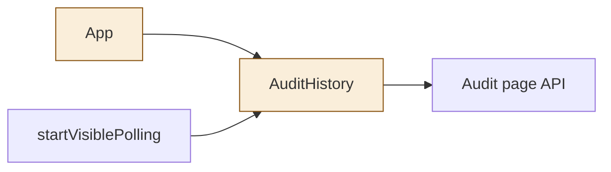
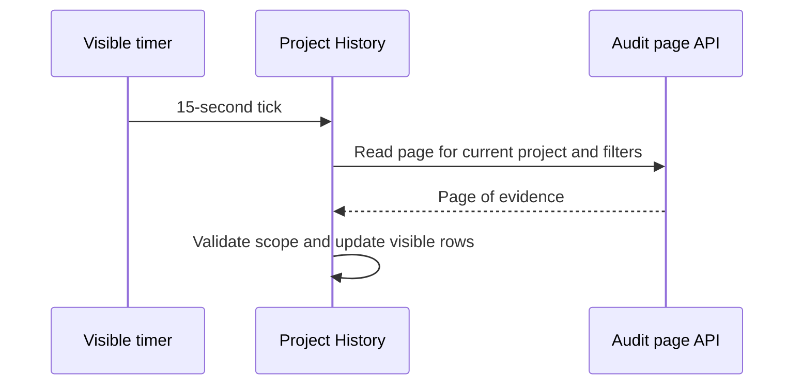

<!--
Copyright (c) 2026 DDP Engineering
This software is licensed under the PolyForm Noncommercial License 1.0.0.
Commercial use requires a separate commercial license.
See the LICENSE.txt file for full license details. SPDX-License-Identifier: LicenseRef-PolyForm-Noncommercial-1.0.0
-->

# TASK-5a699c9f diagrams

Changed components are App and AuditHistory. The polling helper and API are reused.

## Structure

## Sequence

## State

Not drawn. The existing loading, ready and error states apply to both views.
