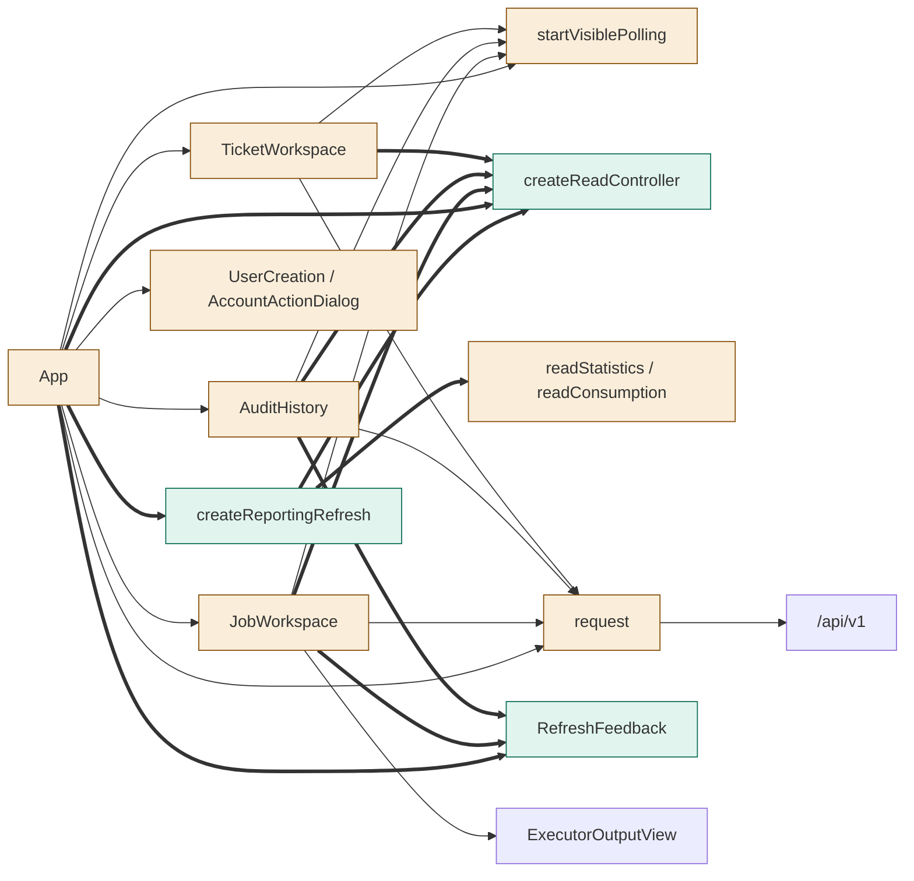

<!--
Copyright (c) 2026 DDP Engineering
This software is licensed under the PolyForm Noncommercial License 1.0.0.
Commercial use requires a separate commercial license.
See the LICENSE.txt file for full license details. SPDX-License-Identifier: LicenseRef-PolyForm-Noncommercial-1.0.0
-->

# TASK-5b9207ee diagrams

Illustrates `## Design` in [TASK-5b9207ee.md](TASK-5b9207ee.md). The Design text
is authoritative. These are proposed browser responsibilities, not implemented
behavior or a claim of an atomic backend reporting instant.

## Structure

Classification from explicit Design edits (D1–D8):

| Searchable node | Class | Design basis |
|---|---|---|
| `App` | changed | D2/D3/D5: report/read ownership, context/denial handling, targeted revalidation. |
| `startVisiblePolling` | changed | D1: actual visibility transitions; nominal intervals unchanged. |
| `createReadController` | added | D1: bounded coalesced owned reads in existing polling.ts. |
| `createReportingRefresh` | added | D2: staged requested/pinned proposals in existing statistics.ts. |
| `request` | changed | D3: transport versus invalid-response/cancellation classification. |
| `readStatistics / readConsumption` | changed | D2/D4: retained strict validation, additional unique usage-bucket validation. |
| `JobWorkspace` | changed | D4/D6: list/detail/consumption continuity, scoped Refresh and authority gates. |
| `AuditHistory` | changed | D4: same-query manual/periodic reader, both-scope Refresh. |
| `TicketWorkspace` | changed | D5/D6: bounded operation reads, live project/review guards; forge reads remain manual. |
| `UserCreation / AccountActionDialog` | changed | D6: keep valid dialogs/drafts, guard changed/failed review authority. |
| `RefreshFeedback` | added | D7: shared nonblocking progress, stale/time/retry presentation in Presentation.tsx. |
| `/api/v1` | unchanged | Existing server contracts, validators and final action authority; no backend edits. |
| `ExecutorOutputView` | unchanged | D4: existing manual read, composite/state_revision binding and integrity behavior reused. |

Edges are classified separately: existing component/request/API calls use `-->`;
new shared-controller/report/feedback/guard connections use `==>`. No removal of
an entire component is proposed. Removal of refresh counters from identity keys
is internal to the changed owners, not removal of the view or periodic updates.



## Sequence

Same authorized selected-project context, with an existing report and a
metrics-only 15s proposal in flight. Manual Refresh or the 30s due boundary
promotes the pinned usage input without launching a second metrics request or
extending the fixed proposal deadline. Reverse response order has the same
publication boundary. Reads/validation are supplied by App adapters; endpoints
retain their current API contracts.

```mermaid
sequenceDiagram
    participant trigger as startVisiblePolling / Refresh
    participant app as App
    participant report as createReportingRefresh
    participant owner as createReadController
    participant metrics as project metrics API
    participant usage as project usage API
    participant view as Statistics view / RefreshFeedback
    trigger->>app: selected metrics due at 15s
    app->>report: refresh(metrics mask, captured context)
    report->>owner: start one 30s bounded proposal
    owner->>view: refreshing=true; retain committed report
    report->>metrics: read owned signal; validate result
    Note over report,view: Not-due usage explicitly pinned with original time
    trigger->>app: full Refresh or usage becomes due while pending
    app->>report: refresh(full mask, same context)
    report->>usage: promote pinned member; read same proposal signal
    Note over report,owner: Same promise; no duplicate metrics or backlog; deadline unchanged
    alt both requested members complete with valid evidence
        metrics-->>report: validated metrics and member completion time
        Note over report,view: Stage only; previous report and export stay mounted
        usage-->>report: validated usage and member completion time
        report->>report: verify current context, canonical scopes and authorized project set
        report-->>owner: complete valid pair and member times
        owner-->>app: publish one owned success
        app->>view: coherent replacement; ready; record fullReportAt
        Note over app,view: Surviving keys, sort, pager, disclosure and focus persist
    else informational transport or owned deadline failure
        owner-->>app: failed proposal; discard staged members
        app->>view: retained complete report marked stale, last success, retry
    else malformed, application, integrity or authority failure
        owner-->>app: fail closed and invalidate relevant authority
        app->>view: withhold affected report/exports; explicit error
    end
    opt context ends during any read
        app->>owner: dispose / invalidate
        owner->>metrics: abort owned request
        owner->>usage: abort owned request
        Note over app,view: Old success/error/time cannot publish under replacement context
    end
```

## State

Logical presentation states combine `status` with `refreshing`; they do not add
a wire or persisted state format. A validated empty result is Ready. Stale is
permitted only for informational transport/deadline failure with a current-context
validated baseline. Authority-bearing reads always take the closed Error path.

```mermaid
stateDiagram-v2
    [*] --> Loading: new authorized context; no validated snapshot
    Loading --> Ready: complete validated owned success
    Loading --> Error: first read fails
    Ready --> RefreshingReady: same-context trigger
    RefreshingReady --> Ready: complete valid unchanged or changed publication
    RefreshingReady --> Stale: informational transport/deadline failure
    RefreshingReady --> Error: malformed / application / integrity / strict failure
    Stale --> RefreshingStale: retry / eligible tick
    RefreshingStale --> Stale: transport/deadline failure again
    RefreshingStale --> Ready: all required recovery dependencies validate
    RefreshingStale --> Error: closed-boundary failure
    Error --> Loading: explicit or eligible automatic retry
    Ready --> Disposed: navigation / context change / sign-out
    RefreshingReady --> Disposed: ownership ends; abort
    Stale --> Disposed: ownership ends
    RefreshingStale --> Disposed: ownership ends; abort
    Loading --> Disposed: ownership ends; abort
    Error --> Disposed: ownership ends
    Ready --> Unauthorized: detected session / role / grant loss
    RefreshingReady --> Unauthorized: detected session / role / grant loss
    Stale --> Unauthorized: detected session / role / grant loss
    RefreshingStale --> Unauthorized: detected session / role / grant loss
    Loading --> Unauthorized: detected session / role / grant loss
    Unauthorized --> Disposed: remove protected data; invalidate owner
    Disposed --> [*]
    note right of Disposed
        Replacement context gets a new owner.
        No prior snapshot or late completion transfers.
    end note
    note right of Stale
        Concise failed-refresh status, last success, retry.
        Not current evidence for dependent mutations.
    end note
    note left of Error
        Incomplete or conflicting Jobs pages use
        existing explicit reload-from-zero transition.
    end note
```


