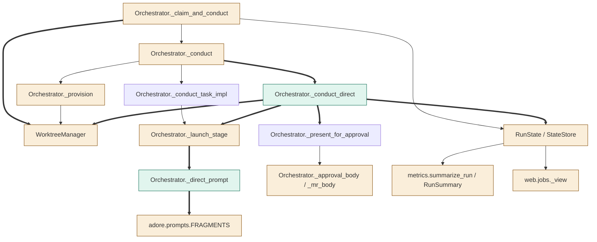
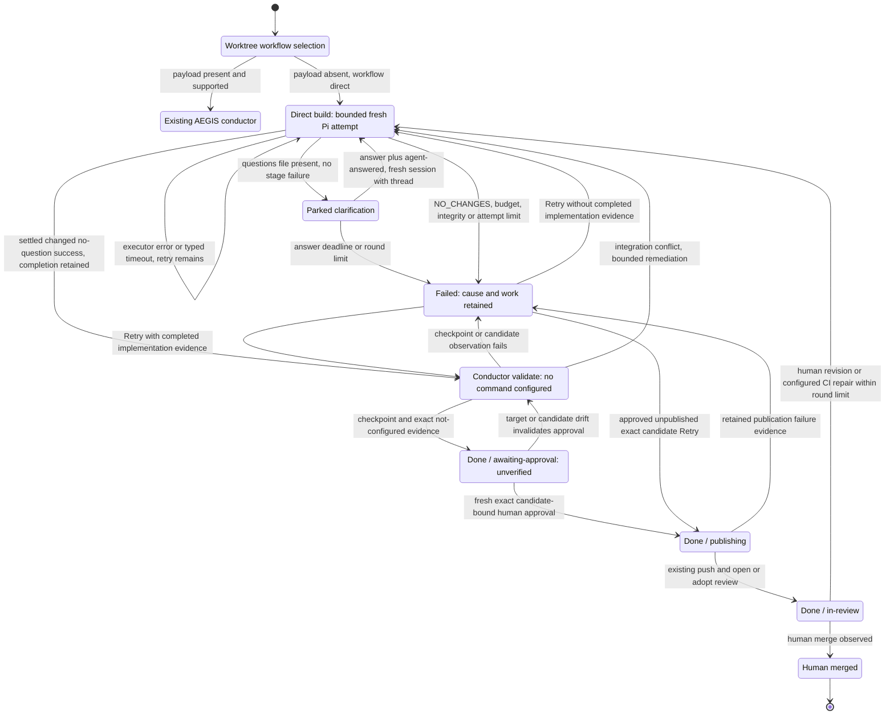

<!--
Copyright (c) 2026 DDP Engineering
This software is licensed under the PolyForm Noncommercial License 1.0.0.
Commercial use requires a separate commercial license.
See the LICENSE.txt file for full license details. SPDX-License-Identifier: LicenseRef-PolyForm-Noncommercial-1.0.0
-->

# TASK-652f9133 diagrams

Illustrates `## Design` in `TASK-652f9133.md`. The Design text is authoritative.
These are proposed connections and transitions, not implementation evidence.

## Structure

Node classification from Design D1–D9:

| Node | Class | Design edit |
|---|---|---|
| claim | changed | D1 allocates/pins worktree before persisted workflow selection |
| state | changed | D4 adds/validates workflow |
| provision | changed | D1 extracts shared allocation; execution authority retained |
| conduct | changed | D2 adds post-provision direct branch |
| direct | added | D3 separate bounded direct conductor |
| aegis | unchanged | D2 retains existing AEGIS stage loop |
| launch | changed | D2 accepts a direct launch without a task |
| prompt | added | D2 direct composition |
| fragments | changed | D2 registers the new licensed resource |
| worktrees | changed | D6 safe summary read/removal and optional exclusions |
| present | unchanged | D7 reuses existing presentation/label mechanism |
| bodies | changed | D7 workflow-specific summary/count/unverified text |
| metrics | changed | D8 serializes workflow |
| jobs | changed | D8 exposes validated workflow |

Edges are classified independently: thick edges add direct data/call paths;
normal edges retain existing calls/ownership. No component is removed.



## Sequence

Primary absent-payload path; failure and clarification alternatives are shown in
State. PiExecutor, StateStore persistence operations and forge publication retain
their existing interfaces except RunState's recorded workflow.

```mermaid
sequenceDiagram
    participant Forge as Forge adapter
    participant O as Orchestrator
    participant W as WorktreeManager
    participant S as StateStore
    participant P as PiExecutor
    O->>O: _probe_repository_payload: absent clone payload, no probe
    O->>W: Shared plan/worktree allocation, pin recipe base when applicable
    W-->>O: Owned isolated worktree
    O->>O: Select direct from worktree; stage build, no task ids
    O->>S: Save immutable workflow and ticket snapshot
    O->>Forge: Claim ticket labels
    O->>O: _provision then _conduct_direct
    O->>W: Progress fingerprint excluding exchange paths
    W-->>O: Before fingerprint
    O->>O: Refresh budgets and compose _direct_prompt
    O->>P: _launch_stage without task; fresh bounded build session
    P-->>O: Settled success, no questions
    O->>W: Safe summary read and product progress observation
    W-->>O: Available summary; changed fingerprint
    O->>S: Retain sanitized summary and completed implementation; validate
    O->>W: Remove observed summary; checkpoint excluding exchange paths
    W-->>O: Clean candidate and target identity; changed-file count
    O->>S: Record not-configured evidence and exact candidate; done
    O->>Forge: Remove stale approval; present summary/count/unverified notice
    O->>S: awaiting-approval
    Note over O,Forge: Later fresh human label, with unchanged candidate and target
    Forge-->>O: Fresh approval observed
    O->>W: Existing guarded branch publication
    O->>Forge: Open/adopt configured draft or ready review; never merge
    O->>S: in-review, same workflow and candidate
```

## State

`Build`, `Validate` and `AwaitingApproval` carry stages build, validate and done.
Publishing/in-review are existing lifecycles at done, not direct executor stages.
The AEGIS branch is reused rather than expanded here. All direct continuations
retain the selected workflow and empty task bindings.


