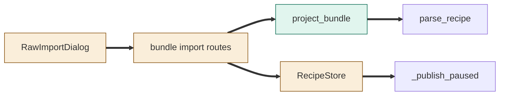
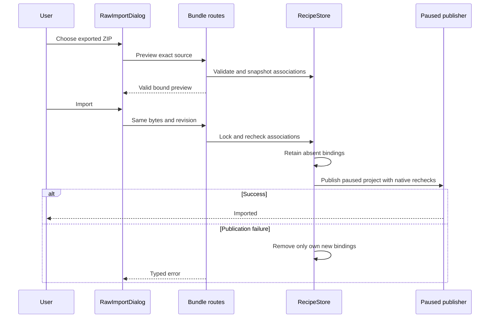
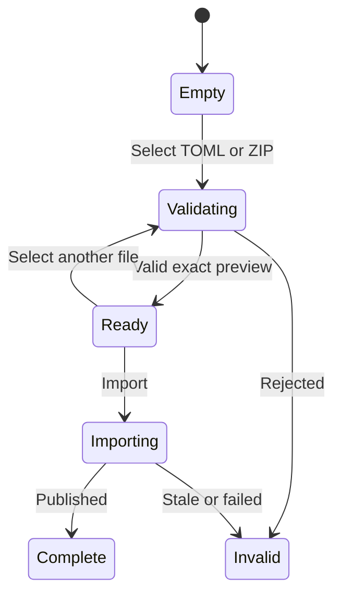

<!--
Copyright (c) 2026 DDP Engineering
This software is licensed under the PolyForm Noncommercial License 1.0.0.
Commercial use requires a separate commercial license.
See the LICENSE.txt file for full license details. SPDX-License-Identifier: LicenseRef-PolyForm-Noncommercial-1.0.0
-->

# TASK-6569314e diagrams

Illustrates the journal Design; it is authoritative.

## Structure

Added: project_bundle. Changed: RawImportDialog, bundle routes, RecipeStore.
Unchanged: parse_recipe, existing paused project publication.

## Sequence

## State

