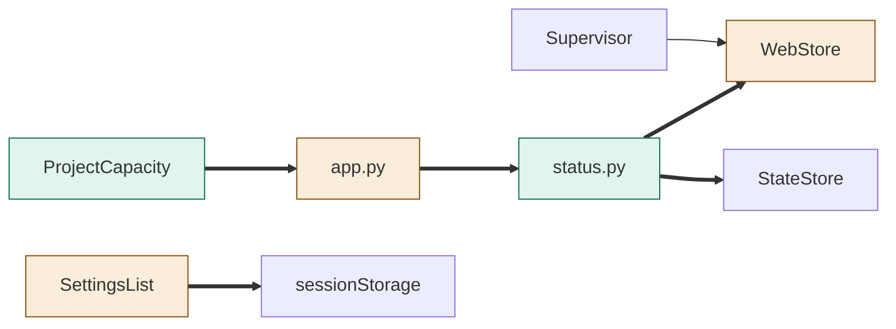
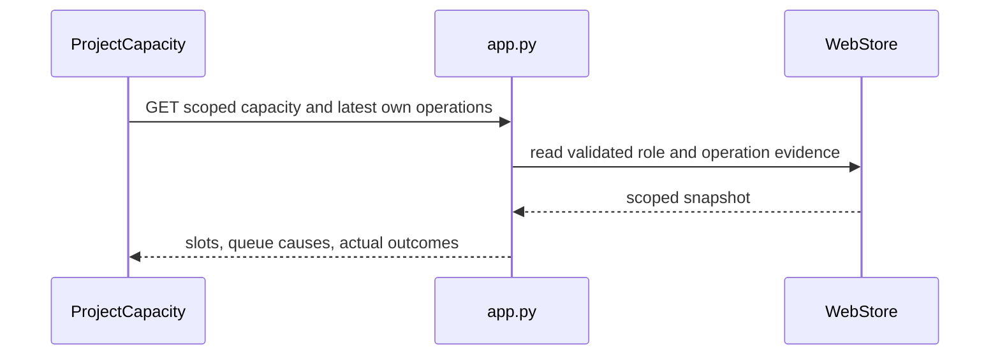

<!--
Copyright (c) 2026 DDP Engineering
This software is licensed under the PolyForm Noncommercial License 1.0.0.
Commercial use requires a separate commercial license.
See the LICENSE.txt file for full license details. SPDX-License-Identifier: LicenseRef-PolyForm-Noncommercial-1.0.0
-->

# TASK-6580e525 diagrams

Illustrates Design in TASK-6580e525.md. Design is authoritative.

## Structure
Map: status projection and ProjectCapacity added; app/store/SettingsList changed; supervisor reused.

## Sequence

## State
Not drawn: lifecycle and operation transitions are unchanged.
