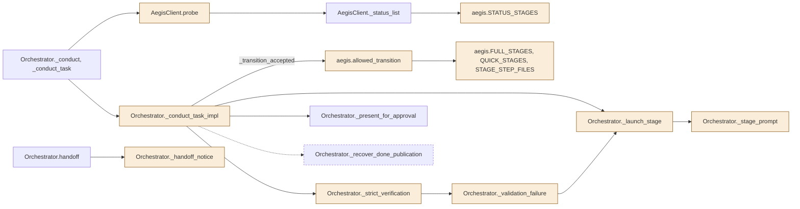
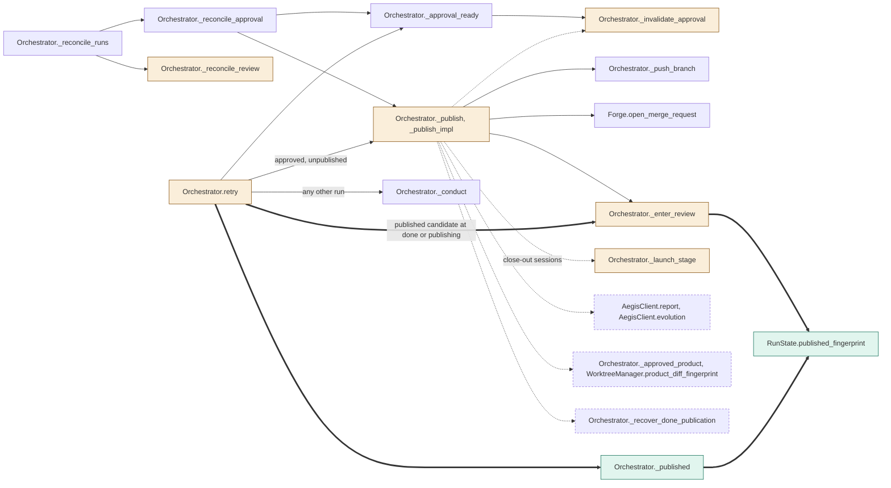
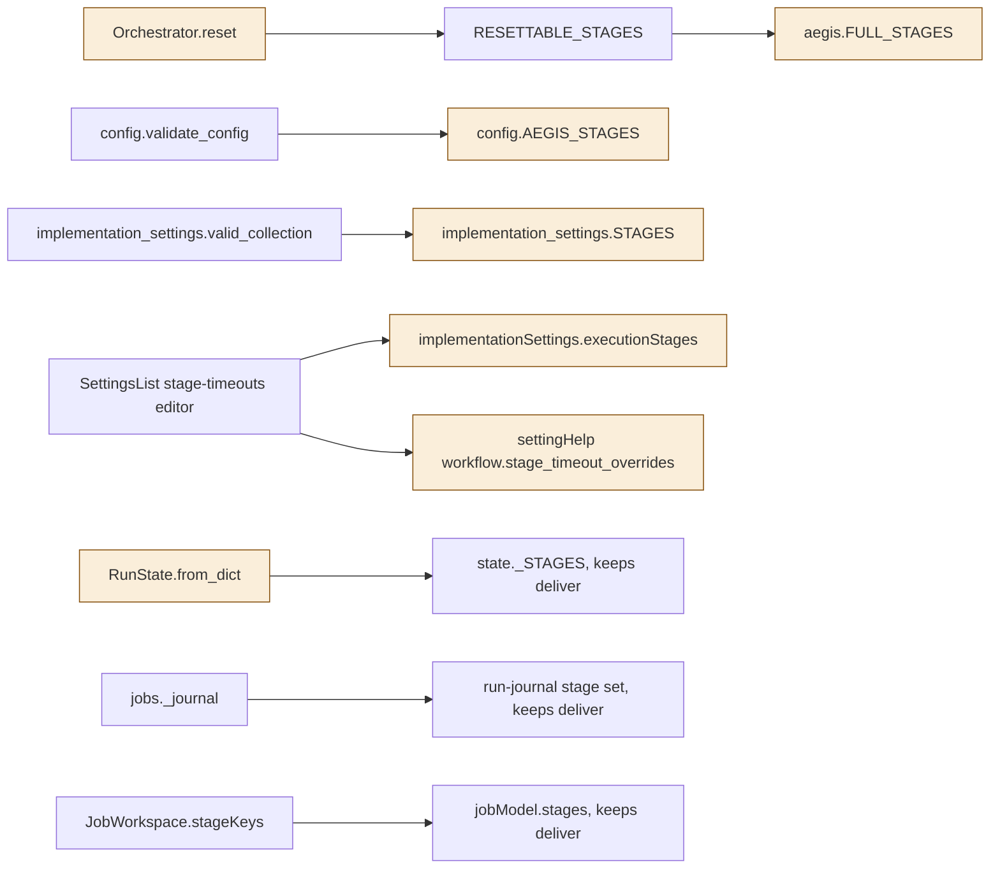
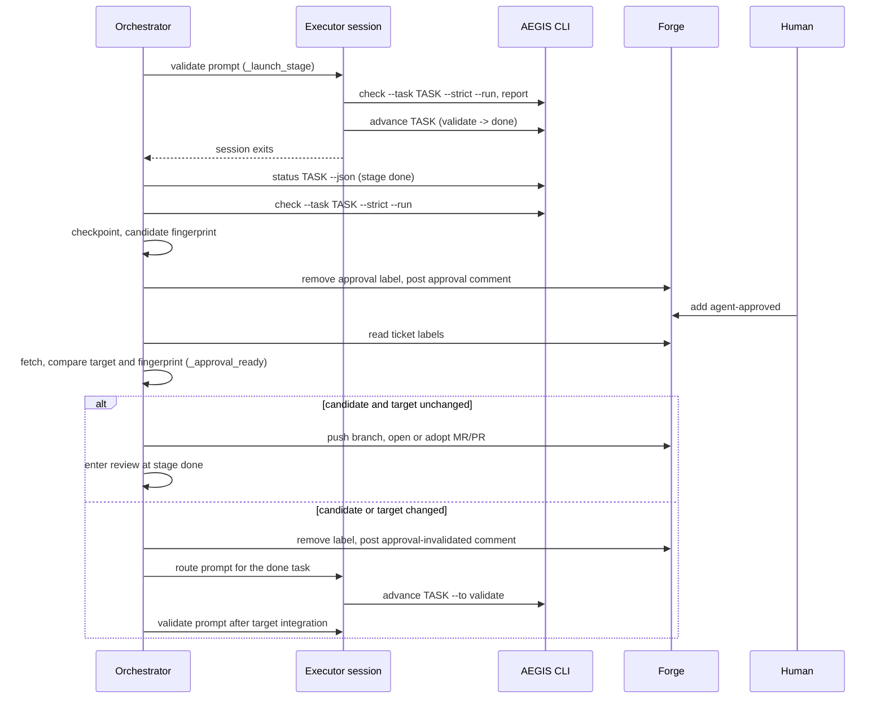
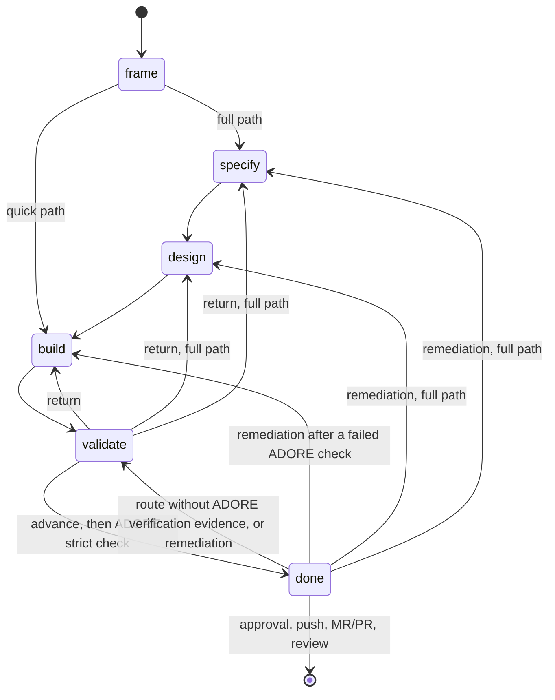

<!--
Copyright (c) 2026 DDP Engineering
This software is licensed under the PolyForm Noncommercial License 1.0.0.
Commercial use requires a separate commercial license.
See the LICENSE.txt in the .agentic folder for full license details.
SPDX-License-Identifier: LicenseRef-PolyForm-Noncommercial-1.0.0
-->

# TASK-6e8cc2e7 diagrams

Illustrates `## Design` in `TASK-6e8cc2e7.md`. The Design text is authoritative.

## Structure

Node classes, from the Design edits:

| Node | Class | Design basis |
|---|---|---|
| `Orchestrator._conduct_task_impl` | changed | validate -> done trigger, revalidation route moves to done |
| `AegisClient.probe` | changed | `MINIMUM_SERIES = (0, 15)` |
| `aegis.STATUS_STAGES` | changed | names deliver itself for older journals; the pinned task decode refuses it |
| `aegis.FULL_STAGES`, `QUICK_STAGES`, `STAGE_STEP_FILES` | changed | 0.15.0 path tables, no deliver |
| `aegis.allowed_transition` | changed | done -> validate replaces deliver -> validate |
| `Orchestrator._strict_verification` | changed | expects done |
| `Orchestrator._validation_failure` | changed | done-stage task view |
| `Orchestrator._launch_stage`, `_stage_prompt` | changed | no close-out parameter; advance, log, pause wording |
| `Orchestrator._handoff_notice` | changed | names `brief` and the full task journal |
| `Orchestrator._publish`, `_publish_impl` | changed | push and MR/PR only, from done or publishing |
| `Orchestrator.retry`, `Orchestrator._enter_review` | changed | review, publication or conduct from done; review records the published candidate |
| `Orchestrator._published`, `RunState.published_fingerprint` | added | published candidate marker |
| `RunState.from_dict` | changed | checks the published fingerprint as a digest |
| `Orchestrator._invalidate_approval`, `_reconcile_review` | changed | no longer write `approved_product` |
| `Orchestrator.reset` | changed | refuses every target for a run recorded at deliver |
| `Orchestrator._conduct`, `_present_for_approval`, `_approval_ready`, `_reconcile_approval`, `_reconcile_runs`, `_push_branch`, `handoff`, `AegisClient._status_list`, `Forge.open_merge_request` | none | reused unchanged |
| `AegisClient.report`, `AegisClient.evolution` | removed | no caller remains |
| `Orchestrator._recover_done_publication` | removed | done is the approval state |
| `Orchestrator._approved_product`, `WorktreeManager.product_diff_fingerprint` | removed | no executor session after approval |
| `config.AEGIS_STAGES`, `implementation_settings.STAGES`, `implementationSettings.executionStages`, `settingHelp` stage timeout copy | changed | five stages |
| `RESETTABLE_STAGES`, `config.validate_config`, `implementation_settings.valid_collection`, `SettingsList`, `state._STAGES`, `jobs._journal`, `jobModel.stages`, `JobWorkspace.stageKeys` | none | unchanged; the last four keep deliver for history |

Conducting a task:

Approval, publication and retry:

Stage vocabularies:

## Sequence

## State

