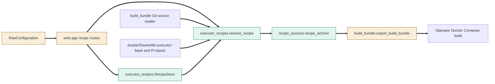
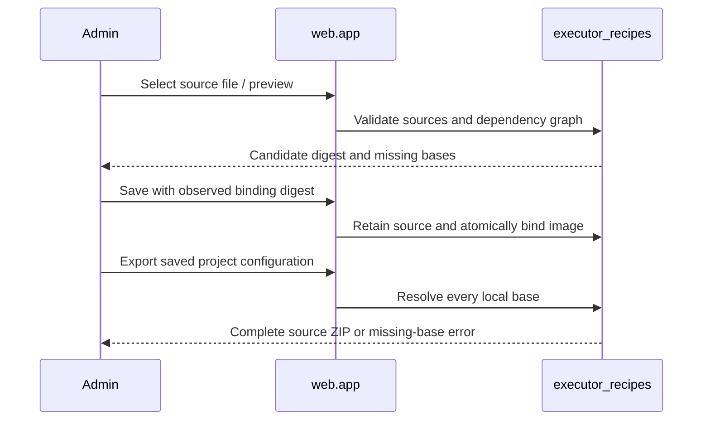
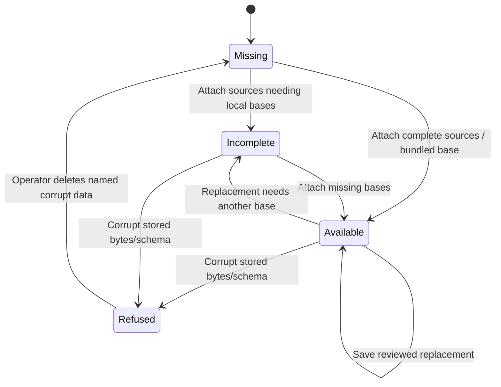

<!--
Copyright (c) 2026 DDP Engineering
This software is licensed under the PolyForm Noncommercial License 1.0.0.
Commercial use requires a separate commercial license.
See the LICENSE.txt file for full license details. SPDX-License-Identifier: LicenseRef-PolyForm-Noncommercial-1.0.0
-->

# TASK-817deb7e diagrams

Illustrates `## Design` in `TASK-817deb7e.md`. The Design text is authoritative.

## Structure

Node map: recipe_sources and executor_recipes added; RawConfiguration, app and
build_bundle changed; immutable Git reader, canonical base sources and operator
Docker Compose builder reused unchanged. Connections below are newly added.

## Sequence

## State

