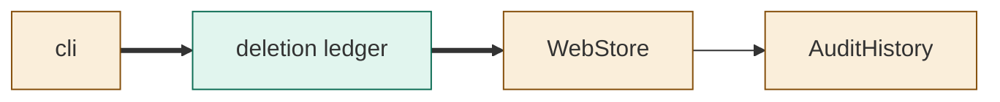
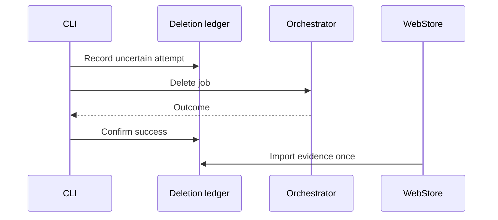
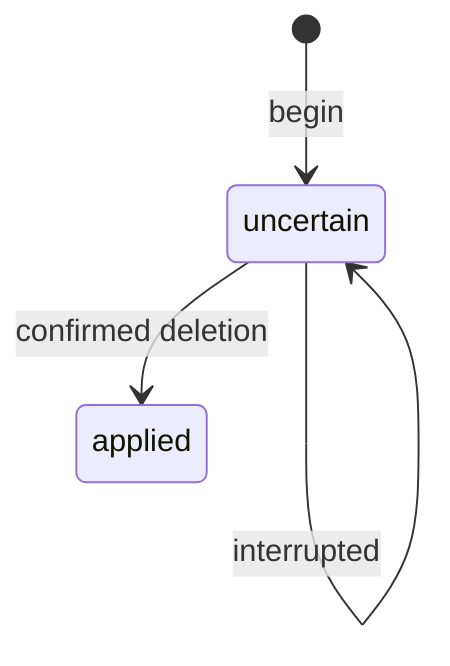

<!--
Copyright (c) 2026 DDP Engineering
This software is licensed under the PolyForm Noncommercial License 1.0.0.
Commercial use requires a separate commercial license.
See the LICENSE.txt file for full license details. SPDX-License-Identifier: LicenseRef-PolyForm-Noncommercial-1.0.0
-->
# TASK-842e14a1 diagrams

Illustrates the Design in the task journal. The Design text is authoritative.

## Structure

Node map: cli, web store and History changed; ledger added.

## Sequence

## State

