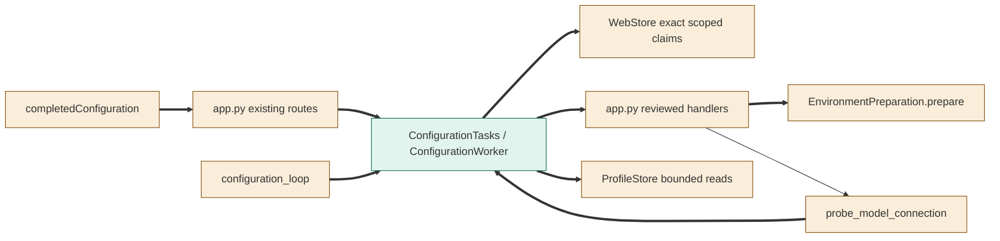
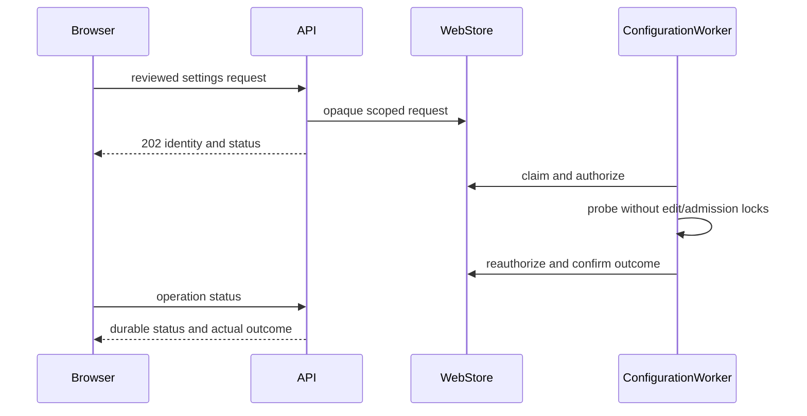
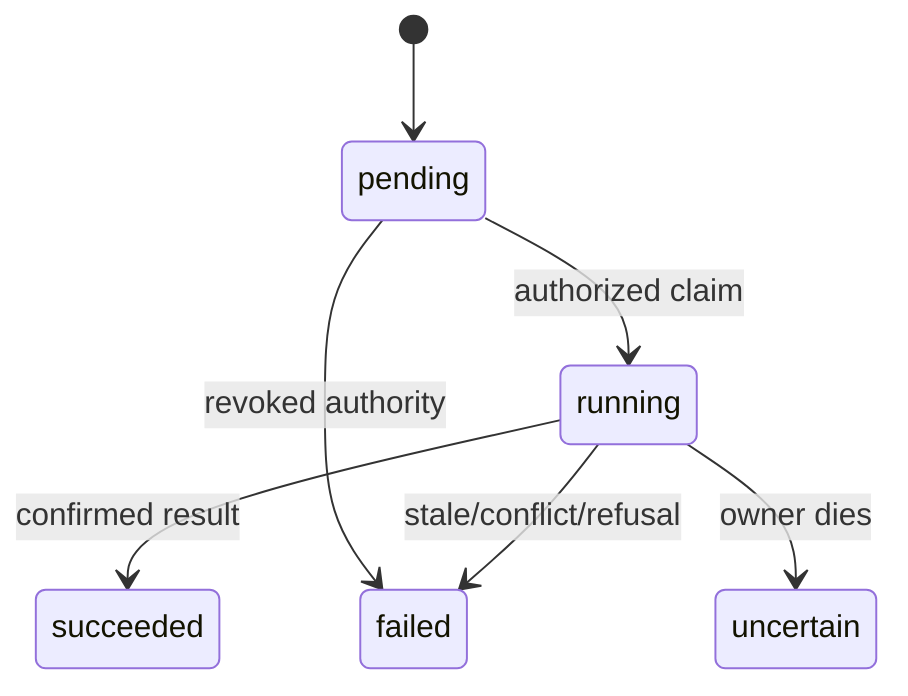

<!--
Copyright (c) 2026 DDP Engineering
This software is licensed under the PolyForm Noncommercial License 1.0.0.
Commercial use requires a separate commercial license.
See the LICENSE.txt file for full license details. SPDX-License-Identifier: LicenseRef-PolyForm-Noncommercial-1.0.0
-->
# TASK-8593afc1 diagrams
Illustrates the journal Design, which is authoritative.

## Structure
Map: app, WebStore, supervisor, environment, profile reads, model cleanup and browser
callers changed; ConfigurationWorker added. Existing run processes are reused.

## Sequence

## State

