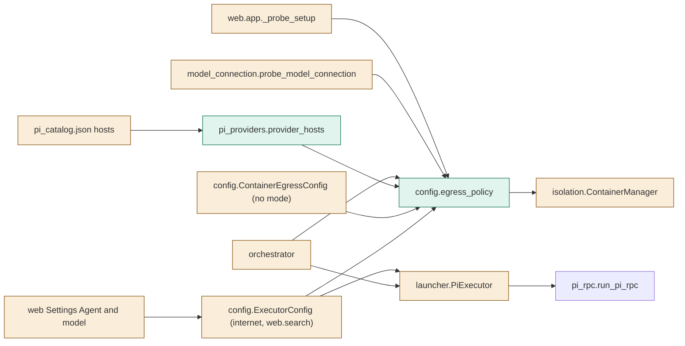
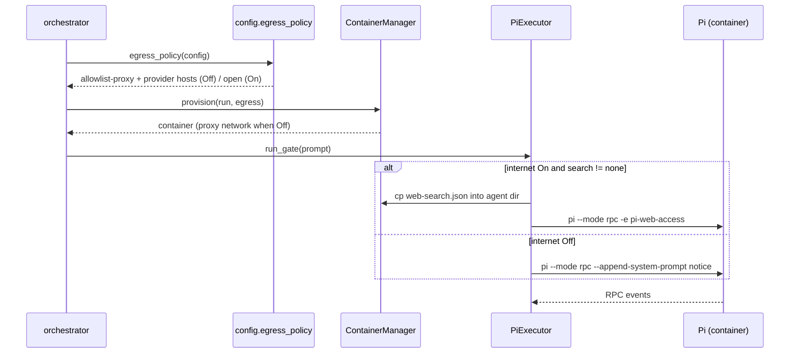

# TASK-898b134c diagrams

Illustrates `## Design` in `TASK-898b134c.md`. The Design text is authoritative.

Node map: added = egress_policy, provider_hosts; changed = ExecutorConfig,
ContainerEgressConfig, pi_catalog, ContainerManager, PiExecutor, orchestrator,
probe_model_connection, probe_setup, Settings; unchanged = pi_rpc.

## Structure

## Sequence

## State

Not drawn: the change adds no lifecycle or status transitions.
