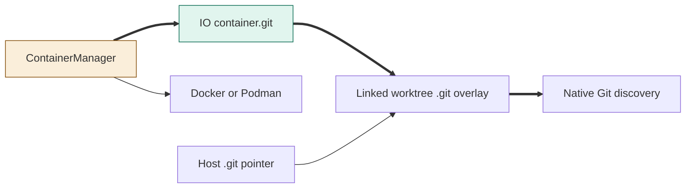
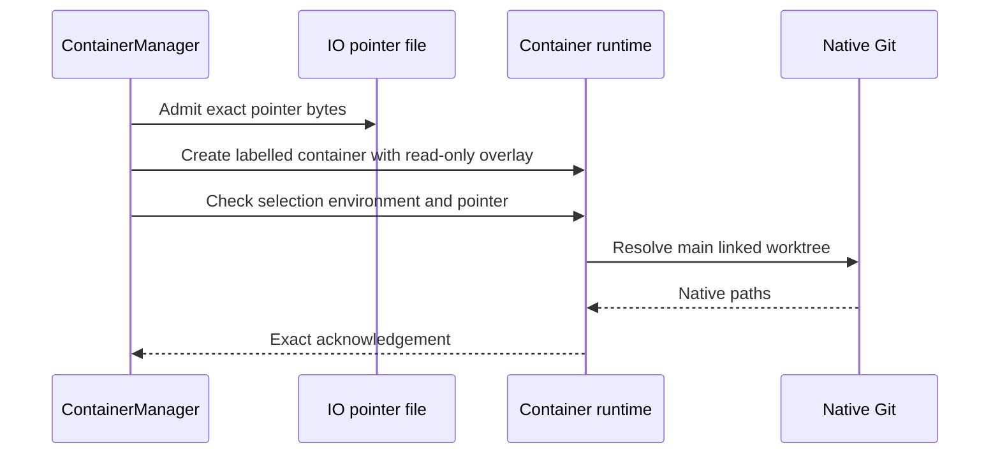
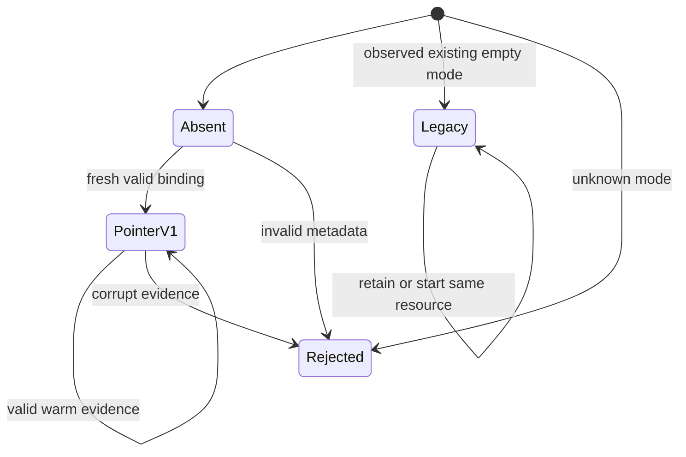

<!--
Copyright (c) 2026 DDP Engineering
This software is licensed under the PolyForm Noncommercial License 1.0.0.
Commercial use requires a separate commercial license.
See the LICENSE.txt file for full license details. SPDX-License-Identifier: LicenseRef-PolyForm-Noncommercial-1.0.0
-->

# TASK-95ab438a diagrams

Illustrates the task journal Design, which is authoritative.

Node map: ContainerManager changed (provision/exec binding responsibility);
container.git added (IO binding data); native Git, host pointer, runtime and
managed linked worktree reused unchanged.

## Structure

## Sequence

## State

