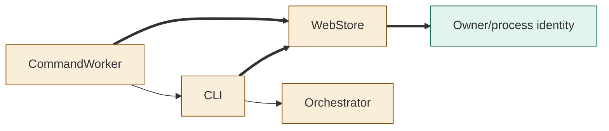
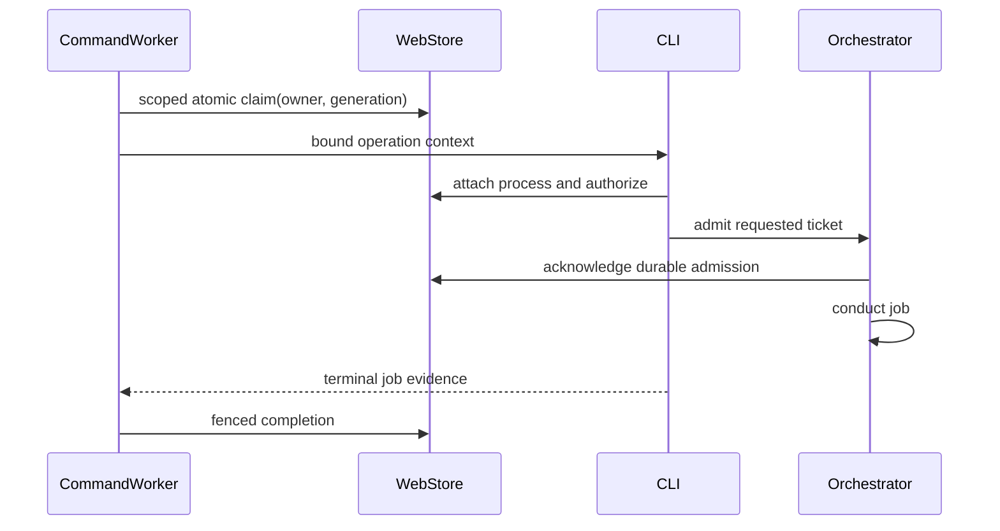
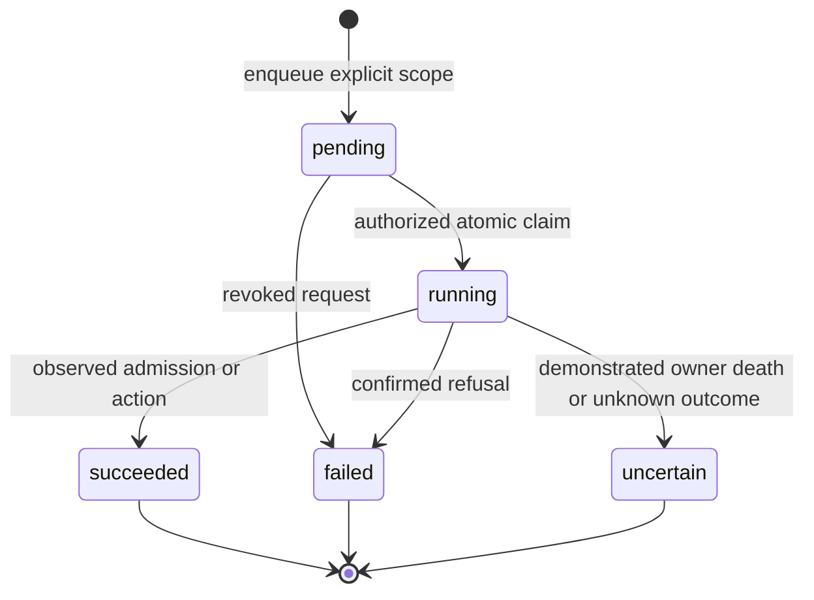

<!--
Copyright (c) 2026 DDP Engineering
This software is licensed under the PolyForm Noncommercial License 1.0.0.
Commercial use requires a separate commercial license.
See the LICENSE.txt file for full license details. SPDX-License-Identifier: LicenseRef-PolyForm-Noncommercial-1.0.0
-->

# TASK-96528d5a diagrams

Illustrates the journal Design. Node map: WebStore, CommandWorker, CLI and Orchestrator changed; Owner/process identity added.

## Structure

## Sequence

## State

