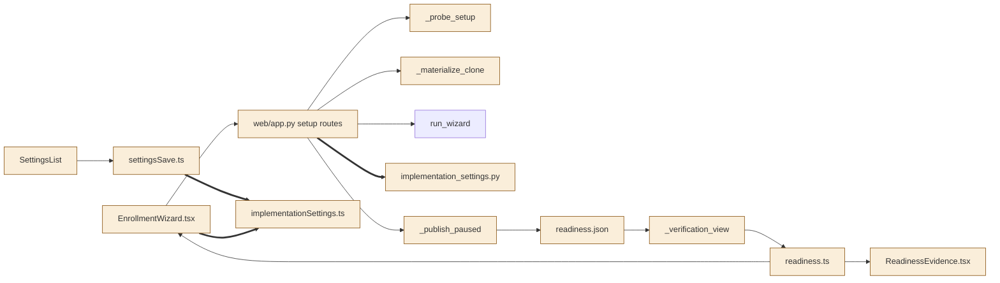
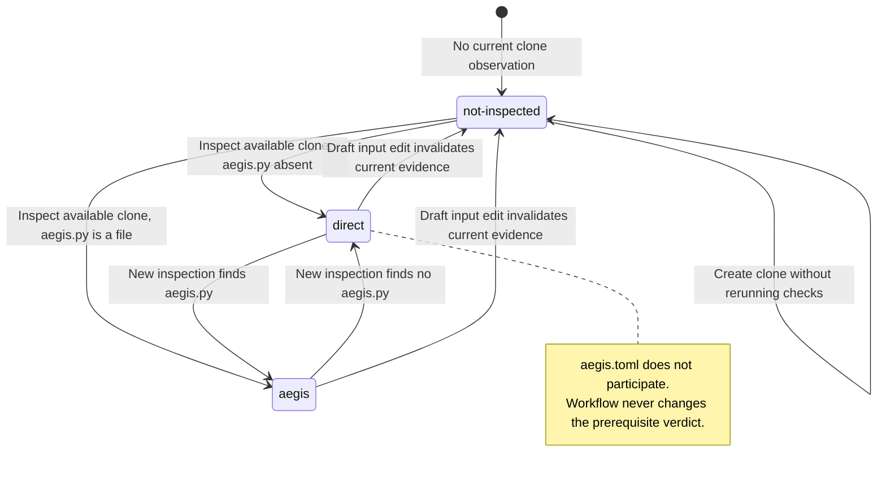

<!--
Copyright (c) 2026 DDP Engineering
This software is licensed under the PolyForm Noncommercial License 1.0.0.
Commercial use requires a separate commercial license.
See the LICENSE.txt file for full license details. SPDX-License-Identifier: LicenseRef-PolyForm-Noncommercial-1.0.0
-->

# TASK-988d986a diagrams

Illustrates `## Design` in `TASK-988d986a.md`. The Design text is authoritative.
All changes below are proposed, not implementation evidence.

## Structure

Node classification from explicit Design decisions:

| Node | Class | Design edit or unchanged responsibility |
|---|---|---|
| EnrollmentWizard.tsx | changed | D3/D5 exact draft, Workflow row and command control/note |
| web/app.py setup routes | changed | D2/D3 required workflow and exact command candidate |
| _probe_setup | changed | D2 read-only workflow separate from prerequisites |
| _materialize_clone | changed | D1 remove only AEGIS eligibility refusal |
| run_wizard | unchanged | Existing prepare-only assembly |
| implementation_settings.py | changed | D3/D4 dedicated exact-string validation/setter |
| _publish_paused | changed | D2 retain measured workflow in readiness record |
| readiness.json | changed | D2 schema 3 with independent workflow field |
| _verification_view | changed | D2 strict current shape/readiness projection |
| readiness.ts | changed | D2/D5 closed enum/check/verdict validation |
| ReadinessEvidence.tsx | changed | D5 neutral Workflow information |
| SettingsList | changed | D4/D5 command text control and localized refusal |
| settingsSave.ts | changed | D5 invalid command blocks reviewed Save |
| implementationSettings.ts | changed | D5 shared pure command-domain validator |

Existing call/data edges stay unchanged even when their payload gains a field.
Added edges denote new calls to the command-domain/setter machinery. No component
is removed; the removed gate/copy is internal to changed nodes, not a new node.



## Sequence

Primary pending-clone enrollment followed by explicit inspection. Existing
reviewed configuration and stopped publication boundaries are retained.

```mermaid
sequenceDiagram
    actor Admin
    participant Wizard as EnrollmentWizard.tsx
    participant API as web/app.py
    participant Prepare as run_wizard
    participant Clone as clone_repository
    participant Store as ProfileStore
    Admin->>Wizard: Enter repository and optional command
    Wizard->>API: setup-preview (strict exact string)
    API->>Prepare: prepare_only (no new CLI question)
    Prepare-->>API: WizardSetup document
    Note over API: Insert exact TOML command, validate and hash
    API-->>Wizard: Canonical review + workflow not-inspected
    Admin->>Wizard: Explicit prerequisite check
    Wizard->>API: setup-check (reviewed revision)
    Note over API: Existing bounded host probes; file observation only for workflow
    API-->>Wizard: Prerequisites + not-inspected + bound token
    Admin->>Wizard: Confirm reviewed creation
    Wizard->>API: setup-create (revision + token)
    API->>Clone: Materialize pending clone; validate target branch
    Clone-->>API: Owned clone, no enrollment-added files
    API->>Store: Publish stopped profile and unchanged measured evidence
    Store-->>API: Created project
    API-->>Wizard: Stopped project; workflow evidence still not-inspected
    Admin->>API: Explicit project readiness-check
    Note over API: Read aegis.py presence; never execute it
    API->>Store: Save current checks and observed workflow, schema 3
    API-->>Admin: AEGIS or Direct Workflow information; independent verdict
```

## State

This is the workflow observation state, not a run lifecycle or readiness verdict.
Invalid input is refused before entering this domain; no version is certified.


