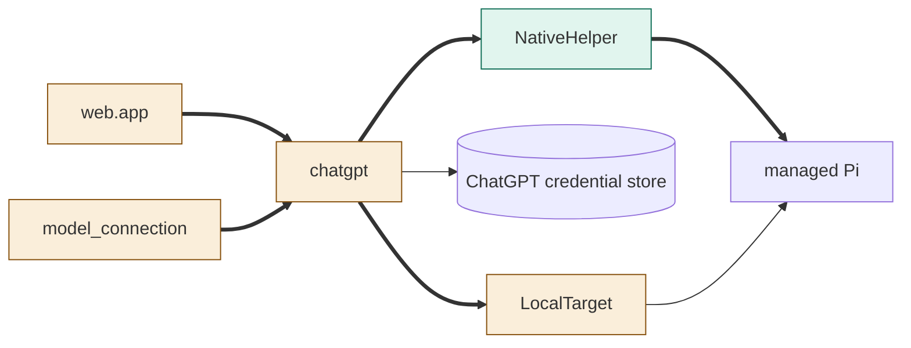
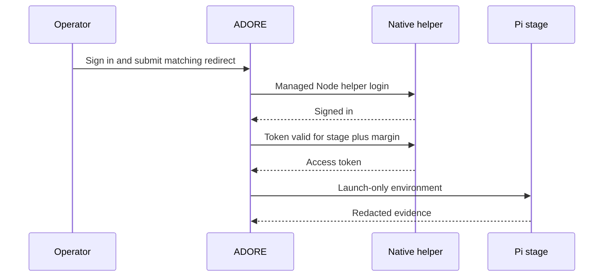

<!--
Copyright (c) 2026 DDP Engineering
This software is licensed under the PolyForm Noncommercial License 1.0.0.
Commercial use requires a separate commercial license.
See the LICENSE.txt file for full license details. SPDX-License-Identifier: LicenseRef-PolyForm-Noncommercial-1.0.0
-->

# TASK-9bfd8e6a diagrams

## Structure

Map: NativeHelper added; chatgpt, LocalTarget, model_connection and app changed; managed Pi and credential store reused.

## Sequence

## State

Not drawn: existing sign-in states and transitions are reused unchanged.
