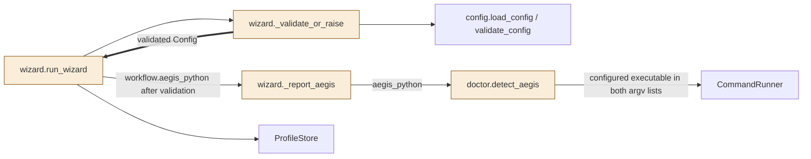

<!--
Copyright (c) 2026 DDP Engineering
This software is licensed under the PolyForm Noncommercial License 1.0.0.
Commercial use requires a separate commercial license.
See the LICENSE.txt file for full license details. SPDX-License-Identifier: LicenseRef-PolyForm-Noncommercial-1.0.0
-->

# TASK-a012d35b diagrams

Illustrates `## Design` in `TASK-a012d35b.md`. The Design text is authoritative.

## Structure

Node classification from Design: run_wizard, _validate_or_raise, _report_aegis
and detect_aegis are changed; load_config/validate_config, CommandRunner and
ProfileStore are reused unchanged. No added or removed nodes.
Existing call edges are unchanged; the added edge carries the validated
configuration returned to run_wizard. Existing report/probe edges carry the
new interpreter argument; their call relationship remains unchanged.



## Sequence

Primary CLI path with an existing payload and supported version; other host
probes remain unchanged and are omitted. Prepare-only returns before the
clone report. Not-ready responses remain informational.

```mermaid
sequenceDiagram
    participant wizard as wizard.run_wizard
    participant validator as wizard._validate_or_raise
    participant report as wizard._report_aegis
    participant doctor as doctor.detect_aegis
    participant runner as CommandRunner
    participant store as ProfileStore
    wizard->>validator: confirmed candidate document
    Note over validator: Load and validate Config; remove temporary file
    validator-->>wizard: validated Config
    wizard->>report: repo_path, config.workflow.aegis_python
    report->>doctor: repo_path, runner, aegis_python
    doctor->>runner: [aegis_python, wrapper, --version], cwd=root
    runner-->>doctor: supported version
    doctor->>runner: [aegis_python, wrapper, status, --all, --json], cwd=root
    runner-->>doctor: status output
    doctor-->>report: AegisStatus
    Note over report: Print OK or CHECK/detail/guidance; existing gitignore/push checks
    report-->>wizard: informational report completed
    wizard->>store: persist valid profile regardless of readiness
```

## State

Not drawn: no lifecycle, status field or state transition changes; existing
AegisStatus acceptance and failure states are preserved.
