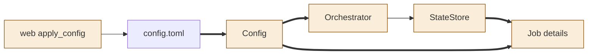
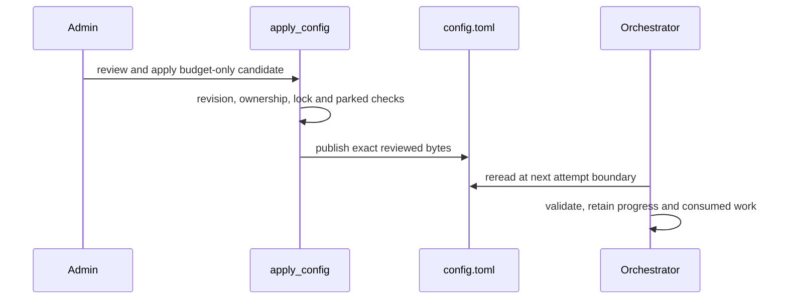
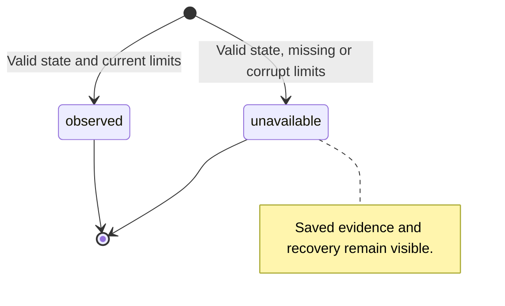

<!--
Copyright (c) 2026 DDP Engineering
This software is licensed under the PolyForm Noncommercial License 1.0.0.
Commercial use requires a separate commercial license.
See the LICENSE.txt file for full license details. SPDX-License-Identifier: LicenseRef-PolyForm-Noncommercial-1.0.0
-->

# TASK-a70e310f diagrams

Illustrates the journal Design, which is authoritative.

## Structure

Map: Config, Orchestrator, StateStore, web apply and Job details changed; config file reused unchanged.

## Sequence

## State

Per-detail budget classification; the run lifecycle is unchanged.

