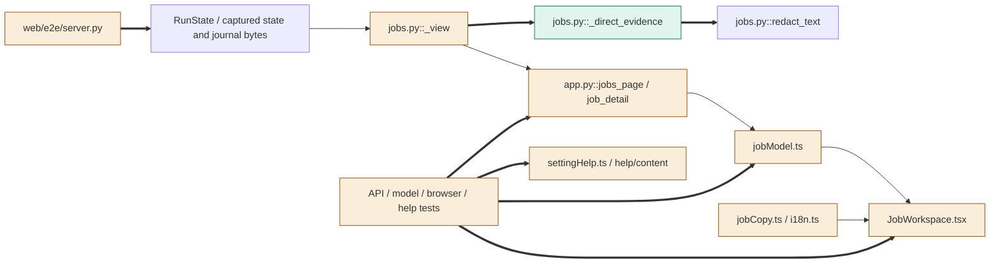
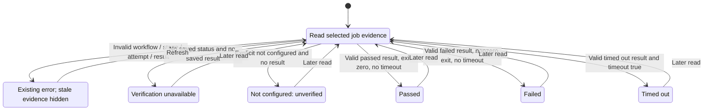

<!--
Copyright (c) 2026 DDP Engineering
This software is licensed under the PolyForm Noncommercial License 1.0.0.
Commercial use requires a separate commercial license.
See the LICENSE.txt file for full license details. SPDX-License-Identifier: LicenseRef-PolyForm-Noncommercial-1.0.0
-->

# TASK-aad00a23 diagrams

Illustrates `## Design` in `TASK-aad00a23.md`. The Design text is authoritative.
All statuses below describe read-only presentation, not run lifecycle transitions.

## Structure

Classification map from the Design:

| Searchable node | Class | Design edit |
|---|---|---|
| `RunState`, captured state/journal bytes | unchanged | Existing source owner and snapshot inputs, D2/D4. |
| `jobs.py::_view` | changed | Build validated direct projection from captured sources, D2–D4. |
| `jobs.py::_direct_evidence` | added | Local attempt/result validator and redacted projector, D2/D3. |
| `jobs.py::redact_text` | unchanged | Reused credential masking without changing its contract, D3. |
| `app.py::jobs_page / job_detail` | changed | Strip direct from list only; preserve detail route flow, D2/D3. |
| `jobModel.ts` | changed | Required workflow and strict direct transport reader, D1/D5. |
| `JobWorkspace.tsx` | changed | Workflow/evidence display, stage context and error gating, D5/D6. |
| `jobCopy.ts / i18n.ts` | changed | Workflow/stage/result and direct-only guidance copy, D6/D7. |
| `settingHelp.ts / help/content` | changed | Four-locale direct evidence/limit guidance, D7. |
| `web/e2e/server.py` | changed | Opt-in persisted direct fixture mode, D6 test seam. |
| Existing API/model/browser/help tests | changed | Direct controls and corruption proof, D1–D7. |

Edges: captured bytes → `_view`, `_view` → routes → reader → workspace and copy →
workspace are reused existing flows (thin arrows). Calls to the new direct helper
and its use of existing credential masking are new connections (thick arrows).
Existing `redact_text` responsibility is unchanged and is deliberately unstyled.



## Sequence

D1–D6 primary detail read; the list uses the same validation but strips direct
and timeline from output. The existing final source and grant/profile checks
remain authoritative; invalid sources never return a partial detail.

```mermaid
sequenceDiagram
    participant Browser as "JobWorkspace / jobModel"
    participant API as "app.py::job_detail"
    participant Jobs as "jobs.py::read_jobs / _view"
    participant Sources as "authorized captured sources"
    Browser->>API: GET composite project/run detail
    API->>API: Resolve authorized project before IO
    API->>Jobs: Read selected project snapshot
    Jobs->>Sources: Capture state, ticket, journal bytes
    Sources-->>Jobs: Saved workflow, launch attempts, latest verification
    Jobs->>Jobs: _direct_evidence validates and redacts saved data
    Jobs->>Sources: Reinspect captured inventory/bytes
    Sources-->>Jobs: Unchanged or source conflict
    alt Invalid evidence or changed source
        Jobs-->>API: Existing typed secret-free read error
        API-->>Browser: Existing 503 or 409 envelope
        Browser->>Browser: Hide affected evidence; show read error
    else Valid unchanged sources
        Jobs-->>API: Validated rows and optimistic revision
        API->>API: Existing budget projection and grant/profile reinspection
        API-->>Browser: Detail with direct object only for direct job
        Browser->>Browser: Validate workflow, stages, closed direct transport
        Browser->>Browser: Show attempt, command, outcome, seconds, inert tail
    end
```

## State

D3/D5 read-result selection only. These arrows do not execute a command, mark a
workflow step complete, approve a candidate or change the saved run. Later reads
may select a different retained result using the existing refresh machinery.


