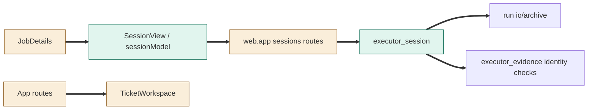
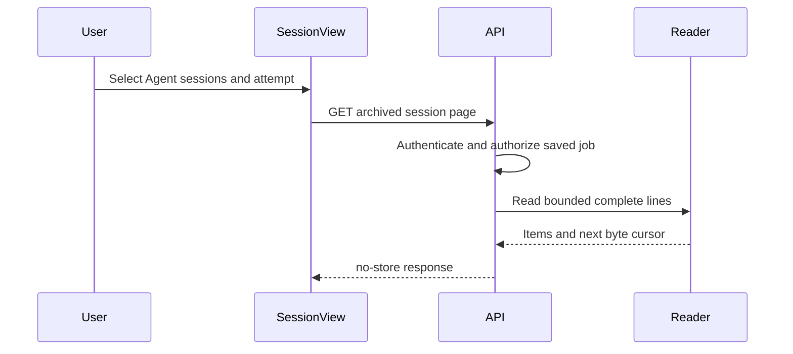

<!--
Copyright (c) 2026 DDP Engineering
This software is licensed under the PolyForm Noncommercial License 1.0.0.
Commercial use requires a separate commercial license.
See the LICENSE.txt file for full license details. SPDX-License-Identifier: LicenseRef-PolyForm-Noncommercial-1.0.0
-->
# TASK-ae44ba07 diagrams

Illustrates the journal Design; Design is authoritative.

## Structure

Map: App/JobDetails/TicketWorkspace/app routes changed; executor_session/sessionModel/SessionView added; archives and executor_evidence identity guard reused unchanged.

## Sequence

## State

Not drawn: no product lifecycle or stored status transition changes.
