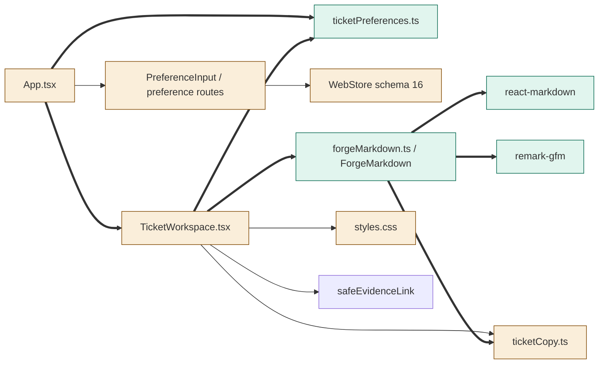
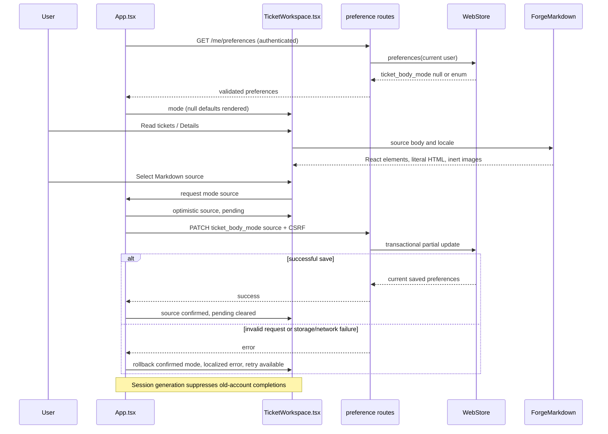
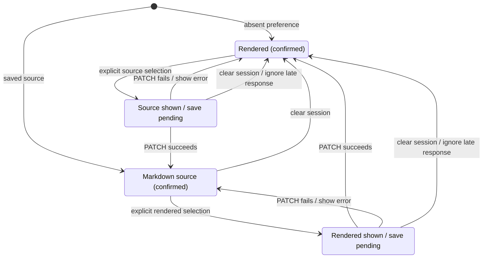

<!--
Copyright (c) 2026 DDP Engineering
This software is licensed under the PolyForm Noncommercial License 1.0.0.
Commercial use requires a separate commercial license.
See the LICENSE.txt file for full license details. SPDX-License-Identifier: LicenseRef-PolyForm-Noncommercial-1.0.0
-->

# TASK-c1c02298 diagrams

Illustrates `## Design` in `TASK-c1c02298.md`. The Design text is authoritative.

## Structure

Node classification from Design: `App.tsx`, `TicketWorkspace.tsx`, `ticketCopy.ts`,
`styles.css`, `PreferenceInput`/preference routes and `WebStore` are changed;
`forgeMarkdown.ts`, `ticketPreferences.ts`, `react-markdown` and `remark-gfm`
are added. `safeEvidenceLink` is reused unchanged. No nodes are removed.
New mode/renderer/library edges are added; the existing preference API/store
path, ticket copy/style connections and metadata safe-link call remain unchanged.

## Sequence

## State

