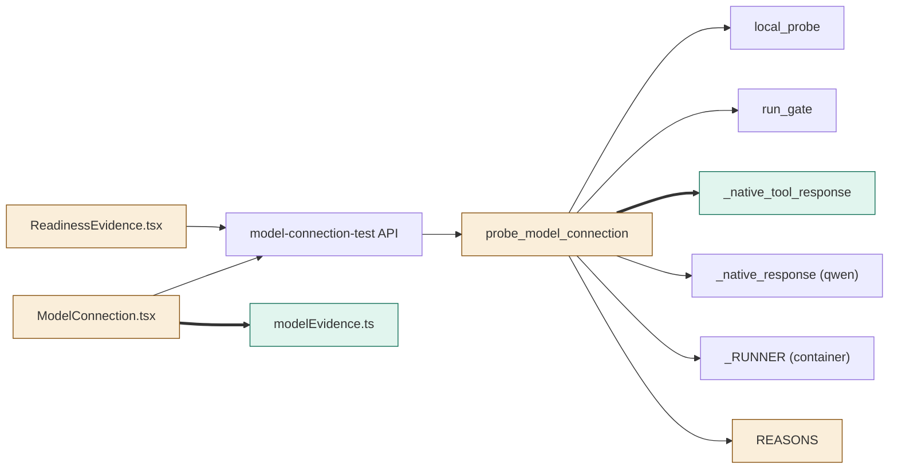
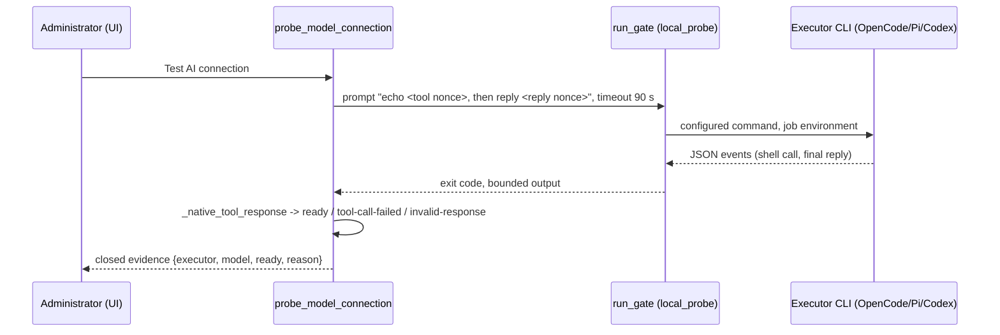

# TASK-c6b3c54f diagrams

Illustrates `## Design` in `TASK-c6b3c54f.md`. The Design text is authoritative.

Node map: added = `_native_tool_response`, `modelEvidence.ts`; changed =
`probe_model_connection` (local branch), `REASONS`, `ModelConnection.tsx`,
`ReadinessEvidence.tsx`; unchanged = `_native_response`, `local_probe`, `run_gate`,
`_RUNNER (container)`, `model-connection-test API`.

## Structure

## Sequence

## State

Not drawn: the design adds no lifecycle or state transition.
