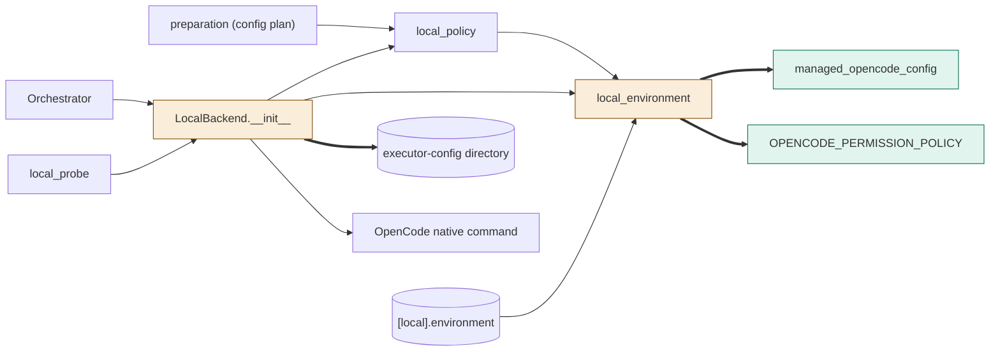
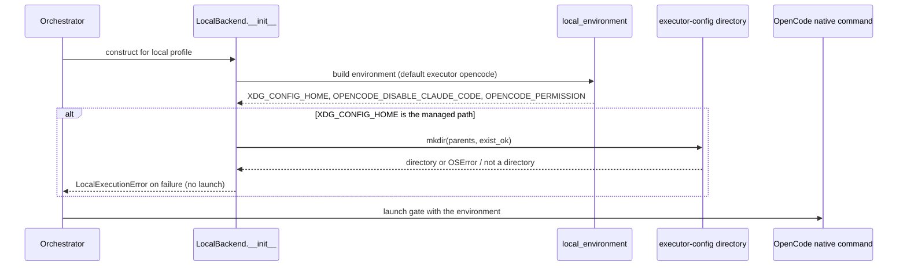

# TASK-c9a9e72d diagrams

Illustrates `## Design` in `TASK-c9a9e72d.md`. The Design text is authoritative.

Node map: added = `OPENCODE_PERMISSION_POLICY`, `managed_opencode_config`;
changed = `local_environment`, `LocalBackend.__init__`; unchanged = `local_policy`,
`preparation (config plan)`, `Orchestrator`, `local_probe`, `[local].environment`,
`OpenCode native command`, `executor-config directory` (filesystem, created at run time).

## Structure

## Sequence

## State

Not drawn: the design adds no lifecycle, status field or state transition.
