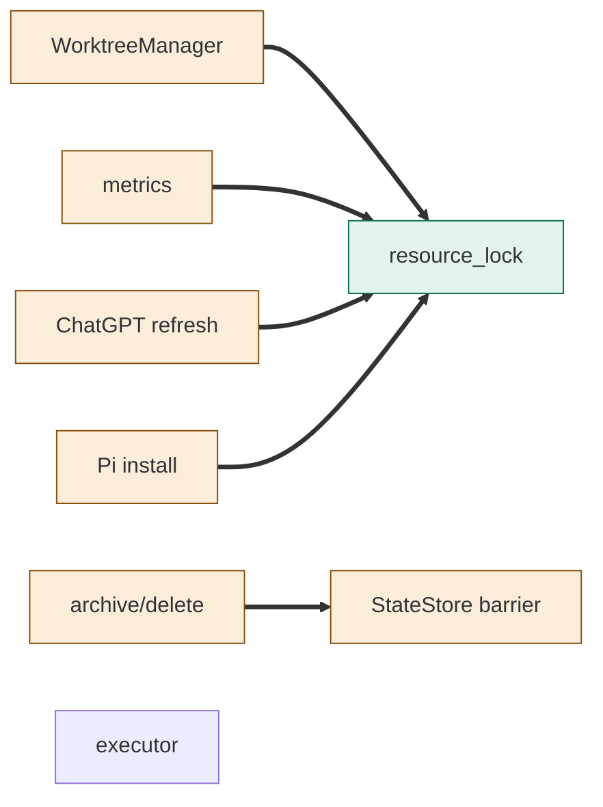
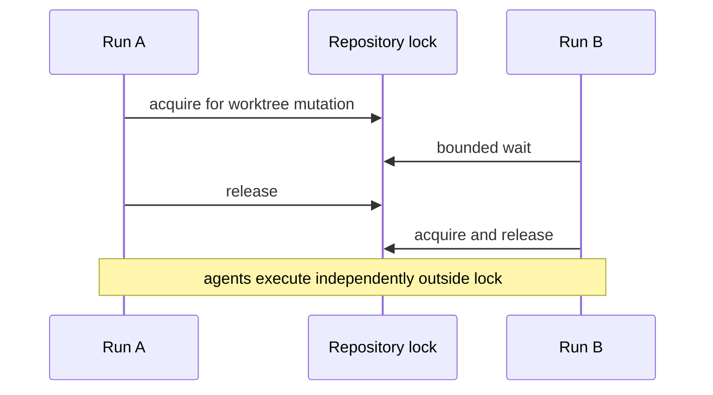

<!--
Copyright (c) 2026 DDP Engineering
This software is licensed under the PolyForm Noncommercial License 1.0.0.
Commercial use requires a separate commercial license.
See the LICENSE.txt file for full license details. SPDX-License-Identifier: LicenseRef-PolyForm-Noncommercial-1.0.0
-->

# TASK-cadbef92 diagrams

## Structure

Map: resource_lock added; WorktreeManager, metrics, ChatGPT refresh, Pi install,
StateStore and archive/delete changed; executor reused unchanged.

## Sequence

## State

Not drawn: no lifecycle or status transition is added.
