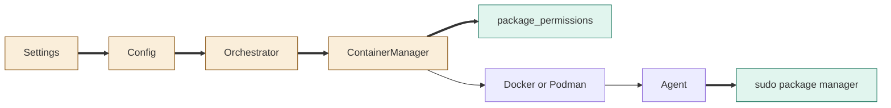
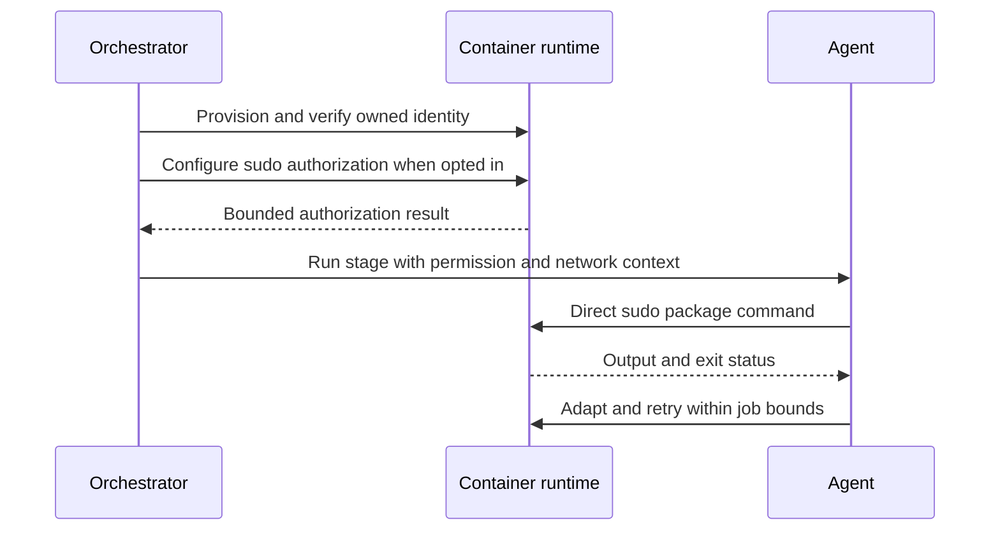

<!--
Copyright (c) 2026 DDP Engineering
This software is licensed under the PolyForm Noncommercial License 1.0.0.
Commercial use requires a separate commercial license.
See the LICENSE.txt file for full license details. SPDX-License-Identifier: LicenseRef-PolyForm-Noncommercial-1.0.0
-->

# TASK-d360af13 diagrams

Illustrates Design in TASK-d360af13.md. Changed nodes: Config, Orchestrator, ContainerManager, Settings. Added node: package_permissions. Agent and runtime are reused unchanged.

## Structure

## Sequence

## State

Not drawn: existing job lifecycle and recipe statuses are retained.
