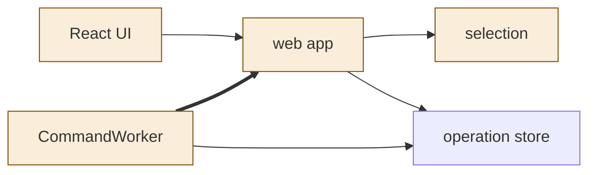
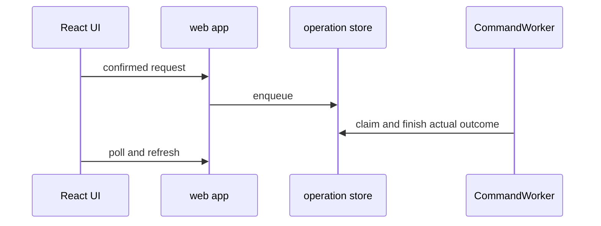

<!--
Copyright (c) 2026 DDP Engineering
This software is licensed under the PolyForm Noncommercial License 1.0.0.
Commercial use requires a separate commercial license.
See the LICENSE.txt file for full license details. SPDX-License-Identifier: LicenseRef-PolyForm-Noncommercial-1.0.0
-->
# TASK-d7bb41ca diagrams

Illustrates the journal Design. Node map: UI, API, selection and worker changed; operation store reused.

## Structure

## Sequence

## State
Not drawn: operation lifecycle remains unchanged; activity is transient evidence.
