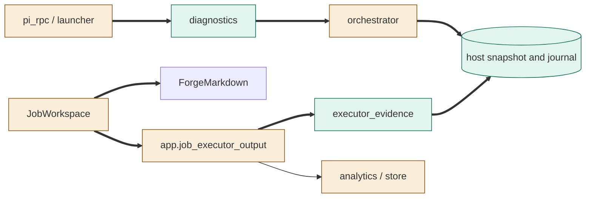
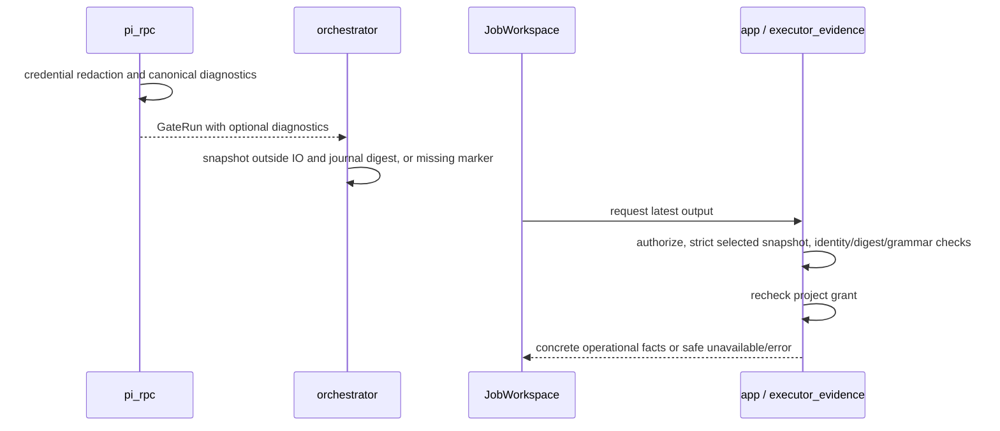

<!--
Copyright (c) 2026 DDP Engineering
This software is licensed under the PolyForm Noncommercial License 1.0.0.
Commercial use requires a separate commercial license.
See the LICENSE.txt file for full license details. SPDX-License-Identifier: LicenseRef-PolyForm-Noncommercial-1.0.0
-->

# TASK-da797a08 diagrams

Illustrates Design in TASK-da797a08.md. Design is authoritative.

## Structure

Map: JobWorkspace, app, analytics/store, Pi RPC/launcher and orchestrator changed; diagnostics, executor_evidence and the host snapshot added; ForgeMarkdown reused unchanged.

## Sequence

## State

Not drawn: lifecycle and stage transitions remain unchanged.
