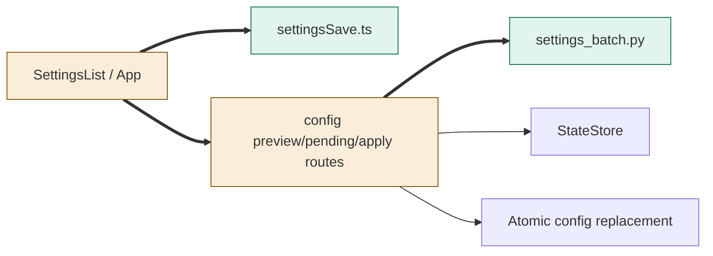
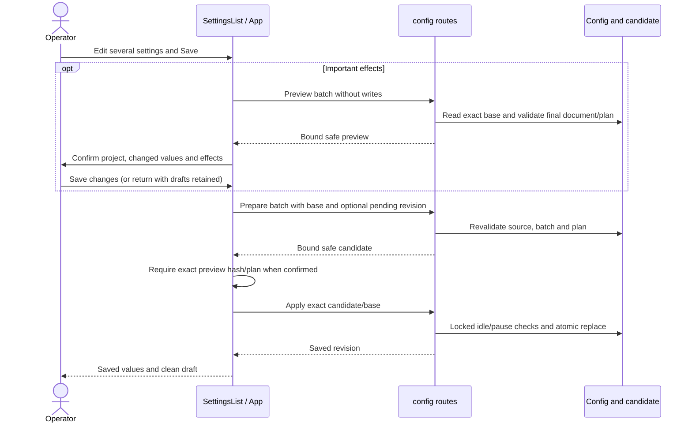
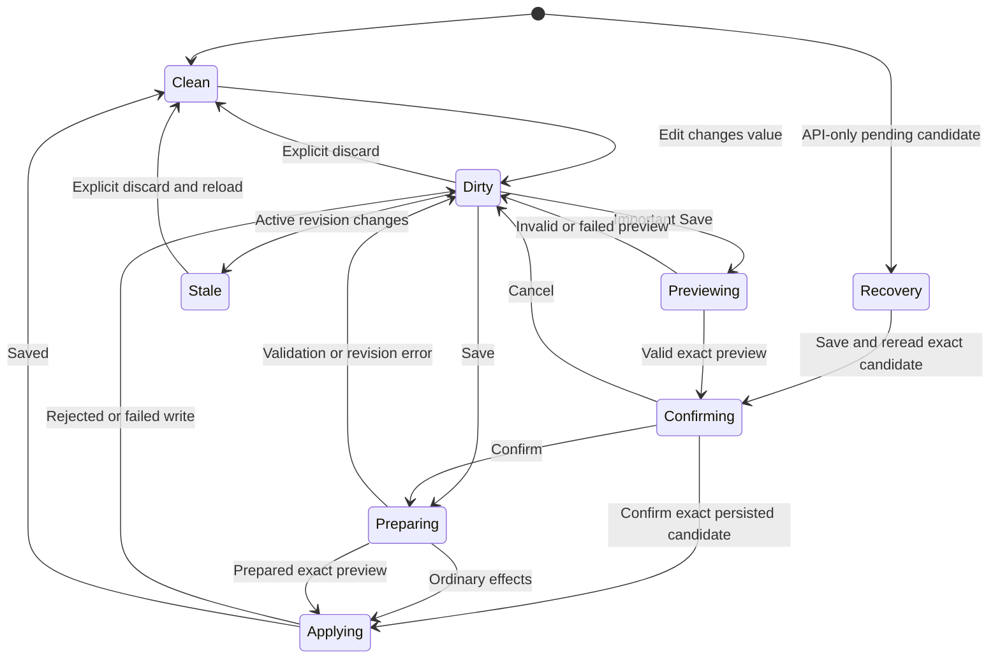

<!--
Copyright (c) 2026 DDP Engineering
This software is licensed under the PolyForm Noncommercial License 1.0.0.
Commercial use requires a separate commercial license.
See the LICENSE.txt file for full license details. SPDX-License-Identifier: LicenseRef-PolyForm-Noncommercial-1.0.0
-->
# TASK-e3102c4d diagrams

Illustrates Design in TASK-e3102c4d.md. Node map: SettingsList/App and config routes changed; settingsSave.ts/settings_batch.py added; StateStore and atomic file replacement reused unchanged.

## Structure

## Sequence

## State

