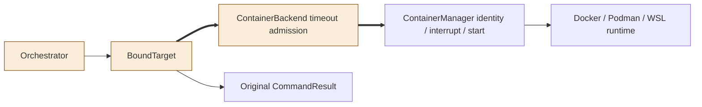
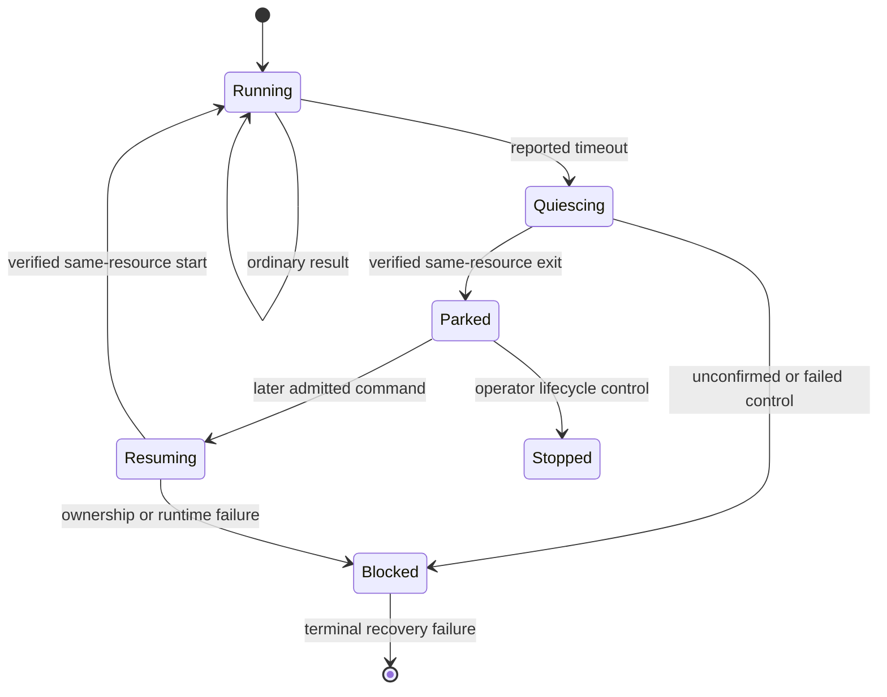

<!--
Copyright (c) 2026 DDP Engineering
This software is licensed under the PolyForm Noncommercial License 1.0.0.
Commercial use requires a separate commercial license.
See the LICENSE.txt file for full license details. SPDX-License-Identifier: LicenseRef-PolyForm-Noncommercial-1.0.0
-->

# TASK-f6de6c0b diagrams

Illustrates Design in TASK-f6de6c0b.md; the Design text is authoritative.
Node map: BoundTarget, ContainerBackend and Orchestrator are changed;
ContainerManager, runtime and original CommandResult are reused unchanged.

## Structure



## Sequence

```mermaid
sequenceDiagram
    participant C as Orchestrator
    participant B as BoundTarget
    participant E as ContainerBackend
    participant R as ContainerManager / runtime
    C->>B: command and deadline
    B->>R: verify running identity; execute immutable ID
    R-->>B: original timed-out result
    B->>E: settle timeout for captured identity
    E->>R: verify; interrupt exact ID; verify exited
    E-->>B: retain pending resume
    B-->>C: original timed-out result unchanged
    C->>B: later admitted command
    B->>E: resume pending original resource
    E->>R: verify exited; start same ID; verify running
    E-->>B: verified running identity
    B->>R: execute command on immutable ID
```

## State


