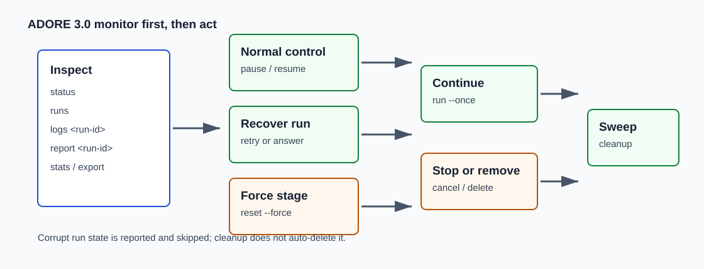

<!--
Copyright (c) 2026 DDP Engineering
This software is licensed under the PolyForm Noncommercial License 1.0.0.
Commercial use requires a separate commercial license.
See the LICENSE.txt file for full license details. SPDX-License-Identifier: LicenseRef-PolyForm-Noncommercial-1.0.0
-->

# Failure Recovery And Cleanup

Applies to ADOR 0.5.1.

Use this when a run is parked, failed, no longer wanted, or has left resources
behind after a crash, close, merge, or interrupted host session.



## First Triage

Start with read-only state:

```powershell
.\.venv\Scripts\ador.exe --profile <profile-name> status
.\.venv\Scripts\ador.exe --profile <profile-name> runs
.\.venv\Scripts\ador.exe --profile <profile-name> logs <run-id>
```

```bash
./.venv/bin/ador --profile <profile-name> status
./.venv/bin/ador --profile <profile-name> runs
./.venv/bin/ador --profile <profile-name> logs <run-id>
```

Then choose the smallest action that matches the state.

## Clarification Park

When ADOR needs human input, it parks the run and writes a question to the
ticket. The worktree and state remain available for resume.

To resume:

1. Answer in a normal human comment.
2. Add `agent-answered` if the project uses label signaling.
3. Run one supervised poll.

```powershell
.\.venv\Scripts\ador.exe --profile <profile-name> run --once
```

```bash
./.venv/bin/ador --profile <profile-name> run --once
```

If no answer arrives before the configured timeout, ADOR escalates the run to
the configured terminal state, normally `failed`.

## Recovery Commands

| Situation | Command | Effect |
| --- | --- | --- |
| Failed run should continue from stored stage. | `ador retry <run-id>` | Re-arms retry flow without repeating completed gates. |
| Run should stop gracefully. | `ador cancel <run-id>` | Cancels the run and updates state. |
| Run must restart from a specific gate. | `ador reset <run-id> --to <stage> --force` | Moves the stage pointer, then requires `retry`. |
| Run state is no longer needed. | `ador delete <run-id> --force` | Irrecoverably removes run state. |
| Stale locks, containers, or worktrees may remain. | `ador cleanup` | Sweeps resources that no active valid run owns. |

Windows examples:

```powershell
.\.venv\Scripts\ador.exe --profile <profile-name> retry <run-id>
.\.venv\Scripts\ador.exe --profile <profile-name> reset <run-id> --to verify --force
.\.venv\Scripts\ador.exe --profile <profile-name> cleanup
```

Linux examples:

```bash
./.venv/bin/ador --profile <profile-name> retry <run-id>
./.venv/bin/ador --profile <profile-name> reset <run-id> --to verify --force
./.venv/bin/ador --profile <profile-name> cleanup
```

## Reset Guardrail

`reset` is intentionally force-gated because it can re-run work, spend model
budget, and churn ticket comments. After reset, ADOR tells you to run:

```text
ador retry <run-id>
```

Use reset only when the stored stage is wrong or the operator deliberately wants
to re-run a gate.

## Cleanup Safety

`ador cleanup` removes stale locks and orphaned containers or worktrees that are
terminal or unknown. It reports corrupt run state but does not auto-delete it.

If cleanup reports corrupt runs:

1. Inspect the run folder and journal manually.
2. Confirm no active process owns it.
3. Use `ador delete <run-id> --force` only when removal is intentional.

## Human Merge Boundary

ADOR may open a draft MR/PR, but it must not merge. After human review:

- If changes are needed, apply the configured revise trigger, normally
  `agent-revise`.
- If the MR/PR is accepted, the human merges it.
- After merge or close, run `ador cleanup` to verify no resources remain.

