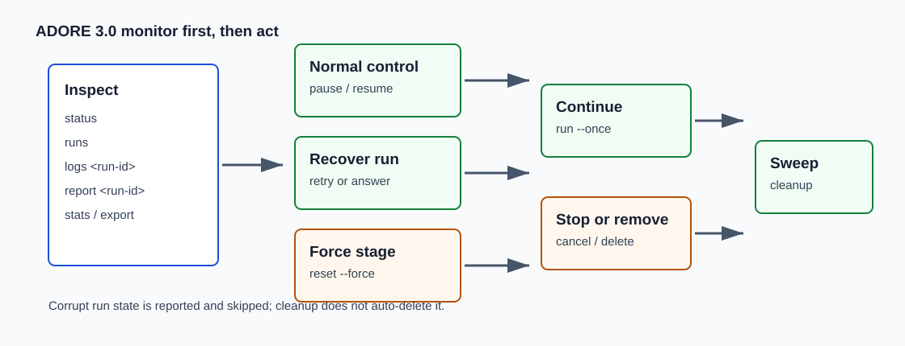

<!--
Copyright (c) 2026 DDP Engineering
This software is licensed under the PolyForm Noncommercial License 1.0.0.
Commercial use requires a separate commercial license.
See the LICENSE.txt file for full license details. SPDX-License-Identifier: LicenseRef-PolyForm-Noncommercial-1.0.0
-->

# Monitoring And Steering

Applies to ADORE 0.13.0 and its AEGIS schema-1 contract.

Use this when ADORE is running, you need to understand its current state, or you
need to pause and resume ticket pickup safely.



## First Three Commands

```powershell
.\.venv\Scripts\adore.exe --profile <profile-name> status
.\.venv\Scripts\adore.exe --profile <profile-name> runs
.\.venv\Scripts\adore.exe --profile <profile-name> logs <run-id>
```

```bash
./.venv/bin/adore --profile <profile-name> status
./.venv/bin/adore --profile <profile-name> runs
./.venv/bin/adore --profile <profile-name> logs <run-id>
```

| Command | Use it for |
| --- | --- |
| `status` | Config health, store path, pause flag, lock state, and run counts. |
| `runs` | Run id, ticket id, stage, lifecycle, and last update time. |
| `logs <run-id>` | Per-run journal events with structured details. |

If `status` reports corrupt run state, ADORE skips it. Inspect it manually before
deleting anything.

### An unchanged stage can still be progressing

Look for `stage-continuation` in `logs <run-id>`. It records a successful partial
session with actual candidate changes and appended work evidence. ADORE keeps
`working`, checkpoints locally and launches a fresh session at the same stage.
No manual retry is needed. These sessions preserve failure counts but consume
run budgets. `NO_STAGE_PROGRESS` is a failed attempt; `WORKTREE_PROGRESS` means
ADORE could not reliably observe the worktree. See
[Recovery and Maintenance](../Recovery_And_Maintenance.md).

## Pause And Resume

Pause stops new ticket pickup. It does not kill in-flight runs.

```powershell
.\.venv\Scripts\adore.exe --profile <profile-name> pause
.\.venv\Scripts\adore.exe --profile <profile-name> resume
```

```bash
./.venv/bin/adore --profile <profile-name> pause
./.venv/bin/adore --profile <profile-name> resume
```

Use pause before maintenance windows, label cleanups, profile edits, or human
triage. Resume only after `config validate` is clean.

## Metrics Commands

```powershell
.\.venv\Scripts\adore.exe --profile <profile-name> stats
.\.venv\Scripts\adore.exe --profile <profile-name> stats --by priority
.\.venv\Scripts\adore.exe --profile <profile-name> stats --html
.\.venv\Scripts\adore.exe --profile <profile-name> report <run-id>
.\.venv\Scripts\adore.exe --profile <profile-name> export --csv
```

```bash
./.venv/bin/adore --profile <profile-name> stats
./.venv/bin/adore --profile <profile-name> stats --by outcome
./.venv/bin/adore --profile <profile-name> stats --html
./.venv/bin/adore --profile <profile-name> report <run-id>
./.venv/bin/adore --profile <profile-name> export --csv
```

| Command | Output |
| --- | --- |
| `stats` | Aggregated runs, outcomes, span, launches, tokens, and cost. |
| `stats --since 30d` | Same summary over a time window. |
| `stats --by priority` | Grouped by priority. |
| `stats --by outcome` | Grouped by outcome. |
| `stats --html` | Self-contained static dashboard at configured `html_out`. |
| `report <run-id>` | JSON summary for one run, including governance outcome. |
| `export --csv` | CSV for external reporting, including governance outcome. |

Treat the AEGIS strict-check outcome (`ok` or `failed`) separately from the
ADORE lifecycle outcome. Both remain visible in journals, reports, exports,
ticket comments, and draft MR/PRs.

If metrics were added after older terminal runs, rebuild summaries once:

```powershell
.\.venv\Scripts\adore.exe --profile <profile-name> stats --rebuild
```

```bash
./.venv/bin/adore --profile <profile-name> stats --rebuild
```

## Safe Operating Modes

| Mode | Command | When to use |
| --- | --- | --- |
| Dry run | `adore run --dry-run` | Before the first real pickup or after config edits. |
| One poll | `adore run --once` | Supervised validation and scheduled polling. |
| Loop | `adore run --loop` | Service-style operation after validation. |

For a new project, keep using `--once` until ticket labels, images, credentials,
and MR/PR delivery have all been proven.

One default is worth a deliberate decision on a new profile: `[review]
on_pipeline_failure` is `revise`, so a newly failed pipeline on a published
draft starts a repair round without anyone asking. It stays bounded by
`max_review_rounds` and still ends at a fresh human approval before any push,
but if you would rather be asked first while proving a project, set it to
`notify`.
