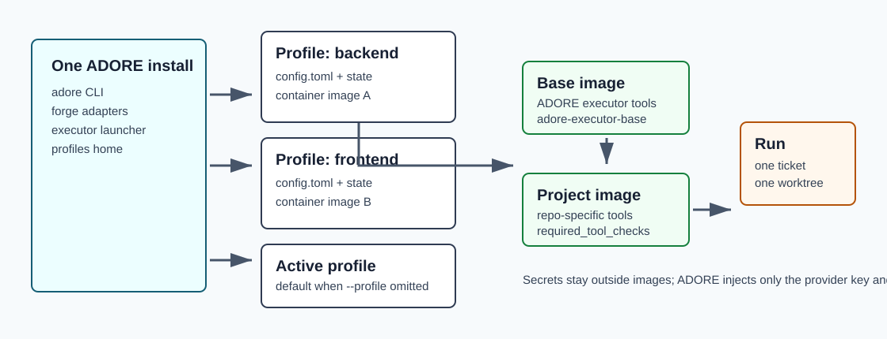

<!--
Copyright (c) 2026 DDP Engineering
This software is licensed under the PolyForm Noncommercial License 1.0.0.
Commercial use requires a separate commercial license.
See the LICENSE.txt file for full license details. SPDX-License-Identifier: LicenseRef-PolyForm-Noncommercial-1.0.0
-->

# Profiles And Container Images

Applies to ADORE 0.15.0 and its AEGIS schema-1 contract.

Use this when you operate more than one runtime project, switch active projects,
or need to decide which executor image a profile should use.



## Mental Model

One ADORE install can serve many runtime projects. Each runtime project should
have its own profile with its own `config.toml`, metadata, state, metrics, and
container image selection.

Config resolution order:

```text
-c FILE > --profile NAME > active profile > ./config.toml
```

## Profile Commands

```powershell
.\.venv\Scripts\adore.exe profile list
.\.venv\Scripts\adore.exe profile show <profile-name>
.\.venv\Scripts\adore.exe profile use <profile-name>
.\.venv\Scripts\adore.exe profile path <profile-name>
```

```bash
./.venv/bin/adore profile list
./.venv/bin/adore profile show <profile-name>
./.venv/bin/adore profile use <profile-name>
./.venv/bin/adore profile path <profile-name>
```

Use explicit `--profile` for scripts and first validation. Use an active profile
for daily interactive work after you trust the selection.

## Container Image Layers

| Layer | What belongs there | Example |
| --- | --- | --- |
| ADORE executor base | Shared executor tooling such as Python, Node, git, uv, and the pinned Pi coding agent. | `adore-executor-base:1.0.0` |
| Runtime-project image | AEGIS prerequisites plus project build, test, and verification tools and caches. | `adore-executor-<runtime-project>:<tag>` |
| Per-run container | One isolated claim of one ticket. | Created by ADORE; a failed run retains it for explicit retry or cleanup. |

Do not put secrets into images. Model provider keys and forge tokens belong in
the host environment or `.env`, and only the configured provider's key
variable and `env_keys` reach the executor container.

## Select The Image In The Profile

The profile's `[container] image` chooses the runtime image:

```toml
[container]
runtime = "docker"
image = "adore-executor-<runtime-project>:<tag>"
required_tool_checks = [
  "python3 --version",
  "node --version",
  "make --version",
  "shellcheck --version",
  "terraform --version",
  "tflint --version",
]
```

For rootless Podman, include the verified user namespace run argument:

```toml
[container]
runtime = "podman"
run_args = ["--userns=keep-id"]
```

On a host with SELinux enforcing, the default on Fedora, RHEL, CentOS Stream,
Rocky, and Alma, add the relabel mode as well. Without it the container cannot
read the mounted clone or worktree and every stage fails on permission denied:

```toml
[container]
selinux_relabel = "shared"
```

A project with internet access for the agent Off (`[executor] internet =
false`, the default) runs behind a per-run egress proxy and additionally needs
Podman 4.0 or newer with the netavark backend, because the executor reaches the
proxy by DNS alias on an internal network. Ubuntu 22.04 packages Podman 3.4,
which cannot serve that alias; check `podman --version` there, and build the
proxy image (`proxy_image`, from `docker/Dockerfile.egress-proxy`) before the
first run.

## Image Readiness Check

`required_tool_checks` is the fast failure point for missing project tools. If a
project needs Java, Terraform, Make, ShellCheck, or another build dependency,
put a simple version command here.

Good checks:

```toml
required_tool_checks = [
  "java -version",
  "mvn --version",
  "make --version",
]
```

Avoid checks that mutate the project, download dependencies, or require a live
network. The point is to prove the selected image is usable before the executor
spends a stage attempt.

## Active Profile Safety

Before a real run, confirm the selected profile and store:

```powershell
.\.venv\Scripts\adore.exe profile list
.\.venv\Scripts\adore.exe --profile <profile-name> status
```

```bash
./.venv/bin/adore profile list
./.venv/bin/adore --profile <profile-name> status
```

The `profile list` output marks the active profile with `*` and shows basic run
statistics, platform, repo, runtime, last used date, and use count.
